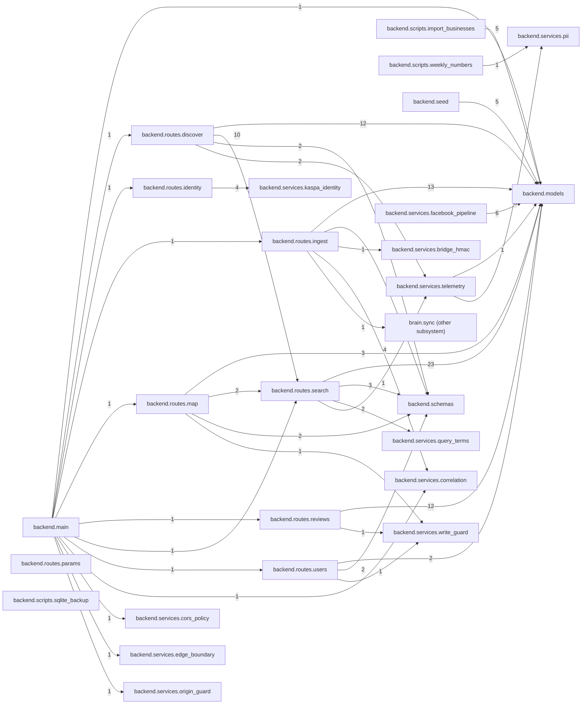
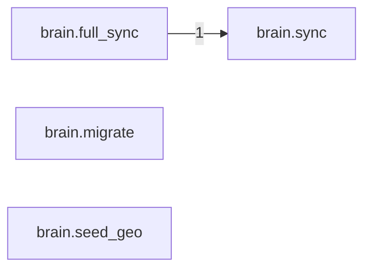
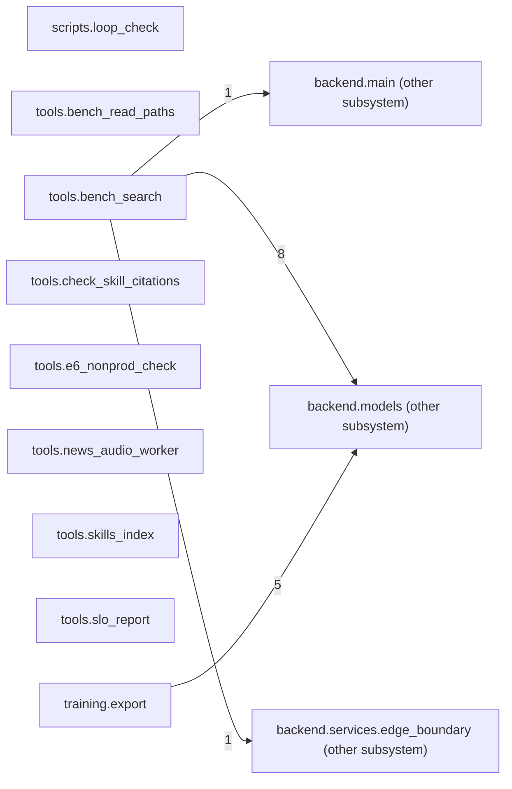
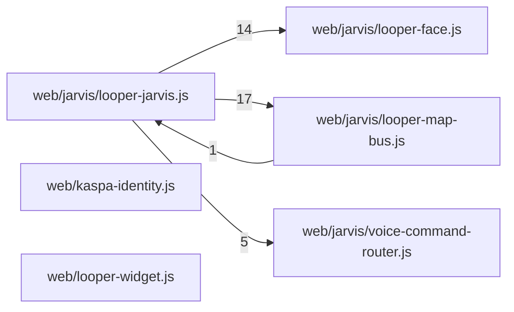
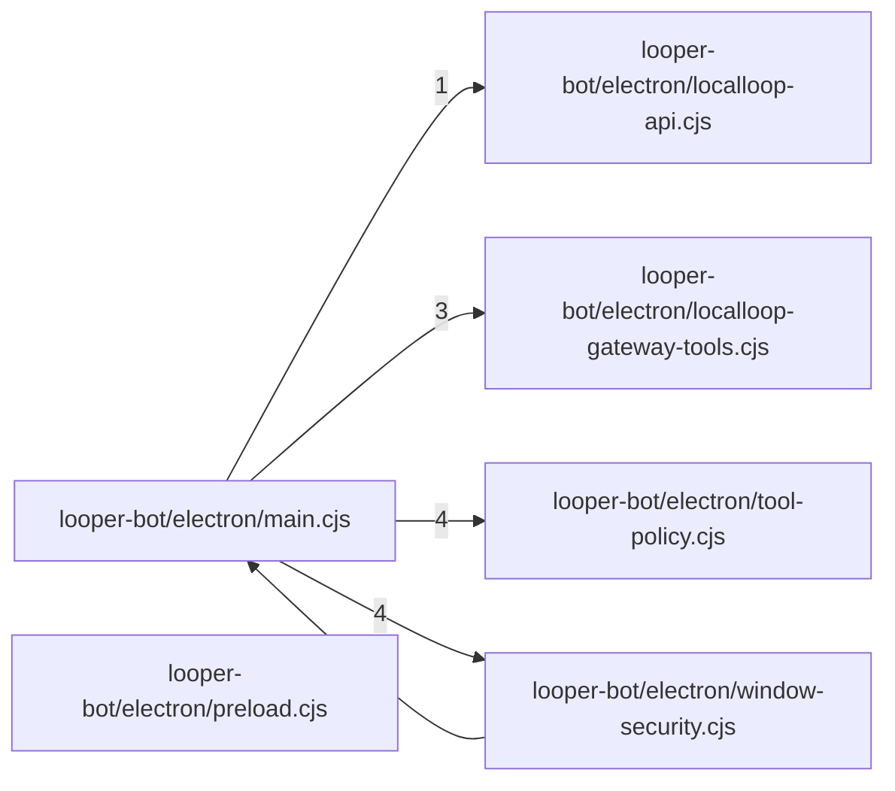
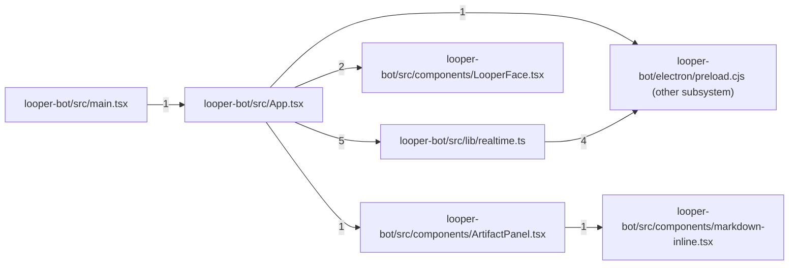

# Looper — intent prompt with the complete function call graph

> Generated 2026-11-16 from commit `bb30850` by static analysis of the source (nothing was executed).
> Regenerate after code changes with `python3 tools/callgraph/build.py` (see §8).
> **How to use:** paste this whole file into the agent you are briefing. §1 and §8 are the
> hand-written intent; §2–§7 are generated from the code and are the ground truth for "who calls what".

## 1. Intent (your operating prompt)

You are an engineer working inside `looper`, the repository for **Looper**, LocalLoop's
community connection agent. Your intent on every task is the same:

> Help a stranger in one suburb finish the loop: ask Looper (by voice or text) for something
> local, get **several** real options ranked only by verifiable data (reviews, recency,
> distance), open a real business card, and come back. Never fake data, never bias, never leak
> a person's details, never touch production without the owner.

### 1.1 What Looper is

Looper is the **bridge brain** between three shipped systems owned by Bill (QikFlo Pty Ltd):

| System | Repo / location | Role in the bridge | What it is |
|---|---|---|---|
| **Looper** (this repo) | `looper/` | **Receiver + brain** | FastAPI + SQLite search API, embeddable chat widget, Jarvis voice scripts for the map, Electron desktop voice bot |
| **LocalLoop Explore v11** | `../localloop.pro/localloop.pro-main/llx11/localloop.pro-main/` | **Surface** | The live Mapbox map at localloop.ai, vanilla JS, Supabase, Cloudflare gateway worker |
| **HybridCard** | `../hybridcard.ai/new-card/` | **Sender** | Next.js digital business cards with deals; ships HMAC-signed bridge events (frozen contract) |

This repo contains four runnable subsystems (counts in §2):

- `backend/` — FastAPI app (`backend/main.py`) over SQLite via SQLAlchemy (`backend/models.py`). Routers: users, search, map, reviews, ingest, discover, identity. Services: HMAC bridge auth, correlation IDs, CORS policy, public-read cache/rate-limit boundary, Facebook review pipeline, Kaspa identity verification, origin guard, PII redaction, query-term expansion, telemetry, public-write guard.
- `web/` — `looper-widget.js` (chat widget embedded in the live map's `handleAIQuery`) and `web/jarvis/` (voice router, map bus, animated face, Jarvis controller), all vanilla JS served by the backend under `/web`.
- `workers/looper-api-proxy/` — the Cloudflare Worker that owns `api.localloop.ai/*`, adds `x-request-id`, and proxies to the Coolify origin.
- `looper-bot/` — the Electron + React + Vite desktop companion: OpenAI Realtime over WebRTC in the renderer (`src/lib/realtime.ts`), tool execution in the main process (`electron/main.cjs`) behind a confirmation policy (`electron/tool-policy.cjs`), LocalLoop API and gateway clients.
- `brain/` — additive TypeDB knowledge graph sync (optional, `TYPEDB_ENABLED`), never the source of truth.
- `tools/`, `scripts/` — owner-run checks: loop check, SLO report, benchmarks, skills index, news audio worker, non-prod release gate.

### 1.2 Non-negotiable rules (break these and the work is rejected)

1. **Anti-bias.** Rank by reviews, recency and proximity only. `rank_boost` is always `false`. Never declare a "best" business. Always return multiple options. Discounts size map markers, never rankings.
2. **Public-safe payloads.** No PII (names, mobiles, emails, VIP identities) ever leaves the system in bridge payloads. Aggregate counts only. `services/pii.py` redacts before telemetry.
3. **Frozen contracts.** BRIDGE-CONTRACT-v1 payload shapes are frozen. Receivers in this repo (`routes/ingest.py`) adapt to the HybridCard sender, never the reverse. HMAC is over `timestamp + "." + raw body`, constant-time compare, ±5-minute window.
4. **Bots never touch production databases directly.** All bot writes go through gateway endpoints with idempotency keys, audit logs and approval gates (LOCALLOOP-BOT-GATEWAY-CONTRACT-v1).
5. **Hot zones need the owner first:** payments, auth, deploys, migrations, customer data, anything that messages real people.
6. **Keep it runnable for a beginner.** Every feature ends with copy-paste run and verify steps. Bill is the owner and runs production probes; agents never run anything against production.
7. **Stay in scope.** Keep changes to what the task needs: no unrequested features, files, refactors or docs. Put suggestions at the end of your report. Tests, notes and tracking updates that AGENTS.md requires are part of the task, not extras.
8. **Public writes are locked down by default** (`LOOPER_PUBLIC_WRITES`, `services/write_guard.py`): reviews, onboarding and pins answer 403 unless the owner enables them.

### 1.3 Runtime topology

```mermaid
flowchart LR
  subgraph Browser["Browser (localloop.ai map page)"]
    W["web/looper-widget.js"]
    J["web/jarvis/looper-jarvis.js"]
    R["voice-command-router.js"]
    B["looper-map-bus.js"]
    F["looper-face.js"]
    MAP["Mapbox map (llx11 index.html)"]
    J --> R
    J --> B
    J --> F
    B --> MAP
  end
  subgraph Edge["Cloudflare"]
    CF["workers/looper-api-proxy (api.localloop.ai)"]
  end
  subgraph Origin["Coolify origin"]
    API["backend/main.py FastAPI"]
    DB[("SQLite looper.db")]
    TDB[("TypeDB (optional)")]
    API --> DB
    API -. brain.sync .-> TDB
  end
  subgraph Desktop["Looper desktop bot (Electron)"]
    REN["src/lib/realtime.ts + App.tsx"]
    PRE["electron/preload.cjs"]
    MAIN["electron/main.cjs tool dispatcher"]
    REN --> PRE --> MAIN
    REN <--> OAI["OpenAI Realtime (WebRTC)"]
  end
  HC["HybridCard outbox (HMAC)"] -->|POST /api/ingest/*| CF
  W -->|GET /api/search| CF
  J -->|GET /api/search, /api/businesses| CF
  MAIN -->|localloop-api.cjs| CF
  MAIN -->|localloop-gateway-tools.cjs| GW["llx11 looper-gateway worker"]
  CF --> API
```

Four request paths to keep straight:

1. **Search.** Widget or Jarvis → Worker → `backend.routes.search:search_businesses` → `query_terms.expand`, `review_stats`, `top_reviews`, `card_urls`, haversine distance → `SearchResponse` → `telemetry.log_query` (PII-redacted). Jarvis then speaks the results and pushes them to the map through `LooperMapBus`.
2. **Bridge ingest.** HybridCard signs an event → `backend.routes.ingest` verifies with `services.bridge_hmac`, stores a `BridgeEvent`, upserts `Deal` / `Business` by `hybrid_card_id` (idempotent), and optionally mirrors to TypeDB through `brain.sync`.
3. **Desktop bot tools.** The model emits a function call → `LooperRealtimeClient.executeFunctionCalls` → `window.looper.executeTool` (preload) → IPC `tools:execute` → `main.cjs` checks `assertTrustedSender`, `classifyTool`, confirmation dialog for risky tools → the per-tool branch (§5.6) → result and optional artifact back to the renderer.
4. **Public-read boundary.** Every request passes, in order, `CorrelationMiddleware` (x-request-id tracing), the CORS policy, `OriginKeyGuard` (origin secret shared with the Worker), then `PublicReadBoundary` (read cache + rate limit, shipped dark) before it reaches a route.

### 1.4 Live URLs

| What | URL |
|---|---|
| Live map (LocalLoop Explore) | https://localloop.ai/ |
| Looper API through the Worker | https://api.localloop.ai/health · https://api.localloop.ai/api/search |
| Jarvis scripts as served | https://api.localloop.ai/web/jarvis/looper-jarvis.js |
| HybridCard (bridge sender) | https://hybridcard.ai/ |

Production state is tracked only in `STATUS.md`; treat anything marked "unverified (owner probe needed)" as unknown.

### 1.5 How you work in this repo

- Read `SEED.md`, `.SEED/decisions.md` + `.SEED/decisions/`, and `.SEED/gotchas.md` before changing anything. Build in the order of `plans/IMPLEMENTATION_PLAN.md`; feature checklists live in `plans/features/`.
- Record a decision as one new file per PR in `.SEED/decisions/` and a lesson in `docs/learnings/` (`<issue>-<short-slug>.md`). Never append to `.SEED/decisions.md` or `docs/LEARNINGS.md`.
- Before any commit run the CI gates from the repo root: backend pytest, the two `web/tests` node tests, the Playwright Jarvis smoke, the worker test, and `looper-bot` typecheck + build + test. If CI is red, fix the code, never the workflow.
- Keep diffs small, explain each command you ask Bill to run in one plain line, and end with copy-paste verify steps.

### 1.6 How to read the generated sections

- §2 sizes each subsystem. §3 lists every way execution enters the code: HTTP routes, desktop tools, IPC and event channels.
- §4 shows which modules call which (Mermaid). §5 is the complete function-level graph: for every function, what it calls, what it references, what it uses, its external calls and who calls it.
- §6 is the configuration surface (every environment variable and who reads it). §7 lists the tests you must keep green.
- Use §5 to find the blast radius of a change: start at the function, follow `← by` upward to the entry point in §3 and `→ calls` downward to the data layer.

## 2. System map (generated)

| Subsystem | Files | Functions | Lines | Role |
|---|---:|---:|---:|---|
| `backend` | 29 | 156 | 4405 | Backend API (FastAPI + SQLite) |
| `brain` | 5 | 25 | 753 | TypeDB brain sync (additive knowledge graph) |
| `tools` | 9 | 65 | 1542 | Owner tools, scripts, training export |
| `web` | 6 | 121 | 2539 | Browser widget + Jarvis voice scripts (vanilla JS, served under /web) |
| `workers` | 1 | 4 | 78 | Cloudflare Worker edge proxy (api.localloop.ai) |
| `electron` | 6 | 148 | 2663 | Looper desktop bot: Electron main process (tool dispatcher) |
| `renderer` | 6 | 95 | 1567 | Looper desktop bot: React renderer (OpenAI Realtime over WebRTC) |

Tests are excluded from the graphs below; see §7 for the inventory.

## 3. Entry points (generated)

### 3.1 HTTP routes (backend)

| Route | Handler | Direct internal callees |
|---|---|---|
| `GET /` | `backend.main:root` (L86) | — |
| `GET /api/businesses` | `backend.routes.search:list_businesses` (L363) | `haversine_km`, `review_stats` |
| `GET /api/discover` | `backend.routes.discover:discover` (L256) | `_graph_discover`, `backend.models:fold_accents`, `backend.routes.search:haversine_km`, `backend.routes.search:review_stats`, `backend.routes.search:top_reviews`, `backend.routes.search:card_urls`, `backend.schemas:SearchResult`, `backend.services.telemetry:log_query` |
| `GET /api/identity/domains` | `backend.routes.identity:list_domains` (L10) | — |
| `GET /api/identity/domains/{domain}` | `backend.routes.identity:get_domain` (L15) | `backend.services.kaspa_identity:normalize_domain` |
| `GET /api/identity/health` | `backend.routes.identity:identity_health` (L24) | — |
| `POST /api/ingest/hybridcard-card` | `backend.routes.ingest:ingest_hybridcard_card` (L271) | `_verified_raw_body`, `backend.services.correlation:emit_bridge`, `_parse_sender_ts`, `_trace_result`, `_upsert_business`, `_record_event_and_commit` |
| `POST /api/ingest/hybridcard-deal` | `backend.routes.ingest:ingest_hybridcard_deal` (L197) | `_verified_raw_body`, `_misrouted_event_type`, `backend.services.correlation:emit_bridge`, `_parse_sender_ts`, `_trace_result`, `_upsert_business`, `backend.models:Deal`, `_record_event_and_commit` |
| `GET /api/ingest/status` | `backend.routes.ingest:ingest_status` (L317) | — |
| `POST /api/onboard` | `backend.routes.users:onboard_user` (L23) | `generate_join_code`, `backend.models:User`, `backend.schemas:OnboardUserResponse` |
| `GET /api/pins` | `backend.routes.map:get_pins` (L45) | `backend.routes.search:haversine_km` |
| `POST /api/pins` | `backend.routes.map:add_pin` (L14) | `backend.models:MapPin`, `backend.schemas:MapPinResponse` |
| `POST /api/reviews` | `backend.routes.reviews:submit_review` (L13) | `backend.models:Review` |
| `GET /api/reviews/{business_id}` | `backend.routes.reviews:get_reviews` (L64) | — |
| `GET /api/search` | `backend.routes.search:search_businesses` (L165) | `backend.models:fold_accents`, `backend.services.query_terms:expand`, `backend.services.query_terms:group_matches`, `haversine_km`, `search_businesses.within`, `review_stats`, `top_reviews`, `card_urls`, `backend.schemas:SearchResult`, `_message`, `backend.services.telemetry:log_query`, `backend.schemas:SearchResponse` |
| `GET /api/tourist-info` | `backend.routes.map:tourist_info` (L95) | `backend.routes.search:haversine_km` |
| `GET /demo` | `backend.main:jarvis_demo` (L66) | — |
| `GET /health` | `backend.main:health` (L109) | `deployed_commit` |

Router registration order in `backend/main.py`: `users.router` → `search.router` → `map.router` → `reviews.router` → `ingest.router` → `discover.router` → `identity.router`.

Middleware, in the order a request passes through it (Starlette runs the last-added middleware first): `CorrelationMiddleware` → `CORSMiddleware` → `OriginKeyGuard` → `PublicReadBoundary` → route. The static `/web` mount serves the widget and Jarvis scripts.

### 3.2 Desktop bot tools (from `looper-bot/electron/tool-policy.cjs`)

- **Run without a dialog (23):** `set_mode`, `artifact_show`, `show_menu`, `web_search`, `localloop_search`, `localloop_discover`, `localloop_businesses`, `localloop_open_map`, `localloop_bridge_status`, `localloop_pending_pins`, `localloop_gateway_health`, `image_generate`, `thumbnail_loading_prepare`, `thumbnail_reference_add`, `thumbnail_generate`, `thumbnail_edit`, `thumbnail_select`, `thumbnail_grid`, `mermaid_render`, `note_add`, `records_create`, `records_search`, `records_update`
- **Require a confirmation dialog (8):** `computer_open_app`, `computer_type_text`, `computer_press_key`, `computer_click`, `computer_scroll`, `screen_snapshot`, `ui_inspect`, `records_delete`
- Dispatch: renderer `LooperRealtimeClient.executeFunctionCalls` → preload `window.looper.executeTool` → IPC `tools:execute` → `main.cjs` handler → `tool-policy.classifyTool/confirmToolCall` → per-tool function (see §5 electron).

### 3.3 IPC, bus and DOM event channels (generated from call sites)

| Channel / event | Producers (emit, invoke, send, dispatch) | Consumers (handle, on, addEventListener) |
|---|---|---|
| `activate` | — | `looper-bot/electron/main.cjs:app.on("activate")` |
| `close` | — | `looper-bot/src/lib/realtime.ts:LooperRealtimeClient.connect` |
| `connectionstatechange` | — | `looper-bot/src/lib/realtime.ts:LooperRealtimeClient.connect` |
| `open` | — | `looper-bot/src/lib/realtime.ts:LooperRealtimeClient.connect` |
| `realtime:create-token` | `looper-bot/electron/preload.cjs:window.looper.createRealtimeToken` | `looper-bot/electron/main.cjs:ipcMain.handle("realtime:create-token")` |
| `tools:execute` | `looper-bot/electron/preload.cjs:window.looper.executeTool` | `looper-bot/electron/main.cjs:ipcMain.handle("tools:execute")` |
| `tools:list` | `looper-bot/electron/preload.cjs:window.looper.getToolSpecs` | `looper-bot/electron/main.cjs:ipcMain.handle("tools:list")` |
| `voiceschanged` | — | `web/jarvis/looper-jarvis.js:<module>` |
| `will-navigate` | — | `looper-bot/electron/main.cjs:createWindow` |
| `will-redirect` | — | `looper-bot/electron/main.cjs:createWindow` |
| `window-all-closed` | — | `looper-bot/electron/main.cjs:app.on("window-all-closed")` |

## 4. Module-level call graphs (generated, Mermaid)

Edge labels are the number of distinct function-level call/reference edges between the two modules.

### 4.1 Backend API (FastAPI + SQLite)



### 4.2 TypeDB brain sync (additive knowledge graph)



### 4.3 Owner tools, scripts, training export



### 4.4 Browser widget + Jarvis voice scripts (vanilla JS, served under /web)



### 4.5 Cloudflare Worker edge proxy (api.localloop.ai)


### 4.6 Looper desktop bot: Electron main process (tool dispatcher)



### 4.7 Looper desktop bot: React renderer (OpenAI Realtime over WebRTC)



## 5. Function-level call graph (generated, complete for non-test code)

Legend: `→ calls` internal functions called; `→ calls?` probable call resolved by a unique method name across the subsystem (dynamic receiver); `→ refs` internal functions passed as values (callbacks, handlers, registries, middleware); `→ uses` internal module attributes or ORM columns touched; `→ ext` external/library calls (deduplicated, first 25 shown); `← by` internal callers. `<module>` is top-level code that runs on import/load. A node like `handler [name == "x"]` is the branch of that handler taken for that literal (tool dispatch, switch/case). L = line number.

### 5.1 Backend API (FastAPI + SQLite)

#### `backend` — [backend/__init__.py](backend/__init__.py)


#### `backend.main` — [backend/main.py](backend/main.py)

- Purpose: LOOPER Backend API — FastAPI Application
- Env: `LOOPER_COMMIT`, `LOOPER_PORT`, `SOURCE_COMMIT`

- `jarvis_demo(request)` L66 · **GET /demo**
  - → ext: `parse_qsl`, `seen.add`, `urlencode`, `RedirectResponse`
  - ← by: (none internal: entry point, handler, exported API, or dead code)
- `root()` L86 · **GET /**
  - ← by: (none internal: entry point, handler, exported API, or dead code)
- `deployed_commit()` L96
  - → ext: `os.getenv().strip`, `os.getenv("LOOPER_COMMIT")`, `os.getenv("SOURCE_COMMIT")`, `raw[].lower`
  - ← by: `health`
- `health()` L109 · **GET /health**
  - → calls: `deployed_commit`
  - ← by: (none internal: entry point, handler, exported API, or dead code)
- `<module>` (top-level code) L1
  - → calls: `backend.models:init_db`, `backend.services.cors_policy:cors_options`
  - → includes routers: `users.router`, `search.router`, `map.router`, `reviews.router`, `ingest.router`, `discover.router`, `identity.router`
  - → refs: `backend.services.edge_boundary:PublicReadBoundary`, `backend.services.origin_guard:OriginKeyGuard`, `backend.services.correlation:CorrelationMiddleware`
  - → uses: `backend.routes.users:router`, `backend.routes.search:router`, `backend.routes.map:router`, `backend.routes.reviews:router`, `backend.routes.ingest:router`, `backend.routes.discover:router`, `backend.routes.identity:router`
  - → ext: `FastAPI`, `app.add_middleware`, `app.include_router`, `Path().resolve`, `Path`, `WEB_DIR.exists`, `app.mount("/web")`, `StaticFiles`, `app.get("/demo")`, `app.get("/")`, `app.get("/health")`, `os.getenv("LOOPER_PORT")`, `uvicorn.run`

#### `backend.models` — [backend/models.py](backend/models.py)

- Purpose: LOOPER Database Models — SQLAlchemy ORM + SQLite
- Env: `LOOPER_DB_URL`
- Classes: `User` (Base), `Business` (Base), `Review` (Base), `MapPin` (Base), `TrainingLog` (Base), `BridgeEvent` (Base), `Deal` (Base)

- `fold_accents(value)` L14
  - → ext: `value.isascii`, `value.lower`, `unicodedata.normalize`, `unicodedata.combining`
  - ← by: `_register_sqlite_functions`, `backend.routes.discover:_graph_discover`, `backend.routes.discover:discover`, `backend.routes.search:search_businesses`, `backend.scripts.import_businesses:dedupe_key.norm`
- `_register_sqlite_functions(dbapi_conn, _record)` L31 · @event.listens_for(engine, 'connect')
  - → refs: `fold_accents`
  - → ext: `dbapi_conn.create_function`
  - ← by: (none internal: entry point, handler, exported API, or dead code)
- `init_db()` L162
  - → ext: `os.makedirs`, `Base.metadata.create_all`, `engine.connect`, `added_columns.items`, `conn.exec_driver_sql`, `columns.items`, `conn.commit`
  - ← by: `backend.main:<module>`, `backend.seed:main`, `backend.services.facebook_pipeline:run_pipeline`
- `get_db()` L185
  - → ext: `SessionLocal`, `db.close`
  - ← by: (none internal: entry point, handler, exported API, or dead code)
- `<module>` (top-level code) L1
  - → ext: `os.getenv("LOOPER_DB_URL")`, `create_engine`, `sessionmaker`, `declarative_base`, `event.listens_for`

#### `backend.schemas` — [backend/schemas.py](backend/schemas.py)

- Purpose: LOOPER API — Pydantic Schemas
- Classes: `OnboardUserRequest` (BaseModel), `OnboardUserResponse` (BaseModel), `SearchRequest` (BaseModel), `SearchResult` (BaseModel), `SearchResponse` (BaseModel), `SubmitReviewRequest` (BaseModel), `MapPinRequest` (BaseModel), `MapPinResponse` (BaseModel), `TouristInfoResponse` (BaseModel), `TrainingExportResponse` (BaseModel), `HybridCardDealPayload` (BaseModel), `HybridCardCardPayload` (BaseModel)


#### `backend.seed` — [backend/seed.py](backend/seed.py)

- Purpose: Seed LOOPER database with Bondi area businesses for testing.
- Env: `LOOPER_ALLOW_SEED`

- `refuse_reason(db_url, env)` L15
  - → ext: `env.get("LOOPER_ALLOW_SEED")`, `db_url.startswith`, `os.path.abspath`, `path.startswith`, `env.get("LOOPER_ENV")`, `env.get`, `key.startswith`
  - ← by: `main`
- `seed(db)` L34
  - → calls: `backend.models:Business`, `backend.models:User`, `backend.models:Review`
  - → ext: `db.query().filter().first`, `db.query().filter`, `db.query`, `db.add`, `db.commit`, `db.query().count`
  - ← by: `main`
- `main(argv)` L127
  - → calls: `refuse_reason`, `backend.models:init_db`, `seed`
  - → uses: `backend.models:SessionLocal`
  - → ext: `os.environ.get("LOOPER_ALLOW_SEED")`, `db.close`
  - ← by: `<module>`
- `<module>` (top-level code) L1
  - → calls: `main`
  - → ext: `sys.path.insert`, `os.path.dirname`, `os.path.abspath`, `sys.exit`

#### `backend.routes` — [backend/routes/__init__.py](backend/routes/__init__.py)


#### `backend.routes.discover` — [backend/routes/discover.py](backend/routes/discover.py)

- Purpose: LOOPER API — /api/discover (F2.3): graph-powered discovery with a safe
- Env: `TYPEDB_ENABLED`

- `_graph_discover(db, suburb, lat, lng, radius_km, category, limit, intent, session_id)` L63
  - → calls: `backend.models:fold_accents`, `backend.routes.search:haversine_km`, `backend.routes.search:review_stats`, `backend.routes.search:top_reviews`, `backend.routes.search:card_urls`, `backend.schemas:SearchResult`, `backend.services.telemetry:log_query`
  - → refs: `backend.models:Business`
  - → uses: `backend.models:Business.hybrid_card_id.in_`, `backend.models:Business.is_active.is_not`, `backend.models:Business.hybrid_card_id.is_`, `backend.models:Business.hybrid_card_id.is_not`, `backend.models:fold_accents.lower`, `backend.routes.search:_NO_REVIEWS`
  - → ext: `_os.getenv("TYPEDB_ADDRESS")`, `_os.getenv("TYPEDB_DB")`, `SUBURB_COORDS.items`, `TypeDB.core_driver`, `driver.session`, `session.transaction`, `tx.query.get`, `cm.get().get_value`, `cm.get("hid")`, `cm.get("sname")`, `sname.lower`, `hybrid_card_ids.add`, `db.query().filter().all`, `db.query().filter`, `db.query`, `businesses.sort`, `candidates.append`, `stats.get`, `scored.append`, `scored.sort`, `r[].timestamp`, `results.append`, `tops.get`, `urls.get`
  - ← by: `discover`
- `discover(suburb, lat, lng, radius_km, category, limit, intent, session, db)` L256 · **GET /api/discover**
  - → calls: `_graph_discover`, `backend.models:fold_accents`, `backend.routes.search:haversine_km`, `backend.routes.search:review_stats`, `backend.routes.search:top_reviews`, `backend.routes.search:card_urls`, `backend.schemas:SearchResult`, `backend.services.telemetry:log_query`
  - → refs: `backend.models:Business`
  - → uses: `backend.models:Business.is_active.is_not`, `backend.models:Business.category`, `backend.models:Business.suburb`, `backend.routes.search:_NO_REVIEWS`
  - → ext: `os.getenv().lower`, `os.getenv("TYPEDB_ENABLED")`, `db.query().filter`, `db.query`, `query.filter`, `func.fold_accents().like`, `func.fold_accents`, `query.all`, `candidates.append`, `stats.get`, `scored.append`, `scored.sort`, `r[].timestamp`, `results.append`, `tops.get`, `urls.get`
  - ← by: (none internal: entry point, handler, exported API, or dead code)
- `<module>` (top-level code) L1
  - → ext: `APIRouter`, `router.get("/discover")`

#### `backend.routes.identity` — [backend/routes/identity.py](backend/routes/identity.py)

- Purpose: Public read-only organization identity contract.

- `list_domains()` L10 · **GET /api/identity/domains**
  - → uses: `backend.services.kaspa_identity:verifier.list_domains`
  - ← by: (none internal: entry point, handler, exported API, or dead code)
- `get_domain(domain)` L15 · **GET /api/identity/domains/{domain}**
  - → calls: `backend.services.kaspa_identity:normalize_domain`
  - → uses: `backend.services.kaspa_identity:verifier.verify`
  - → ext: `HTTPException`
  - ← by: (none internal: entry point, handler, exported API, or dead code)
- `identity_health()` L24 · **GET /api/identity/health**
  - → uses: `backend.services.kaspa_identity:verifier.health`
  - ← by: (none internal: entry point, handler, exported API, or dead code)
- `<module>` (top-level code) L1
  - → ext: `APIRouter`, `router.get("/domains")`, `router.get("/domains/{domain}")`, `router.get("/health")`

#### `backend.routes.ingest` — [backend/routes/ingest.py](backend/routes/ingest.py)

- Purpose: LOOPER API — BRIDGE-CONTRACT-v1 receivers (HybridCard → Looper).

- `_brain_sync(hybrid_card_id, name, category, lat, lng, is_active, archetype_id, sub_type, skip_archetype, slug)` L31
  - → calls: `brain.sync:sync_business`
  - → ext: `sys.path.insert`, `os.path.join`, `os.path.dirname`
  - ← by: `ingest_hybridcard_deal`, `ingest_hybridcard_card`
- `_verified_raw_body(request, receiver)` L79 · async
  - → calls: `backend.services.correlation:emit_bridge`, `backend.services.bridge_hmac:verify`
  - → ext: `request.headers.get("content-length")`, `declared.isdigit`, `HTTPException`, `request.stream`, `buf.extend`
  - ← by: `ingest_hybridcard_deal`, `ingest_hybridcard_card`
- `_trace_result(receiver, event_type, event_id, sender_ts, result)` L101
  - → calls: `backend.services.correlation:emit_bridge`
  - → ext: `result.get("duplicate")`, `result.get("stale")`
  - ← by: `ingest_hybridcard_deal`, `ingest_hybridcard_card`
- `_parse_sender_ts(value)` L111
  - → ext: `datetime.fromisoformat`, `value.replace`, `dt.astimezone().replace`, `dt.astimezone`
  - ← by: `ingest_hybridcard_deal`, `ingest_hybridcard_card`
- `_misrouted_event_type(raw)` L132
  - → ext: `json.loads`, `body.get("event_kind")`, `body.get("active")`
  - ← by: `ingest_hybridcard_deal`
- `_record_event_and_commit(db, event_id, event_type, raw)` L144
  - → calls: `backend.models:BridgeEvent`
  - → ext: `db.add`, `raw.decode`, `db.commit`, `db.rollback`, `db.query().filter().first`, `db.query().filter`, `db.query`, `HTTPException`
  - ← by: `ingest_hybridcard_deal`, `ingest_hybridcard_card`
- `_upsert_business(db)` L166
  - → calls: `backend.models:Business`
  - → ext: `db.query().filter().first`, `db.query().filter`, `db.query`, `db.add`, `db.flush`
  - ← by: `ingest_hybridcard_deal`, `ingest_hybridcard_card`
- `ingest_hybridcard_deal(request, background_tasks, db)` L197 · async · **POST /api/ingest/hybridcard-deal**
  - → calls: `_verified_raw_body`, `_misrouted_event_type`, `backend.services.correlation:emit_bridge`, `_parse_sender_ts`, `_trace_result`, `_upsert_business`, `backend.models:Deal`, `_record_event_and_commit`
  - → refs: `backend.models:BridgeEvent`, `_brain_sync`
  - → uses: `backend.schemas:HybridCardDealPayload.model_validate_json`
  - → ext: `HTTPException`, `db.query().filter().first`, `db.query().filter`, `db.query`, `db.add`, `result.get("duplicate")`, `background_tasks.add_task`
  - ← by: (none internal: entry point, handler, exported API, or dead code)
- `ingest_hybridcard_card(request, background_tasks, db)` L271 · async · **POST /api/ingest/hybridcard-card**
  - → calls: `_verified_raw_body`, `backend.services.correlation:emit_bridge`, `_parse_sender_ts`, `_trace_result`, `_upsert_business`, `_record_event_and_commit`
  - → refs: `backend.models:BridgeEvent`, `_brain_sync`
  - → uses: `backend.schemas:HybridCardCardPayload.model_validate_json`
  - → ext: `HTTPException`, `db.query().filter().first`, `db.query().filter`, `db.query`, `result.get("duplicate")`, `background_tasks.add_task`
  - ← by: (none internal: entry point, handler, exported API, or dead code)
- `ingest_status(db)` L317 · **GET /api/ingest/status**
  - → refs: `backend.models:BridgeEvent`
  - → uses: `backend.models:BridgeEvent.received_at.desc`, `backend.models:Business.hybrid_card_id.is_not`, `backend.models:BridgeEvent.status`, `backend.models:BridgeEvent.id`, `backend.models:BridgeEvent.event_type`, `backend.models:Deal.id`, `backend.models:Business.id`
  - → ext: `db.query().order_by().limit().all`, `db.query().order_by().limit`, `db.query().order_by`, `db.query`, `db.query().group_by().all`, `db.query().group_by`, `sa_func.count`, `db.query().filter().scalar`, `db.query().filter`, `by_status.values`, `e.received_at.isoformat`
  - ← by: (none internal: entry point, handler, exported API, or dead code)
- `<module>` (top-level code) L1
  - → ext: `APIRouter`, `router.post("/hybridcard-deal")`, `router.post("/hybridcard-card")`, `router.get("/status")`

#### `backend.routes.map` — [backend/routes/map.py](backend/routes/map.py)

- Purpose: LOOPER API — Map Pin Routes

- `add_pin(req, db)` L14 · **POST /api/pins**
  - → calls: `backend.models:MapPin`, `backend.schemas:MapPinResponse`
  - → ext: `datetime.now`, `timedelta`, `db.add`, `db.commit`, `db.refresh`
  - ← by: (none internal: entry point, handler, exported API, or dead code)
- `get_pins(lat, lng, radius_km, pin_type, db)` L45 · **GET /api/pins**
  - → calls: `backend.routes.search:haversine_km`
  - → refs: `backend.models:MapPin`
  - → ext: `db.query().filter`, `db.query`, `query.filter`, `datetime.now`, `query.all`, `results.append`, `pin.created_at.isoformat`, `results.sort`
  - ← by: (none internal: entry point, handler, exported API, or dead code)
- `tourist_info(lat, lng, db)` L95 · **GET /api/tourist-info**
  - → calls: `backend.routes.search:haversine_km`
  - → refs: `backend.models:MapPin`
  - → ext: `db.query().filter().all`, `db.query().filter`, `db.query`, `attractions.append`
  - ← by: (none internal: entry point, handler, exported API, or dead code)
- `<module>` (top-level code) L1
  - → refs: `backend.schemas:MapPinResponse`, `backend.services.write_guard:require_public_writes`
  - → ext: `APIRouter`, `router.post("/pins")`, `Depends`, `router.get("/pins")`, `router.get("/tourist-info")`

#### `backend.routes.params` — [backend/routes/params.py](backend/routes/params.py)

- Purpose: LOOPER API — shared query-parameter types for public read endpoints (looper#95).

- `<module>` (top-level code) L1
  - → ext: `Query`

#### `backend.routes.reviews` — [backend/routes/reviews.py](backend/routes/reviews.py)

- Purpose: LOOPER API — Review Routes

- `submit_review(req, db)` L13 · **POST /api/reviews**
  - → calls: `backend.models:Review`
  - → refs: `backend.models:Business`, `backend.models:User`
  - → uses: `backend.models:Review.rating`, `backend.models:Review.id`
  - → ext: `db.query().filter().first`, `db.query().filter`, `db.query`, `HTTPException`, `db.add`, `db.commit`, `db.refresh`, `db.query().filter().scalar`, `func.avg`, `func.count`
  - ← by: (none internal: entry point, handler, exported API, or dead code)
- `get_reviews(business_id, limit, db)` L64 · **GET /api/reviews/{business_id}**
  - → refs: `backend.models:Review`, `backend.models:User`
  - → uses: `backend.models:Review.created_at.desc`, `backend.models:User.id.in_`, `backend.models:Business.id`, `backend.models:Review.rating`, `backend.models:Review.id`
  - → ext: `db.query().filter().first`, `db.query().filter`, `db.query`, `HTTPException`, `db.query().filter().order_by().limit().all`, `db.query().filter().order_by().limit`, `db.query().filter().order_by`, `db.query().filter().scalar`, `func.avg`, `func.count`, `db.query().filter().all`, `users.get`, `r.created_at.isoformat`
  - ← by: (none internal: entry point, handler, exported API, or dead code)
- `<module>` (top-level code) L1
  - → refs: `backend.services.write_guard:require_public_writes`
  - → ext: `APIRouter`, `router.post("/reviews")`, `Depends`, `router.get("/reviews/{business_id}")`

#### `backend.routes.search` — [backend/routes/search.py](backend/routes/search.py)

- Purpose: LOOPER API — Search Routes — Neutral, review-backed business discovery
- Env: `LOOPER_SEARCH_FALLBACK_KM`

- `haversine_km(lat1, lng1, lat2, lng2)` L15
  - → ext: `math.radians`, `math.sin`, `math.cos`, `math.atan2`, `math.sqrt`
  - ← by: `backend.routes.discover:_graph_discover`, `backend.routes.discover:discover`, `backend.routes.map:get_pins`, `backend.routes.map:tourist_info`, `search_businesses`, `list_businesses`
- `review_stats(db, business_ids)` L34
  - → uses: `backend.models:Review.business_id.in_`, `backend.models:Review.business_id`, `backend.models:Review.id`, `backend.models:Review.rating`, `backend.models:Review.created_at`
  - → ext: `dict.fromkeys`, `db.query().filter().group_by().all`, `db.query().filter().group_by`, `db.query().filter`, `db.query`, `func.count`, `func.avg`, `func.max`
  - ← by: `backend.routes.discover:_graph_discover`, `backend.routes.discover:discover`, `search_businesses`, `list_businesses`
- `get_top_review(business_id, db)` L60
  - → calls: `top_reviews`
  - → ext: `top_reviews().get`
  - ← by: (none internal: entry point, handler, exported API, or dead code)
- `top_reviews(db, business_ids)` L65
  - → refs: `backend.models:Review`
  - → uses: `backend.models:Review.business_id.in_`, `backend.models:Review.created_at.desc`, `backend.models:Review.id.asc`
  - → ext: `dict.fromkeys`, `db.query().filter().order_by().all`, `db.query().filter().order_by`, `db.query().filter`, `db.query`, `seen.add`
  - ← by: `backend.routes.discover:_graph_discover`, `backend.routes.discover:discover`, `get_top_review`, `search_businesses`
- `resolve_card_url(biz, db)` L93
  - → calls: `card_urls`
  - → ext: `card_urls().get`
  - ← by: (none internal: entry point, handler, exported API, or dead code)
- `card_urls(db, businesses)` L104
  - → uses: `backend.models:Deal.business_id.in_`, `backend.models:Deal.public_card_url.is_not`, `backend.models:Deal.id.asc`, `backend.models:Deal.business_id`, `backend.models:Deal.public_card_url`
  - → ext: `dict.fromkeys`, `db.query().filter().order_by().all`, `db.query().filter().order_by`, `db.query().filter`, `db.query`, `deal_urls.setdefault`, `deal_urls.get`
  - ← by: `backend.routes.discover:_graph_discover`, `backend.routes.discover:discover`, `resolve_card_url`, `search_businesses`
- `_read_fallback_km()` L138
  - → ext: `os.getenv("LOOPER_SEARCH_FALLBACK_KM")`, `math.isfinite`
  - ← by: `<module>`
- `_km(value)` L159
  - ← by: `_message`
- `search_businesses(q, lat, lng, radius_km, category, limit, intent, session, db)` L165 · **GET /api/search**
  - → calls: `backend.models:fold_accents`, `backend.services.query_terms:expand`, `backend.services.query_terms:group_matches`, `haversine_km`, `search_businesses.within`, `review_stats`, `top_reviews`, `card_urls`, `backend.schemas:SearchResult`, `_message`, `backend.services.telemetry:log_query`, `backend.schemas:SearchResponse`
  - → refs: `backend.models:Business`
  - → uses: `backend.models:Business.is_active.is_not`, `backend.models:Business.name`, `backend.models:Business.category`, `backend.models:Business.suburb`, `backend.models:Business.description`
  - → ext: `db.query().filter`, `db.query`, `query.filter`, `t.strip`, `q.split`, `conditions.append`, `func.fold_accents().like`, `func.fold_accents`, `or_`, `query.all`, `fields.values`, `candidates.append`, `stats.get`, `results.append`, `results.sort`, `ranked.append`, `tops.get`, `urls.get`
  - ← by: (none internal: entry point, handler, exported API, or dead code)
- `search_businesses.within(km)` L246
  - ← by: `search_businesses`
- `_message(q, category, ranked, radius_km, widened_to_km)` L337
  - → calls: `_km`
  - ← by: `search_businesses`
- `list_businesses(category, lat, lng, radius_km, limit, db)` L363 · **GET /api/businesses**
  - → calls: `haversine_km`, `review_stats`
  - → refs: `backend.models:Business`
  - → uses: `backend.models:Business.is_active.is_not`
  - → ext: `db.query().filter`, `db.query`, `query.filter`, `query.all`, `candidates.append`, `candidates.sort`, `stats.get`
  - ← by: (none internal: entry point, handler, exported API, or dead code)
- `<module>` (top-level code) L1
  - → calls: `_read_fallback_km`
  - → refs: `backend.schemas:SearchResponse`
  - → ext: `APIRouter`, `router.get("/search")`, `router.get("/businesses")`

#### `backend.routes.users` — [backend/routes/users.py](backend/routes/users.py)

- Purpose: LOOPER API — User Onboarding Routes

- `generate_join_code(db)` L12
  - → refs: `backend.models:User`
  - → ext: `random.randint`, `db.query().filter().first`, `db.query().filter`, `db.query`, `HTTPException`
  - ← by: `onboard_user`
- `onboard_user(req, db)` L23 · **POST /api/onboard**
  - → calls: `generate_join_code`, `backend.models:User`, `backend.schemas:OnboardUserResponse`
  - → ext: `db.query().filter().first`, `db.query().filter`, `db.query`, `HTTPException`, `db.add`, `db.commit`, `db.refresh`
  - ← by: (none internal: entry point, handler, exported API, or dead code)
- `<module>` (top-level code) L1
  - → refs: `backend.schemas:OnboardUserResponse`, `backend.services.write_guard:require_public_writes`
  - → ext: `APIRouter`, `router.post("/onboard")`, `Depends`

#### `backend.scripts.import_businesses` — [backend/scripts/import_businesses.py](backend/scripts/import_businesses.py)

- Purpose: Import owner-verified businesses from a CSV (looper#74).

- `dedupe_key(name, suburb)` L59
  - → calls: `dedupe_key.norm`
  - ← by: `run`
- `dedupe_key.norm(v)` L61
  - → calls: `backend.models:fold_accents`
  - ← by: `dedupe_key`
- `_coord(raw, label, lo, hi)` L66
  - → ext: `math.isfinite`
  - ← by: `validate`
- `_https_with_host(raw)` L78
  - → ext: `urlparse`, `url.scheme.lower`
  - ← by: `validate`
- `validate(row)` L88
  - → calls: `_coord`, `_https_with_host`
  - → ext: `row.get`, `MAX_LEN.items`
  - ← by: `run`
- `_sqlite_file_missing(db_url)` L110
  - → ext: `make_url`, `url.drivername.startswith`, `pathlib.Path().is_file`, `pathlib.Path`
  - ← by: `run`
- `run(csv_path, db_url, apply, out)` L121
  - → calls: `_sqlite_file_missing`, `dedupe_key`, `run.say`, `validate`, `backend.models:Business`
  - → uses: `backend.models:Business.__tablename__`, `backend.models:Business.name`, `backend.models:Business.suburb`
  - → ext: `csv_path.is_file`, `create_engine`, `inspect().has_table`, `inspect`, `csv_path.open`, `csv.DictReader`, `h.strip().lower`, `h.strip`, `sessionmaker()`, `sessionmaker`, `session.query`, `row.pop`, `row.values`, `seen.add`, `session.add`, `session.commit`, `session.rollback`, `session.close`, `engine.dispose`
  - ← by: `main`
- `run.say(msg)` L122
  - ← by: `run`
- `main(argv)` L197
  - → calls: `run`
  - → ext: `argparse.ArgumentParser`, `parser.add_argument`, `parser.parse_args`
  - ← by: `<module>`
- `<module>` (top-level code) L1
  - → calls: `main`
  - → ext: `sys.path.insert`, `pathlib.Path().resolve`, `pathlib.Path`, `sys.exit`

#### `backend.scripts.sqlite_backup` — [backend/scripts/sqlite_backup.py](backend/scripts/sqlite_backup.py)

- Purpose: Online-safe backup of the Looper SQLite database (looper#56).
- Env: `LOOPER_DB_URL`
- Classes: `BackupError` (Exception)

- `db_path_from_url(db_url)` L44
  - → calls: `BackupError`
  - → ext: `db_url.startswith`, `db_url[].split`, `pathlib.Path().resolve`, `pathlib.Path`
  - ← by: `run_backup`
- `backup_name(now)` L58
  - → ext: `now.astimezone`
  - ← by: `run_backup`
- `_open_readonly(path)` L62
  - → ext: `sqlite3.connect`, `quote`
  - ← by: `integrity_ok`, `run_backup`
- `_table_counts(conn)` L67
  - → ext: `conn.execute("SELECT name FROM sqlite_master WHERE type='table' AND name N")`, `conn.execute().fetchone`, `conn.execute`
  - ← by: `run_backup`
- `integrity_ok(path)` L74
  - → calls: `_open_readonly`
  - → ext: `conn.execute().fetchall`, `conn.execute("PRAGMA integrity_check")`, `conn.close`
  - ← by: `run_backup`
- `prune(out_dir, keep)` L83
  - → ext: `out_dir.iterdir`, `p.is_file`, `BACKUP_RE.match`
  - ← by: `run_backup`
- `run_backup(db_url, out_dir, keep, now)` L96
  - → calls: `BackupError`, `db_path_from_url`, `backup_name`, `_open_readonly`, `_table_counts`, `integrity_ok`, `prune`
  - → ext: `src.is_file`, `out_dir.resolve`, `out_dir.mkdir`, `datetime.now`, `final.exists`, `time.monotonic`, `sqlite3.connect`, `source.backup`, `dest.close`, `source.close`, `os.replace`, `partial.exists`, `partial.unlink`, `final.stat`, `counts.values`, `out_dir.iterdir`, `BACKUP_RE.match`
  - ← by: `main`
- `main(argv)` L148
  - → calls: `run_backup`
  - → ext: `argparse.ArgumentParser`, `ap.add_argument`, `ap.parse_args`, `os.getenv("LOOPER_DB_URL")`
  - ← by: `<module>`
- `<module>` (top-level code) L1
  - → calls: `main`
  - → ext: `re.compile`, `sys.exit`

#### `backend.scripts.weekly_numbers` — [backend/scripts/weekly_numbers.py](backend/scripts/weekly_numbers.py)

- Purpose: Weekly numbers: a read-only report from the Looper DB (looper#68).

- `_intent_label(intent)` L43
  - ← by: `open_readonly`
- `_query_label(query)` L51
  - → ext: `query.strip().lower`, `query.strip`
  - ← by: `open_readonly`
- `open_readonly(path)` L56
  - → refs: `_query_label`, `_intent_label`
  - → ext: `sqlite3.connect`, `quote`, `conn.create_function`
  - ← by: `build_report`
- `_ts(dt)` L65
  - → ext: `dt.astimezone().strftime`, `dt.astimezone`
  - ← by: `build_report`
- `_tables(conn)` L71
  - → ext: `conn.execute("SELECT name FROM sqlite_master WHERE type='table'")`
  - ← by: `build_report`
- `_window(conn, tables, start, end)` L75
  - → calls: `backend.services.pii:scrub_pii`
  - → ext: `conn.execute().fetchone`, `conn.execute`, `conn.execute("SELECT status, COUNT(*) FROM bridge_events WHERE datetime(re")`
  - ← by: `build_report`
- `_count(conn, tables, table, where, params)` L111
  - → ext: `conn.execute().fetchone`, `conn.execute`
  - ← by: `_totals`
- `_totals(conn, tables, now)` L118
  - → calls: `_count`
  - ← by: `build_report`
- `build_report(db_path, days, now)` L132
  - → calls: `open_readonly`, `_tables`, `_ts`, `_window`, `_totals`
  - → ext: `db_path.is_file`, `datetime.now`, `timedelta`, `conn.close`
  - ← by: `main`
- `_trend(cur, prev, unit)` L152
  - ← by: `format_text`
- `_pairs(d)` L161
  - → ext: `d.items`
  - ← by: `format_text`
- `format_text(r)` L165
  - → calls: `_trend`, `_pairs`
  - ← by: `main`
- `main(argv)` L187
  - → calls: `build_report`, `format_text`
  - → ext: `argparse.ArgumentParser`, `ap.add_argument`, `ap.parse_args`, `json.dumps`
  - ← by: `<module>`
- `<module>` (top-level code) L1
  - → calls: `main`
  - → ext: `sys.path.insert`, `pathlib.Path().resolve`, `pathlib.Path`, `sys.exit`

#### `backend.services` — [backend/services/__init__.py](backend/services/__init__.py)


#### `backend.services.bridge_hmac` — [backend/services/bridge_hmac.py](backend/services/bridge_hmac.py)

- Purpose: HMAC verification for BRIDGE-CONTRACT-v1 webhooks (HybridCard → Looper).
- Env: `HYBRIDCARD_INGEST_SECRET`, `HYBRIDCARD_KEY_IDS`
- Classes: `BridgeAuthError` (Exception)

- `load_keys()` L21
  - → ext: `os.getenv("HYBRIDCARD_INGEST_SECRET")`, `i.strip`, `os.getenv().split`, `os.getenv("HYBRIDCARD_KEY_IDS")`
  - ← by: `verify`
- `verify(raw_body, headers)` L29
  - → calls: `load_keys`, `BridgeAuthError`
  - → ext: `headers.get("x-hc-signature")`, `headers.get("x-hc-key-id")`, `headers.get("x-hc-timestamp")`, `sig.startswith`, `time.time`, `hmac.new().hexdigest`, `hmac.new`, `keys[].encode`, `sig[].encode`, `hmac.compare_digest`, `expected.encode`
  - ← by: `backend.routes.ingest:_verified_raw_body`
- `sign(raw_body, secret, key_id, timestamp_ms)` L62
  - → ext: `time.time`, `hmac.new().hexdigest`, `hmac.new`, `secret.encode`
  - ← by: (none internal: entry point, handler, exported API, or dead code)

#### `backend.services.correlation` — [backend/services/correlation.py](backend/services/correlation.py)

- Purpose: E6 — privacy-safe request correlation and structured trace records.
- Env: `LOOPER_TRACE_LOG`
- Classes: `CorrelationMiddleware`

- `trace_enabled()` L53
  - → ext: `os.getenv().strip().lower`, `os.getenv().strip`, `os.getenv("LOOPER_TRACE_LOG")`
  - ← by: `emit`
- `resolve_request_id(inbound)` L57
  - → ext: `_REQUEST_ID_RE.match`, `_HAS_LETTER_RE.search`, `uuid.uuid4`
  - ← by: `CorrelationMiddleware.__call__`
- `safe_event_id(value)` L65
  - → ext: `_EVENT_ID_RE.match`
  - ← by: `emit_bridge`
- `emit(record)` L72
  - → calls: `trace_enabled`
  - → ext: `datetime.now().isoformat`, `datetime.now`, `logger.info`, `json.dumps`
  - ← by: `emit_bridge`, `CorrelationMiddleware.__call__`
- `emit_bridge()` L84
  - → calls: `emit`, `safe_event_id`
  - → ext: `datetime.now().replace`, `datetime.now`, `current_request_id.get`
  - ← by: `backend.routes.ingest:_verified_raw_body`, `backend.routes.ingest:_trace_result`, `backend.routes.ingest:ingest_hybridcard_deal`, `backend.routes.ingest:ingest_hybridcard_card`
- `CorrelationMiddleware.__init__(app)` L112
  - ← by: (none internal: entry point, handler, exported API, or dead code)
- `CorrelationMiddleware.__call__(scope, receive, send)` L115 · async
  - → calls: `resolve_request_id`, `emit`
  - → refs: `CorrelationMiddleware.__call__.send_with_id`
  - → ext: `self.app`, `scope.get("headers")`, `value.decode`, `headers.append`, `request_id.encode`, `scope.setdefault`, `current_request_id.set`, `time.perf_counter`, `scope.get("route")`, `scope.get("method")`, `current_request_id.reset`
  - ← by: (none internal: entry point, handler, exported API, or dead code)
- `CorrelationMiddleware.__call__.send_with_id(message)` L136 · async
  - → ext: `MutableHeaders`, `out.get("x-looper-cache")`, `send`
  - ← by: `CorrelationMiddleware.__call__`
- `<module>` (top-level code) L1
  - → ext: `re.compile`, `contextvars.ContextVar`, `logging.getLogger`, `logging.StreamHandler`, `_handler.setFormatter`, `logging.Formatter`, `logger.addHandler`, `logger.setLevel`

#### `backend.services.cors_policy` — [backend/services/cors_policy.py](backend/services/cors_policy.py)

- Purpose: CORS allowlist (looper#28).
- Env: `LOOPER_DEV_ORIGINS`

- `dev_origins()` L28
  - → ext: `os.getenv("LOOPER_DEV_ORIGINS")`, `raw.split`, `item.strip().rstrip`, `item.strip`, `out.append`
  - ← by: `cors_options`
- `cors_options()` L39
  - → calls: `dev_origins`
  - ← by: `backend.main:<module>`

#### `backend.services.edge_boundary` — [backend/services/edge_boundary.py](backend/services/edge_boundary.py)

- Purpose: Public read-path boundary (issue #8, Functions epic E4): request
- Env: `LOOPER_CLIENT_IP_HEADER`, `TYPEDB_ENABLED`
- Classes: `ReadCache`, `RateLimiter`, `PublicReadBoundary`

- `_env_int(name, default)` L71
  - → ext: `os.getenv`
  - ← by: `PublicReadBoundary.__call__`, `PublicReadBoundary._cached_read`
- `ReadCache.__init__()` L81
  - → ext: `threading.Lock`, `OrderedDict`
  - ← by: (none internal: entry point, handler, exported API, or dead code)
- `ReadCache.clear()` L86
  - → ext: `self._entries.clear`
  - ← by: (none internal: entry point, handler, exported API, or dead code)
- `ReadCache.invalidate()` L91
  - → ext: `self._entries.clear`
  - ← by: (none internal: entry point, handler, exported API, or dead code)
- `ReadCache.get(key, ttl, stale)` L97
  - → ext: `time.monotonic`, `self._entries.get`, `self._entries.move_to_end`
  - ← by: (none internal: entry point, handler, exported API, or dead code)
- `ReadCache.put(key, status, headers, body, max_entries)` L113
  - → ext: `time.monotonic`, `self._entries.move_to_end`, `self._entries.popitem`
  - ← by: (none internal: entry point, handler, exported API, or dead code)
- `RateLimiter.__init__()` L126
  - → ext: `threading.Lock`, `OrderedDict`
  - ← by: (none internal: entry point, handler, exported API, or dead code)
- `RateLimiter.clear()` L130
  - → ext: `self._windows.clear`
  - ← by: (none internal: entry point, handler, exported API, or dead code)
- `RateLimiter.hit(key, limit)` L134
  - → ext: `time.time`, `self._windows.get`, `self._windows.move_to_end`, `self._windows.popitem`
  - ← by: (none internal: entry point, handler, exported API, or dead code)
- `cache_key(path, query_string)` L155
  - → ext: `parse_qsl`, `query_string.decode`, `os.getenv().lower`, `os.getenv("TYPEDB_ENABLED")`
  - ← by: `PublicReadBoundary._cached_read`
- `client_key(scope, headers)` L166
  - → ext: `os.getenv("LOOPER_CLIENT_IP_HEADER")`, `headers.get().split()[].strip`, `headers.get().split`, `headers.get`, `scope.get("client")`
  - ← by: `PublicReadBoundary.__call__`
- `PublicReadBoundary.__init__(app)` L180
  - ← by: (none internal: entry point, handler, exported API, or dead code)
- `PublicReadBoundary.__call__(scope, receive, send)` L183 · async
  - → calls: `_env_int`, `client_key`, `PublicReadBoundary.__call__.decorate`, `PublicReadBoundary._cached_read`
  - → refs: `PublicReadBoundary.__call__.send_write`, `PublicReadBoundary.__call__.send_plain`
  - → ext: `self.app`, `Headers`, `headers.get("x-request-id")`, `_REQUEST_ID_RE.match`, `uuid.uuid4`, `path.startswith`, `status_holder.get("status")`, `read_cache.invalidate`, `rate_limiter.hit`, `send`, `str().encode`
  - ← by: (none internal: entry point, handler, exported API, or dead code)
- `PublicReadBoundary.__call__.decorate(raw_headers, cache_state, cache_control)` L194
  - → ext: `MutableHeaders`
  - ← by: `PublicReadBoundary.__call__`, `PublicReadBoundary.__call__.send_write`, `PublicReadBoundary.__call__.send_plain`
- `PublicReadBoundary.__call__.send_write(message)` L207 · async
  - → calls: `PublicReadBoundary.__call__.decorate`
  - → ext: `send`
  - ← by: `PublicReadBoundary.__call__`
- `PublicReadBoundary.__call__.send_plain(message)` L242 · async
  - → calls: `PublicReadBoundary.__call__.decorate`
  - → ext: `send`
  - ← by: `PublicReadBoundary.__call__`
- `PublicReadBoundary._cached_read(scope, receive, send, headers, decorate)` L250 · async
  - → calls: `_env_int`, `cache_key`, `PublicReadBoundary._cached_read.replay`
  - → refs: `PublicReadBoundary._cached_read.send_off`, `PublicReadBoundary._cached_read.capture`
  - → ext: `self.app`, `scope.get("query_string")`, `headers.get("cache-control")`, `headers.get("pragma")`, `read_cache.get`, `start.get("status")`, `read_cache.put`, `start.get("headers")`, `send`, `decorate`
  - ← by: `PublicReadBoundary.__call__`
- `PublicReadBoundary._cached_read.send_off(message)` L253 · async
  - → ext: `decorate`, `send`
  - ← by: `PublicReadBoundary._cached_read`
- `PublicReadBoundary._cached_read.replay(entry, state)` L270 · async
  - → ext: `send`, `decorate`
  - ← by: `PublicReadBoundary._cached_read`
- `PublicReadBoundary._cached_read.capture(message)` L286 · async
  - → ext: `start.update`, `chunks.append`, `message.get("body")`
  - ← by: `PublicReadBoundary._cached_read`
- `<module>` (top-level code) L1
  - → calls: `ReadCache`, `RateLimiter`
  - → ext: `re.compile`

#### `backend.services.facebook_pipeline` — [backend/services/facebook_pipeline.py](backend/services/facebook_pipeline.py)

- Purpose: Facebook Group Data Pipeline for LOOPER

- `classify_post(text)` L64
  - → ext: `text.lower`, `text[].strip`, `re.findall`, `match.strip`, `name.split`, `w.lower`, `businesses.append`, `re.search`, `rating_match.group`
  - ← by: `run_pipeline`
- `import_to_db(post_data, db_session)` L130
  - → calls: `backend.models:User`, `backend.models:Business`, `backend.models:Review`
  - → uses: `backend.models:Business.name.ilike`
  - → ext: `post_data.get("is_review")`, `db_session.query().filter().first`, `db_session.query().filter`, `db_session.query`, `post_data.get("author_id")`, `post_data.get("author_name")`, `hashlib.md5().hexdigest`, `hashlib.md5`, `str().encode`, `datetime.now`, `db_session.add`, `db_session.flush`, `post_data.get("businesses")`, `post_data.get("estimated_rating")`, `post_data.get("summary")`, `post_data.get("post_id")`, `review_ids.append`
  - ← by: `run_pipeline`
- `run_pipeline(graph_api_token, group_id, limit)` L185
  - → calls: `backend.models:init_db`, `classify_post`, `import_to_db`
  - → uses: `backend.models:SessionLocal`
  - → ext: `logger.warning`, `httpx.get`, `logger.error`, `db.close`, `resp.json().get("data")`, `resp.json`, `posts.append`, `item.get("id")`, `item.get().get("id")`, `item.get("from")`, `item.get().get("name")`, `item.get("message")`, `item.get("created_time")`, `post.get("message")`, `post.update`, `logger.info`, `db.commit`
  - ← by: `<module>`
- `<module>` (top-level code) L1
  - → calls: `run_pipeline`
  - → ext: `logging.basicConfig`, `logging.getLogger`, `argparse.ArgumentParser`, `parser.add_argument`, `parser.parse_args`

#### `backend.services.kaspa_identity` — [backend/services/kaspa_identity.py](backend/services/kaspa_identity.py)

- Purpose: Read-only verification of LocalLoop's configured KNS organization identities.
- Env: `KASPA_IDENTITY_CACHE_PATH`, `KASPA_IDENTITY_STALE_SECONDS`, `KASPA_IDENTITY_TTL_SECONDS`, `KNS_API_BASE_URL`
- Classes: `ExpectedIdentity`, `IdentityProviderError` (RuntimeError), `KaspaIdentityVerifier`

- `utc_now()` L61
  - → ext: `datetime.now`
  - ← by: (none internal: entry point, handler, exported API, or dead code)
- `isoformat(value)` L65
  - → ext: `value.astimezone().isoformat().replace`, `value.astimezone().isoformat`, `value.astimezone`
  - ← by: `KaspaIdentityVerifier.verify`
- `parse_time(value)` L69
  - → ext: `datetime.fromisoformat`, `value.replace`
  - ← by: `KaspaIdentityVerifier._cache_is_valid`, `KaspaIdentityVerifier._fresh`, `KaspaIdentityVerifier._degraded`
- `normalize_domain(value)` L77
  - → ext: `unicodedata.normalize().strip().lower`, `unicodedata.normalize().strip`, `unicodedata.normalize`
  - ← by: `backend.routes.identity:get_domain`, `KaspaIdentityVerifier.verify`
- `public_record(expected, state, verified_at, expires_at)` L86
  - ← by: `KaspaIdentityVerifier._fresh`, `KaspaIdentityVerifier._degraded`, `KaspaIdentityVerifier.verify`
- `redact_url(url)` L103
  - → ext: `urlsplit`
  - ← by: `KaspaIdentityVerifier.__init__`
- `_env_int(name, default)` L115
  - → ext: `os.getenv`
  - ← by: `KaspaIdentityVerifier.__init__`
- `KaspaIdentityVerifier.__init__()` L133
  - → calls: `redact_url`, `_env_int`
  - → ext: `os.getenv("KNS_API_BASE_URL")`, `LOGGER.warning`, `json.dumps`, `Path().resolve`, `Path`, `os.getenv("KASPA_IDENTITY_CACHE_PATH")`, `os.getenv("KASPA_IDENTITY_TTL_SECONDS")`, `os.getenv("KASPA_IDENTITY_STALE_SECONDS")`, `threading.Lock`
  - ← by: (none internal: entry point, handler, exported API, or dead code)
- `KaspaIdentityVerifier._read_cache()` L167
  - → ext: `json.loads`, `self.cache_path.read_text`
  - ← by: `KaspaIdentityVerifier._persist`, `KaspaIdentityVerifier._tombstone`, `KaspaIdentityVerifier._read_valid_entry`
- `KaspaIdentityVerifier._write_cache(cache)` L174
  - → ext: `self.cache_path.parent.mkdir`, `self.cache_path.with_suffix`, `temporary.write_text`, `json.dumps`, `temporary.replace`
  - ← by: `KaspaIdentityVerifier._persist`, `KaspaIdentityVerifier._tombstone`
- `KaspaIdentityVerifier._persist(normalized, entry)` L180
  - → calls: `KaspaIdentityVerifier._read_cache`, `KaspaIdentityVerifier._write_cache`
  - → ext: `cache.pop`, `self._memory.pop`, `self._tombstoned.add`, `self._tombstoned.discard`, `LOGGER.warning`, `json.dumps`
  - ← by: `KaspaIdentityVerifier.verify`
- `KaspaIdentityVerifier._tombstone(normalized, mismatch_until)` L201
  - → calls: `KaspaIdentityVerifier._read_cache`, `KaspaIdentityVerifier._write_cache`
  - → ext: `self._memory.pop`, `self._tombstoned.add`, `cache.pop`, `LOGGER.warning`, `json.dumps`
  - ← by: `KaspaIdentityVerifier.verify`
- `KaspaIdentityVerifier._fingerprint(expected)` L220
  - → ext: `hashlib.sha256().hexdigest`, `hashlib.sha256`, `material.encode`
  - ← by: `KaspaIdentityVerifier._cache_is_valid`, `KaspaIdentityVerifier.verify`
- `KaspaIdentityVerifier._cache_is_valid(cached, now, expected)` L229
  - → calls: `parse_time`, `KaspaIdentityVerifier._fingerprint`
  - → ext: `cached.get("provider")`, `cached.get("fingerprint")`, `timedelta`
  - ← by: `KaspaIdentityVerifier._read_valid_entry`
- `KaspaIdentityVerifier._read_valid_entry(normalized, expected, now)` L244
  - → calls: `KaspaIdentityVerifier._read_cache`, `KaspaIdentityVerifier._cache_is_valid`
  - → ext: `self._memory.get`, `LOGGER.warning`, `json.dumps`
  - ← by: `KaspaIdentityVerifier.verify`
- `KaspaIdentityVerifier._refresh_lock(normalized)` L260
  - → ext: `self._refresh_locks.setdefault`, `threading.Lock`
  - ← by: `KaspaIdentityVerifier.verify`
- `KaspaIdentityVerifier._failure_backoff_active(normalized, now)` L264
  - → ext: `self._failed_until.get`
  - ← by: `KaspaIdentityVerifier.verify`
- `KaspaIdentityVerifier._note_failure(normalized, now)` L269
  - → ext: `timedelta`
  - ← by: `KaspaIdentityVerifier.verify`
- `KaspaIdentityVerifier._clear_failure(normalized)` L273
  - → ext: `self._failed_until.pop`
  - ← by: `KaspaIdentityVerifier.verify`
- `KaspaIdentityVerifier._mismatch_active(normalized, now)` L277
  - → ext: `self._mismatch_until.get`
  - ← by: `KaspaIdentityVerifier.verify`
- `KaspaIdentityVerifier._note_mismatch(normalized, now)` L282
  - → ext: `timedelta`
  - ← by: (none internal: entry point, handler, exported API, or dead code)
- `KaspaIdentityVerifier._clear_mismatch(normalized)` L286
  - → ext: `self._mismatch_until.pop`
  - ← by: `KaspaIdentityVerifier.verify`
- `KaspaIdentityVerifier._fetch(expected)` L292
  - → calls: `IdentityProviderError`
  - → ext: `httpx.Client`, `client.get`, `response.json`, `hashlib.sha256().hexdigest`, `hashlib.sha256`, `payload.get("success")`, `payload.get("data")`, `data.get("assets")`
  - ← by: `KaspaIdentityVerifier.verify`
- `KaspaIdentityVerifier._exact_int(value)` L322 · @staticmethod
  - → ext: `re.fullmatch`
  - ← by: `KaspaIdentityVerifier._matches`
- `KaspaIdentityVerifier._exact_domain(value)` L336 · @staticmethod
  - → ext: `value.isascii`, `value.strip().lower`, `value.strip`
  - ← by: `KaspaIdentityVerifier._matches`
- `KaspaIdentityVerifier._matches(expected, asset)` L345 · @staticmethod
  - → calls: `KaspaIdentityVerifier._exact_domain`, `KaspaIdentityVerifier._exact_int`
  - → ext: `str().strip().lower`, `str().strip`, `asset.get("isDomain")`, `asset.get("isVerifiedDomain")`
  - ← by: `KaspaIdentityVerifier.verify`
- `KaspaIdentityVerifier._fresh(expected, cached, now)` L363 · @staticmethod
  - → calls: `parse_time`, `public_record`
  - ← by: `KaspaIdentityVerifier.verify`
- `KaspaIdentityVerifier._degraded(expected, cached, now)` L372 · @staticmethod
  - → calls: `parse_time`, `public_record`
  - ← by: `KaspaIdentityVerifier.verify`
- `KaspaIdentityVerifier.verify(domain)` L381
  - → calls: `normalize_domain`, `KaspaIdentityVerifier._read_valid_entry`, `KaspaIdentityVerifier._fresh`, `KaspaIdentityVerifier._mismatch_active`, `public_record`, `KaspaIdentityVerifier._refresh_lock`, `KaspaIdentityVerifier._degraded`, `KaspaIdentityVerifier._failure_backoff_active`, `KaspaIdentityVerifier._fetch`, `KaspaIdentityVerifier._note_failure`, `KaspaIdentityVerifier._matches`, `KaspaIdentityVerifier._tombstone`, `KaspaIdentityVerifier._clear_failure`, `isoformat`, `KaspaIdentityVerifier._fingerprint`, `KaspaIdentityVerifier._persist`, `KaspaIdentityVerifier._clear_mismatch`
  - → ext: `self.clock`, `lock.acquire`, `LOGGER.warning`, `json.dumps`, `assets[].get("owner")`, `LOGGER.error`, `timedelta`, `LOGGER.info`, `lock.release`
  - ← by: `KaspaIdentityVerifier.list_domains`
- `KaspaIdentityVerifier.list_domains()` L464
  - → calls: `KaspaIdentityVerifier.verify`
  - ← by: `KaspaIdentityVerifier.health`
- `KaspaIdentityVerifier.health()` L467
  - → calls: `KaspaIdentityVerifier.list_domains`
  - → ext: `states.values`
  - ← by: (none internal: entry point, handler, exported API, or dead code)
- `<module>` (top-level code) L1
  - → calls: `ExpectedIdentity`, `KaspaIdentityVerifier`
  - → ext: `logging.getLogger`

#### `backend.services.origin_guard` — [backend/services/origin_guard.py](backend/services/origin_guard.py)

- Purpose: Origin lock (looper#28, BLIND-SPOTS §3.12): only the Cloudflare Worker at
- Env: `LOOPER_ORIGIN_KEY`
- Classes: `OriginKeyGuard`

- `expected_key()` L30
  - → ext: `os.getenv("LOOPER_ORIGIN_KEY")`
  - ← by: `OriginKeyGuard.__call__`
- `OriginKeyGuard.__init__(app)` L38
  - ← by: (none internal: entry point, handler, exported API, or dead code)
- `OriginKeyGuard.__call__(scope, receive, send)` L41 · async
  - → calls: `expected_key`
  - → ext: `self.app`, `scope.get("method")`, `scope.get("path")`, `scope.get("headers")`, `hmac.compare_digest`, `send`, `str().encode`
  - ← by: (none internal: entry point, handler, exported API, or dead code)
- `<module>` (top-level code) L1
  - → ext: `ORIGIN_KEY_HEADER.encode`

#### `backend.services.pii` — [backend/services/pii.py](backend/services/pii.py)

- Purpose: Shared stdlib-only contact-detail redaction for telemetry and reports.

- `scrub_pii(text)` L12
  - → ext: `EMAIL_RE.sub`, `AU_MOBILE_RE.sub`
  - ← by: `backend.scripts.weekly_numbers:_window`, `backend.services.telemetry:log_query`
- `<module>` (top-level code) L1
  - → ext: `re.compile`

#### `backend.services.query_terms` — [backend/services/query_terms.py](backend/services/query_terms.py)

- Purpose: Search query normalisation — a small, explicit synonym / compound-word table.
- Classes: `Term`

- `Term.__init__(text, original, anywhere)` L86
  - → ext: `re.compile`, `re.escape`
  - ← by: (none internal: entry point, handler, exported API, or dead code)
- `Term.matches(haystack)` L92
  - → ext: `self._re.search`
  - ← by: (none internal: entry point, handler, exported API, or dead code)
- `Term.__repr__()` L99
  - ← by: (none internal: entry point, handler, exported API, or dead code)
- `expand(tokens)` L103
  - → calls: `Term`
  - → ext: `EXPANSIONS.get`, `seen.add`, `group.append`, `groups.append`
  - ← by: `backend.routes.search:search_businesses`
- `group_matches(group, haystack)` L139
  - → ext: `t.matches`
  - ← by: `backend.routes.search:search_businesses`

#### `backend.services.telemetry` — [backend/services/telemetry.py](backend/services/telemetry.py)

- Purpose: F2.5 — self-improving telemetry: log queries into training_log.

- `clean_intent(intent)` L20
  - → ext: `str().strip().lower`, `str().strip`, `INTENT_RE.fullmatch`
  - ← by: `log_query`
- `clean_session_id(session_id)` L31
  - → uses: `backend.services.pii:EMAIL_RE.search`, `backend.services.pii:AU_MOBILE_RE.search`
  - → ext: `SESSION_ID_RE.fullmatch`
  - ← by: `log_query`
- `log_query(db, query_text, intent, session_id, response_text)` L41
  - → calls: `backend.models:TrainingLog`, `backend.services.pii:scrub_pii`, `clean_intent`, `clean_session_id`
  - → ext: `db.add`, `db.commit`, `db.rollback`
  - ← by: `backend.routes.discover:_graph_discover`, `backend.routes.discover:discover`, `backend.routes.search:search_businesses`
- `<module>` (top-level code) L1
  - → ext: `re.compile`

#### `backend.services.write_guard` — [backend/services/write_guard.py](backend/services/write_guard.py)

- Purpose: Kill switch for the unauthenticated public writes (BLIND-SPOTS §3.6, step 7).
- Env: `LOOPER_PUBLIC_WRITES`

- `public_writes_enabled()` L15
  - → ext: `os.environ.get("LOOPER_PUBLIC_WRITES")`
  - ← by: `require_public_writes`
- `require_public_writes()` L19
  - → calls: `public_writes_enabled`
  - → ext: `HTTPException`
  - ← by: `backend.routes.map:<module>`, `backend.routes.reviews:<module>`, `backend.routes.users:<module>`

### 5.2 TypeDB brain sync (additive knowledge graph)

#### `brain` — [brain/__init__.py](brain/__init__.py)


#### `brain.full_sync` — [brain/full_sync.py](brain/full_sync.py)

- Purpose: F2.2 — Nightly full sync: SQLite → TypeDB.
- Env: `LOOPER_DB_URL`, `TYPEDB_ADDRESS`, `TYPEDB_DB`, `TYPEDB_ENABLED`

- `run_full_sync(db_url, typedb_host, typedb_db)` L40
  - → calls: `brain.sync:sync_business`
  - → ext: `sys.exit`, `create_engine`, `engine.connect`, `conn.execute().fetchall`, `conn.execute`, `text`, `logger.info`, `logger.warning`
  - ← by: `<module>`
- `<module>` (top-level code) L1
  - → calls: `run_full_sync`
  - → ext: `sys.path.insert`, `Path`, `logging.basicConfig`, `logging.getLogger`, `os.getenv("LOOPER_DB_URL")`, `os.getenv("TYPEDB_ADDRESS")`, `os.getenv("TYPEDB_DB")`, `argparse.ArgumentParser`, `p.add_argument`, `p.parse_args`, `sys.exit`

#### `brain.migrate` — [brain/migrate.py](brain/migrate.py)

- Purpose: TypeDB schema migration runner for the LOOPER brain.
- Env: `TYPEDB_ADDRESS`, `TYPEDB_DB`

- `_log_path(host, db_name)` L31
  - → ext: `Path`
  - ← by: `migrate`
- `_applied(log_path)` L38
  - → ext: `log_path.exists`, `line.strip`, `log_path.read_text().splitlines`, `log_path.read_text`
  - ← by: `migrate`
- `_mark_applied(log_path, filename)` L44
  - → ext: `log_path.open`, `fh.write`
  - ← by: `migrate`
- `migrate(host, db_name, dry_run)` L49
  - → calls: `_log_path`, `_applied`, `_mark_applied`
  - → ext: `sys.exit`, `SCHEMA_DIR.glob`, `TypeDB.core_driver`, `driver.databases.contains`, `driver.databases.create`, `driver.session`, `schema_file.read_text`, `session.transaction`, `tx.query.define`, `tx.commit`
  - ← by: `<module>`
- `<module>` (top-level code) L1
  - → calls: `migrate`
  - → ext: `Path`, `os.getenv("TYPEDB_ADDRESS")`, `os.getenv("TYPEDB_DB")`, `argparse.ArgumentParser`, `p.add_argument`, `p.parse_args`

#### `brain.seed_geo` — [brain/seed_geo.py](brain/seed_geo.py)

- Purpose: Seed TypeDB with the LOOPER geo hierarchy.
- Env: `TYPEDB_ADDRESS`, `TYPEDB_DB`
- Classes: `SuburbRow` (NamedTuple)

- `haversine(lat1, lng1, lat2, lng2)` L38
  - → ext: `math.radians`, `math.sin`, `math.cos`, `math.asin`, `math.sqrt`
  - ← by: `seed`
- `_slugify(name)` L49
  - → ext: `name.lower().replace().replace`, `name.lower().replace`, `name.lower`
  - ← by: `seed`
- `_load_csv()` L53
  - → calls: `SuburbRow`
  - → ext: `DATA_FILE.open`, `csv.DictReader`, `rows.append`, `r[].strip`
  - ← by: `seed`
- `_existing_names(session, entity_type)` L69
  - → ext: `session.transaction`, `tx.query.get`, `answer.get("n")`, `names.add`, `concept.get_value`
  - ← by: `seed`
- `_existing_nearby_pairs(session)` L89
  - → calls: `_existing_nearby_pairs._val`
  - → ext: `session.transaction`, `tx.query.get`, `pairs.add`, `answer.get("na")`, `answer.get("nb")`
  - ← by: `seed`
- `_existing_nearby_pairs._val(c)` L101
  - → ext: `c.get_value`
  - ← by: `_existing_nearby_pairs`
- `seed(host, db_name)` L113
  - → calls: `_load_csv`, `_existing_names`, `_slugify`, `_existing_nearby_pairs`, `haversine`
  - → ext: `sys.exit`, `TypeDB.core_driver`, `driver.session`, `session.transaction`, `tx.query.insert`, `existing_countries.add`, `existing_states.add`, `existing_cities.add`, `existing_suburbs.add`, `tx.commit`, `existing_pairs.add`
  - ← by: `<module>`
- `<module>` (top-level code) L1
  - → calls: `seed`
  - → ext: `Path`, `os.getenv("TYPEDB_ADDRESS")`, `os.getenv("TYPEDB_DB")`, `argparse.ArgumentParser`, `p.add_argument`, `p.parse_args`

#### `brain.sync` — [brain/sync.py](brain/sync.py)

- Purpose: F2.2 — TypeDB sync worker.
- Env: `TYPEDB_ADDRESS`, `TYPEDB_DB`, `TYPEDB_ENABLED`
- Classes: `_SuburbEntry`

- `_SuburbEntry.__init__(name, lat, lng)` L41
  - ← by: (none internal: entry point, handler, exported API, or dead code)
- `_load_suburbs()` L48 · @lru_cache(maxsize=1)
  - → calls: `_SuburbEntry`
  - → ext: `SUBURBS_CSV.open`, `csv.DictReader`, `entries.append`, `row[].strip`, `logger.warning`
  - ← by: `nearest_suburb`
- `_haversine(lat1, lng1, lat2, lng2)` L66
  - → ext: `math.radians`, `math.sin`, `math.cos`, `math.asin`, `math.sqrt`
  - ← by: `nearest_suburb`
- `nearest_suburb(lat, lng)` L76
  - → calls: `_load_suburbs`, `_haversine`
  - ← by: `sync_business`
- `_tql_escape(value)` L94
  - → ext: `value.replace().replace`, `value.replace`
  - ← by: `_upsert_business`, `_clear_suburb`
- `_get_driver()` L99
  - → ext: `TypeDB.core_driver`
  - ← by: `sync_business`
- `_concept_value(concept)` L104
  - → ext: `concept.get_value`
  - ← by: (none internal: entry point, handler, exported API, or dead code)
- `_business_exists(session, hybrid_card_id)` L115
  - → ext: `session.transaction`, `tx.query.get`
  - ← by: `_upsert_business`
- `_slugify(name)` L124
  - → ext: `name.lower().replace().replace`, `name.lower().replace`, `name.lower`
  - ← by: `_upsert_business`
- `_upsert_business(session)` L128
  - → calls: `_tql_escape`, `_slugify`, `_business_exists`
  - → ext: `session.transaction`, `tx.query.delete`, `tx.query.insert`, `str().lower`, `tx.commit`
  - ← by: `sync_business`
- `_clear_suburb(session, hybrid_card_id)` L213
  - → calls: `_tql_escape`
  - → ext: `session.transaction`, `tx.query.delete`, `tx.commit`
  - ← by: `sync_business`
- `_link_suburb(session, hybrid_card_id, suburb_name)` L226
  - → ext: `session.transaction`, `tx.query.get`, `tx.query.delete`, `tx.query.insert`, `tx.commit`
  - ← by: `sync_business`
- `sync_business(hybrid_card_id, name, category, lat, lng, is_active)` L259
  - → calls: `nearest_suburb`, `_get_driver`, `_upsert_business`, `_link_suburb`, `_clear_suburb`
  - → ext: `logger.debug`, `driver.session`, `logger.warning`
  - ← by: `backend.routes.ingest:_brain_sync`, `brain.full_sync:run_full_sync`
- `<module>` (top-level code) L1
  - → ext: `logging.getLogger`, `Path`, `os.getenv().lower`, `os.getenv("TYPEDB_ENABLED")`, `os.getenv("TYPEDB_ADDRESS")`, `os.getenv("TYPEDB_DB")`, `lru_cache`

### 5.3 Owner tools, scripts, training export

#### `tools.bench_read_paths` — [tools/bench_read_paths.py](tools/bench_read_paths.py)

- Purpose: Read-path latency harness (issue #8 / E1 method): p50/p95 + error rate.

- `one(url)` L27
  - → ext: `url.replace`, `str().zfill`, `time.perf_counter`, `urllib.request.urlopen`, `resp.read`
  - ← by: `run`
- `pct(values, p)` L39
  - ← by: `run`
- `run(base)` L44
  - → calls: `one`, `pct`
  - → ext: `SCENARIOS.items`, `base.rstrip`, `ThreadPoolExecutor`, `pool.map`, `statistics.median`
  - ← by: `<module>`
- `<module>` (top-level code) L1
  - → calls: `run`
  - → ext: `json.dumps`

#### `tools.bench_search` — [tools/bench_search.py](tools/bench_search.py)

- Purpose: In-process benchmark for the public read path (issue #30).
- Env: `LOOPER_DB_URL`, `LOOPER_READ_CACHE_TTL_S`, `LOOPER_READ_RATE_LIMIT_PER_MIN`, `LOOPER_TRACE_LOG`
- Classes: `SqlMeter`

- `build_dataset(db, n_businesses, n_reviews, seed)` L78
  - → calls: `backend.models:User`, `backend.models:Business`, `backend.models:Deal`, `backend.models:Review`
  - → ext: `random.Random`, `db.add_all`, `db.flush`, `SUBURBS.items`, `rng.choice`, `rng.random`, `category.title`, `rng.randint`, `rng.uniform`, `businesses.append`, `db.add`, `datetime`, `rng.paretovariate`, `rng.choices`, `rng.sample`, `timedelta`, `db.commit`
  - ← by: `main`
- `pct(values, p)` L139
  - ← by: `time_endpoint`
- `SqlMeter.__init__(engine)` L147
  - → ext: `event.listens_for`
  - ← by: (none internal: entry point, handler, exported API, or dead code)
- `SqlMeter.__init__._before()` L154 · @event.listens_for(engine, 'before_cursor_execute')
  - → ext: `self._t.append`, `time.perf_counter`
  - ← by: (none internal: entry point, handler, exported API, or dead code)
- `SqlMeter.__init__._after()` L158 · @event.listens_for(engine, 'after_cursor_execute')
  - → ext: `time.perf_counter`, `self._t.pop`
  - ← by: (none internal: entry point, handler, exported API, or dead code)
- `SqlMeter.reset()` L162
  - ← by: (none internal: entry point, handler, exported API, or dead code)
- `time_endpoint(client, meter, path, cases, n)` L166
  - → calls: `pct`
  - → ext: `meter.reset`, `time.perf_counter`, `client.get`, `total_ms.append`, `sql_ms.append`, `sql_n.append`, `statistics.median`
  - ← by: `main`
- `ordered_ids(client)` L187
  - → ext: `client.get().json`, `client.get`, `json.dumps`, `r.get("business_id")`, `r.get("id")`
  - ← by: `main`
- `main(argv)` L198
  - → calls: `build_dataset`, `SqlMeter`, `time_endpoint`, `ordered_ids`
  - → uses: `backend.models:Base.metadata.create_all`, `backend.models:SessionLocal`, `backend.services.edge_boundary:read_cache.clear`, `backend.models:engine.url`, `backend.models:engine`, `backend.main:app`
  - → ext: `argparse.ArgumentParser`, `__doc__.split`, `ap.add_argument`, `ap.parse_args`, `tempfile.mkdtemp`, `os.environ.pop`, `os.chdir`, `sys.path.insert`, `str().startswith`, `time.perf_counter`, `db.close`, `TestClient`, `client.get`, `Path().write_text`, `Path`, `json.dumps`, `report[].items`, `cProfile.Profile`, `prof.enable`, `prof.disable`, `io.StringIO`, `pstats.Stats().sort_stats().print_stats`, `pstats.Stats().sort_stats`, `pstats.Stats`, `buf.getvalue().splitlines` … +1 more
  - ← by: `<module>`
- `<module>` (top-level code) L1
  - → calls: `main`
  - → ext: `Path().resolve`, `Path`

#### `tools.check_skill_citations` — [tools/check_skill_citations.py](tools/check_skill_citations.py)

- Purpose: Check that every file:line citation in skills registry entries resolves (looper#89).

- `parse(text)` L36
  - → ext: `_PIN.findall`, `_CITE.findall`
  - ← by: `check`
- `cited_line(clone, commit, path, line)` L43
  - → ext: `subprocess.run`, `out.stdout.splitlines`
  - ← by: `check`
- `check(files, clones)` L55
  - → calls: `parse`, `cited_line`
  - → ext: `f.is_relative_to`, `f.relative_to().as_posix`, `f.relative_to`, `f.read_text`, `pins.get`, `clones.get`, `subprocess.run`, `text.strip`
  - ← by: `main`
- `main(argv)` L85
  - → calls: `check`
  - → ext: `argparse.ArgumentParser`, `__doc__.splitlines`, `ap.add_argument`, `ap.parse_args`, `spec.partition`, `ap.error`, `pathlib.Path().expanduser().resolve`, `pathlib.Path().expanduser`, `pathlib.Path`, `f.resolve`, `SKILLS.glob`
  - ← by: `<module>`
- `<module>` (top-level code) L1
  - → calls: `main`
  - → ext: `pathlib.Path().resolve`, `pathlib.Path`, `re.compile`, `sys.exit`

#### `tools.e6_nonprod_check` — [tools/e6_nonprod_check.py](tools/e6_nonprod_check.py)

- Purpose: E6 (issue #9) — load, contract and adversarial checks against a NON-production Looper.
- Env: `HYBRIDCARD_INGEST_SECRET`
- Classes: `Checks`

- `http(method, url)` L45
  - → ext: `urllib.request.Request`, `time.perf_counter`, `urllib.request.urlopen`, `resp.read`, `exc.read`, `json.loads`
  - ← by: `phase_load`, `phase_contract`, `phase_adversarial`
- `sign(raw, secret, key_id, ts_ms)` L62
  - → ext: `time.time`, `hmac.new().hexdigest`, `hmac.new`, `secret.encode`
  - ← by: `phase_contract`, `phase_adversarial`
- `Checks.__init__()` L70
  - ← by: (none internal: entry point, handler, exported API, or dead code)
- `Checks.add(phase, name, ok, detail)` L73
  - → ext: `self.items.append`
  - ← by: (none internal: entry point, handler, exported API, or dead code)
- `phase_load(base, checks, rounds, workers)` L78
  - → calls: `http`
  - → ext: `ThreadPoolExecutor`, `pool.map`, `checks.add`, `statuses.count`, `r[].get("x-request-id")`
  - ← by: `main`
- `_deal(event_id)` L101
  - ← by: `phase_contract`, `phase_adversarial`
- `phase_contract(base, secret, checks)` L114
  - → calls: `_deal`, `http`, `sign`
  - → ext: `uuid.uuid4`, `time.strftime`, `time.gmtime`, `json.dumps().encode`, `json.dumps`, `checks.add`, `want.items`, `urllib.parse.quote`, `r.get("name")`, `hits[].get("card_url")`
  - ← by: `main`
- `phase_adversarial(base, secret, checks)` L158
  - → calls: `_deal`, `sign`, `http`
  - → ext: `json.dumps().encode`, `json.dumps`, `uuid.uuid4`, `time.time`, `cases.items`, `checks.add`, `h.get("x-request-id")`, `HEX32.match`, `h.get("access-control-allow-origin")`, `path.split`
  - ← by: `main`
- `guard_target(base, allowed_host)` L202
  - → ext: `urllib.parse.urlsplit`, `PRODUCTION_HOSTS.search`, `sys.exit`
  - ← by: `main`
- `main(argv)` L211
  - → calls: `guard_target`, `Checks`, `phase_load`, `phase_contract`, `phase_adversarial`
  - → ext: `argparse.ArgumentParser`, `ap.add_argument`, `ap.parse_args`, `args.base.rstrip`, `p.strip`, `args.phases.split`, `os.getenv("HYBRIDCARD_INGEST_SECRET")`, `sys.exit`, `json.dumps`
  - ← by: `<module>`
- `<module>` (top-level code) L1
  - → calls: `main`
  - → ext: `re.compile`, `sys.exit`

#### `tools.news_audio_worker` — [tools/news_audio_worker.py](tools/news_audio_worker.py)

- Purpose: F6.1 — News audio worker.
- Env: `NEWS_AUDIO_BATCH`, `NEWS_AUDIO_BUCKET`, `NEWS_AUDIO_VOICE`, `NEWS_MAX_CHARS`, `NEWS_TTS_API_KEY`, `NEWS_TTS_PROVIDER`, `OPENAI_API_KEY`, `SUPABASE_SERVICE_KEY`, `SUPABASE_URL`

- `_check_env()` L52
  - → ext: `os.getenv`, `missing.append`, `logger.error`
  - ← by: `run`
- `_strip_markup(text)` L62
  - → ext: `re.sub`, `text.strip`
  - ← by: `_build_tts_text`
- `_build_tts_text(row)` L72
  - → calls: `_strip_markup`
  - → ext: `row.get("district_slug")`, `row.get("title")`, `row.get("body")`, `datetime.fromisoformat`, `row.get("created_at")`, `dt.strftime`, `district.replace().title`, `district.replace`
  - ← by: `run`
- `_generate_audio_openai(text, api_key)` L93
  - → ext: `OpenAI`, `client.audio.speech.create`, `io.BytesIO`, `response.iter_bytes`, `buf.write`, `buf.getvalue`
  - ← by: `_generate_audio`
- `_generate_audio(text)` L109
  - → calls: `_generate_audio_openai`
  - ← by: `run`
- `_upload_audio(supabase_client, post_id, mp3_bytes)` L115
  - → ext: `supabase_client.storage.from_`, `storage.upload`, `storage.get_public_url`
  - ← by: `run`
- `_set_audio_url(supabase_client, post_id, audio_url)` L128
  - → ext: `supabase_client.table().update().eq().execute`, `supabase_client.table().update().eq`, `supabase_client.table().update`, `supabase_client.table`
  - ← by: `run`
- `_mark_error(supabase_client, post_id, error)` L135
  - → ext: `supabase_client.table().select().eq().single().execute`, `supabase_client.table().select().eq().single`, `supabase_client.table().select().eq`, `supabase_client.table().select`, `supabase_client.table`, `supabase_client.table().update().eq().execute`, `supabase_client.table().update().eq`, `supabase_client.table().update`
  - ← by: `run`
- `run()` L150
  - → calls: `_check_env`, `_build_tts_text`, `_generate_audio`, `_upload_audio`, `_set_audio_url`, `_mark_error`
  - → ext: `sys.exit`, `logger.error`, `create_client`, `sb.table().select().is_().filter().limit().execute`, `sb.table().select().is_().filter().limit`, `sb.table().select().is_().filter`, `sb.table().select().is_`, `sb.table().select`, `sb.table`, `logger.info`
  - ← by: `<module>`
- `<module>` (top-level code) L1
  - → calls: `run`
  - → ext: `logging.basicConfig`, `logging.getLogger`, `os.getenv("SUPABASE_URL")`, `os.getenv("SUPABASE_SERVICE_KEY")`, `os.getenv("NEWS_TTS_PROVIDER")`, `os.getenv("NEWS_TTS_API_KEY")`, `os.getenv("OPENAI_API_KEY")`, `os.getenv("NEWS_AUDIO_BUCKET")`, `os.getenv("NEWS_AUDIO_VOICE")`, `os.getenv("NEWS_MAX_CHARS")`, `os.getenv("NEWS_AUDIO_BATCH")`

#### `tools.skills_index` — [tools/skills_index.py](tools/skills_index.py)

- Purpose: Skills registry index (looper#71).
- Classes: `FrontmatterError` (ValueError)

- `parse_frontmatter(text)` L37
  - → calls: `FrontmatterError`
  - → ext: `text.splitlines`, `lines.index`, `_LINE.match`, `m.group`, `m.group().strip`
  - ← by: `check_entry`
- `archetype_dirs()` L60
  - → ext: `SKILLS.iterdir`, `p.is_dir`
  - ← by: `entry_files`, `build_index`
- `entry_files()` L64
  - → calls: `archetype_dirs`
  - → ext: `d.glob`
  - ← by: `build_index`
- `load_schema()` L74
  - → ext: `json.loads`, `SCHEMA.read_text`
  - ← by: `build_index`
- `check_entry(path, validator)` L78
  - → calls: `parse_frontmatter`
  - → ext: `path.relative_to().as_posix`, `path.relative_to`, `path.read_text`, `validator.iter_errors`, `data.get("name")`, `problems.append`, `data.get("archetype")`, `data.get("home_repo")`, `data.get("path")`
  - ← by: `build_index`
- `build_index()` L101
  - → calls: `load_schema`, `archetype_dirs`, `entry_files`, `check_entry`
  - → ext: `Draft202012Validator.check_schema`, `Draft202012Validator`, `entries.append`, `f.relative_to().as_posix`, `f.relative_to`
  - ← by: `main`
- `main()` L124
  - → calls: `build_index`
  - → ext: `json.dump`, `sys.stdout.write`
  - ← by: `<module>`
- `<module>` (top-level code) L1
  - → calls: `main`
  - → ext: `pathlib.Path().resolve`, `pathlib.Path`, `re.compile`, `sys.exit`

#### `tools.slo_report` — [tools/slo_report.py](tools/slo_report.py)

- Purpose: E6 (issue #9) — SLO report and release gate from Looper trace lines.

- `percentile(values, pct)` L33
  - → ext: `math.ceil`
  - ← by: `summarize`
- `read_records(lines)` L42
  - → ext: `line.find`, `json.loads`, `rec.get("kind")`, `rec.get("status")`, `http.append`, `rec.get("outcome")`, `bridge.append`
  - ← by: `main`
- `summarize(http, bridge)` L61
  - → calls: `percentile`
  - → ext: `routes.setdefault().append`, `routes.setdefault`, `rec.get("route")`, `routes.items`, `r.get("dur_ms")`, `r.get("cache")`, `outcomes.get`, `r.get("outcome")`, `r.get("delivery_age_s")`, `outcomes.get("processed")`, `outcomes.get("duplicate")`, `outcomes.get("stale_skipped")`, `r.get("ts")`
  - ← by: `main`
- `_check(name, value, op, limit)` L115
  - ← by: `evaluate`
- `evaluate(summary, thresholds)` L123
  - → calls: `_check`
  - → ext: `thresholds.get("min_samples_per_route")`, `checks.append`, `thresholds.get().items`, `thresholds.get("routes")`, `summary[][].get`, `thresholds.get("bridge")`, `bridge[].get`, `b.get`
  - ← by: `main`
- `compare(base, cand, thresholds)` L150
  - → ext: `thresholds.get("routes")`, `base[][].get().get("p95_ms")`, `base[][].get`, `cand[][].get().get("p95_ms")`, `cand[][].get`, `checks.append`
  - ← by: `main`
- `_is_num(value)` L180
  - → ext: `math.isfinite`
  - ← by: `threshold_problems`, `threshold_problems.need`
- `threshold_problems(t)` L185
  - → calls: `threshold_problems.need`, `_is_num`
  - → ext: `t.get("provisional")`, `problems.append`, `t.get("adr")`, `t[].strip`, `t.get("routes")`, `routes.items`, `limits.get("p95_ms_max")`, `t.get("bridge")`, `t.get("compare")`
  - ← by: `main`
- `threshold_problems.need(where, key, low, high, positive)` L191
  - → calls: `_is_num`
  - → ext: `where.get`, `problems.append`
  - ← by: `threshold_problems`
- `_final_check(thresholds)` L224
  - → ext: `thresholds.get("provisional")`, `thresholds.get("adr")`
  - ← by: `main`
- `_load_json(path)` L232
  - → ext: `json.loads`, `Path().read_text`, `Path`
  - ← by: `main`
- `main(argv)` L236
  - → calls: `_load_json`, `threshold_problems`, `summarize`, `read_records`, `evaluate`, `_final_check`, `compare`
  - → ext: `argparse.ArgumentParser`, `ap.add_subparsers`, `sub.add_parser`, `rep.add_argument`, `cmp_.add_argument`, `ap.parse_args`, `sys.stdin.read().splitlines`, `sys.stdin.read`, `Path().read_text().splitlines`, `Path().read_text`, `Path`, `checks.append`, `thresholds.get("provisional")`, `json.dumps`, `Path().write_text`
  - ← by: `<module>`
- `<module>` (top-level code) L1
  - → calls: `main`
  - → ext: `Path().with_name`, `Path`, `sys.exit`

#### `scripts.loop_check` — [scripts/loop_check.py](scripts/loop_check.py)

- Purpose: Owner-run loop readiness probe. Sends only GET/HEAD; never follows redirects.
- Classes: `NoRedirects` (HTTPRedirectHandler)

- `NoRedirects.redirect_request(req, fp, code, msg, headers, newurl)` L14
  - ← by: (none internal: entry point, handler, exported API, or dead code)
- `request(url, method)` L18
  - → calls: `NoRedirects`
  - → ext: `Request`, `build_opener().open`, `build_opener`, `response.read`
  - ← by: `check.probe`
- `safe_card_url(value)` L34
  - → ext: `c.isspace`, `urlsplit`, `host.endswith`
  - ← by: `check`
- `one_line(value)` L48
  - → ext: `json.dumps`
  - ← by: `check`
- `health_commit(body)` L53
  - → ext: `json.loads().get("commit")`, `json.loads`
  - ← by: `check`
- `check(args)` L65
  - → calls: `check.probe`, `check.report`, `health_commit`, `one_line`, `safe_card_url`
  - → ext: `args.base_url.rstrip`, `urlencode`, `json.loads`, `data.get("results")`, `result.get("name")`, `result.get("card_url")`
  - ← by: `main`
- `check.report(ok, label, detail)` L68
  - → ext: `checks.append`
  - ← by: `check`
- `check.probe(url, method)` L72
  - → calls: `request`
  - ← by: `check`
- `main(argv)` L122
  - → calls: `check`
  - → ext: `argparse.ArgumentParser`, `parser.add_argument`, `parser.parse_args`, `urlsplit`, `c.isspace`, `parser.error`, `math.isfinite`
  - ← by: `<module>`
- `<module>` (top-level code) L1
  - → calls: `main`

#### `training.export` — [training/export.py](training/export.py)

- Purpose: Export LOOPER training data to Hugging Face datasets format.

- `export_to_jsonl(output_path, limit)` L8
  - → refs: `backend.models:TrainingLog`
  - → uses: `backend.models:SessionLocal`, `backend.models:TrainingLog.created_at.desc`
  - → ext: `db.query().order_by`, `db.query`, `query.limit`, `query.all`, `os.makedirs`, `datetime.now().strftime`, `datetime.now`, `records.append`, `log.created_at.isoformat`, `f.write`, `json.dumps`, `db.close`
  - ← by: `<module>`
- `export_to_hf_dataset(output_dir)` L44
  - → refs: `backend.models:TrainingLog`
  - → uses: `backend.models:SessionLocal`
  - → ext: `db.query().filter().all`, `db.query().filter`, `db.query`, `Dataset.from_dict`, `dataset.save_to_disk`, `db.close`
  - ← by: (none internal: entry point, handler, exported API, or dead code)
- `<module>` (top-level code) L1
  - → calls: `export_to_jsonl`

### 5.4 Browser widget + Jarvis voice scripts (vanilla JS, served under /web)

#### `web/jarvis/looper-face.js` — [web/jarvis/looper-face.js](web/jarvis/looper-face.js)

- Browser/UMD globals exposed: `LooperFace` = `root.LooperFace`
- Exports: `root.LooperFace`

- `injectCss()` L47
  - → ext: `document.createElement("style")`, `document.head.appendChild`
  - ← by: `mount`
- `silentMouth()` L58
  - ← by: `mount`, `mount.stopTalking`
- `mount(container, opts)` L62
  - → calls: `injectCss`, `silentMouth`, `mount.applyMouth`
  - → refs: `mount.setMood`, `mount.startTalking`, `mount.stopTalking`, `mount.attachAnalyser`, `mount.destroy`
  - → ext: `document.createElement("div")`, `el.setAttribute`, `container.appendChild`
  - ← by: `<module>`, `web/jarvis/looper-jarvis.js:buildUi`
- `mount.applyMouth(shape)` L85
  - → ext: `el.style.setProperty`
  - ← by: `mount`, `mount.smooth`
- `mount.setMood(next)` L93
  - ← by: `mount`, `mount.startTalking`, `mount.stopTalking [mood == "speaking"]`, `web/jarvis/looper-jarvis.js:settleUi`, `web/jarvis/looper-jarvis.js:rec.onend`, `web/jarvis/looper-jarvis.js:startListening`, `web/jarvis/looper-jarvis.js:tryStartRecognition`, `web/jarvis/looper-jarvis.js:stopListening`, `web/jarvis/looper-jarvis.js:runSearch`, `web/jarvis/looper-jarvis.js:runBusiness`, `web/jarvis/looper-jarvis.js:execute [cmd.intent == "stop"]`, `web/jarvis/looper-jarvis.js:execute [cmd.intent == "zoom"]`, `web/jarvis/looper-jarvis.js:execute [cmd.intent == "reset"]`
- `mount.smooth(target, amount)` L99
  - → calls: `mount.applyMouth`
  - ← by: `mount.startTalking`, `mount.stopTalking`, `mount.attachAnalyser.frame`
- `mount.startTalking()` L111
  - → calls: `mount.stopTalking`, `mount.setMood`, `mount.smooth`
  - → ext: `setInterval`
  - ← by: `mount`, `web/jarvis/looper-jarvis.js:speak`
- `mount.stopTalking()` L125
  - → calls: `mount.smooth`, `silentMouth`
  - → ext: `clearInterval`
  - ← by: `mount`, `mount.startTalking`, `mount.destroy`, `web/jarvis/looper-jarvis.js:speak.finish`, `web/jarvis/looper-jarvis.js:stopSpeaking`
- `mount.stopTalking [mood == "speaking"]` L128 · branch
  - → calls: `mount.setMood`
  - ← by: (none internal: entry point, handler, exported API, or dead code)
- `mount.attachAnalyser(node)` L133
  - → refs: `mount.attachAnalyser.frame`
  - → ext: `new Uint8Array`, `requestAnimationFrame`
  - ← by: `mount`
- `mount.attachAnalyser.frame()` L136
  - → calls: `mount.smooth`
  - → ext: `analyser.getByteTimeDomainData`, `requestAnimationFrame`
  - ← by: `mount.attachAnalyser`
- `mount.destroy()` L157
  - → calls: `mount.stopTalking`
  - → ext: `cancelAnimationFrame`, `el.remove`
  - ← by: `mount`
- `<returned-obj>.setMouth(shape)` L167
  - → ext: `smooth`
  - ← by: (none internal: entry point, handler, exported API, or dead code)
- `<module>` (top-level code) L1
  - → refs: `mount`

#### `web/jarvis/looper-jarvis.js` — [web/jarvis/looper-jarvis.js](web/jarvis/looper-jarvis.js)

- Browser/UMD globals exposed: `LooperJarvis` = `API`
- Global aliases used: `Router` → `LooperVoiceRouter`, `Bus` → `LooperMapBus`, `Face` → `LooperFace`, `SR` → `SpeechRecognition`, `cfg` → `LooperJarvisConfig`, `llCfg` → `LocalLoopConfig`
- Exports: `root.LooperJarvis`

- `pick(list)` L67
  - ← by: `runSearch`, `runBusiness`, `execute`, `execute [cmd.intent == "greet"]`
- `injectCss()` L141
  - → ext: `document.getElementById("looper-jarvis-css")`, `document.createElement("style")`, `document.head.appendChild`
  - ← by: `buildUi`
- `buildUi(dock)` L149
  - → calls: `injectCss`, `web/jarvis/looper-face.js:mount`, `submitTyped`
  - → refs: `toggleListening`, `toggleHandsFree`
  - → ext: `document.createElement("div")`, `wrap.style.setProperty`, `document.body.appendChild`, `wrap.querySelector("#lj-panel")`, `wrap.querySelector("#lj-status")`, `wrap.querySelector("#lj-face-btn")`, `wrap.querySelector("#lj-wake")`, `wrap.querySelector("#lj-input-row")`, `wrap.querySelector("#lj-input")`, `wrap.querySelector("#lj-send")`, `S.ui.faceBtn.addEventListener("click")`, `S.ui.wake.addEventListener("click")`, `S.ui.send.addEventListener("click")`, `S.ui.input.addEventListener("keydown")`
  - ← by: `init`
- `buildUi [e.key == "Enter"]` L189 · branch
  - → calls: `submitTyped`
  - ← by: (none internal: entry point, handler, exported API, or dead code)
- `submitTyped()` L192
  - → calls: `ask`
  - ← by: `buildUi`, `buildUi [e.key == "Enter"]`
- `setStatus(text)` L199
  - ← by: `settleUi`, `setupRecognition`, `rec.onresult`, `rec.onerror [err == "not-allowed" | err == "service-not-allowed" | err == "audio-capture" | err == "network"]`, `rec.onend`, `toggleHandsFree`, `startListening`, `tryStartRecognition`, `stopListening`, `runSearch`, `runBusiness`, `execute [cmd.intent == "stop"]`, `ask`, `applyDeepLinks`
- `settleUi()` L203
  - → calls: `setStatus`
  - → calls?: `web/jarvis/looper-face.js:mount.setMood`
  - ← by: `speak.finish`, `runSearch`, `runBusiness`
- `showPanel(html)` L216
  - → ext: `S.ui.panel.classList.add`
  - ← by: `runSearch`, `runBusiness`, `execute`, `execute [cmd.intent == "help"]`
- `escapeHtml(s)` L221
  - ← by: `optionsHtml`, `runSearch`, `runBusiness`, `execute`, `execute [cmd.intent == "help"]`
- `safeUrl(value)` L229
  - → ext: `new URL`
  - ← by: `cardUrl`, `optionsHtml`
- `chunkText(text, max)` L242
  - ← by: `speak`
- `speak(text, done)` L263
  - → calls: `stopSpeaking`, `chunkText`, `pickVoice`, `speak.buildAndSpeak`
  - → calls?: `web/jarvis/looper-face.js:mount.startTalking`
  - → ext: `done`, `S.beforeSpeak`, `performance.now`
  - ← by: `<module>`, `speak.buildAndSpeak`, `speakResults`, `runSearch`, `runBusiness`, `execute`, `execute [cmd.intent == "greet"]`, `execute [cmd.intent == "help"]`, `execute [cmd.intent == "suburb"]`, `execute [cmd.intent == "reset"]`, `execute [cmd.intent == "set_radius"]`
- `speak.buildAndSpeak()` L277
  - → calls: `speak.finish`
  - → calls?: `speak`
  - → ext: `new SpeechSynthesisUtterance`
  - ← by: `speak`
- `speak.finish()` L291
  - → calls: `settleUi`
  - → calls?: `web/jarvis/looper-face.js:mount.stopTalking`
  - → ext: `done`
  - ← by: `speak.buildAndSpeak`
- `scoreVoice(v)` L308
  - ← by: `pickVoice`
- `pickVoice()` L324
  - → calls: `scoreVoice`
  - → ext: `root.speechSynthesis.getVoices`
  - ← by: `speak`, `preWarmVoice`
- `preWarmVoice()` L336
  - → calls: `pickVoice`
  - ← by: `init`
- `root.speechSynthesis.onvoiceschanged()` L347
  - ← by: (none internal: entry point, handler, exported API, or dead code)
- `stopSpeaking()` L351
  - → calls?: `web/jarvis/looper-face.js:mount.stopTalking`
  - → ext: `root.speechSynthesis.cancel`
  - ← by: `speak`, `rec.onresult`, `rec.onresult [Router.route().intent == "stop"]`, `startListening`, `execute [cmd.intent == "stop"]`, `ask`, `applyDeepLinks`, `API.stop`
- `setupRecognition()` L358
  - → calls: `setStatus`
  - → ext: `S.ui.inputRow.classList.add`, `new SR`
  - ← by: `init`
- `rec.onresult(event)` L372
  - → calls: `setStatus`, `stopSpeaking`, `web/jarvis/voice-command-router.js:clean`, `ask`, `web/jarvis/voice-command-router.js:route`
  - ← by: (none internal: entry point, handler, exported API, or dead code)
- `rec.onresult [Router.route().intent == "stop"]` L406 · branch
  - → calls: `stopSpeaking`, `stopListening`
  - ← by: (none internal: entry point, handler, exported API, or dead code)
- `rec.onerror(event)` L426
  - ← by: (none internal: entry point, handler, exported API, or dead code)
- `rec.onerror [err == "not-allowed" | err == "service-not-allowed" | err == "audio-capture" | err == "network"]` L429 · branch
  - → calls: `stopListening`, `setStatus`
  - → ext: `S.ui.inputRow.classList.add`
  - ← by: (none internal: entry point, handler, exported API, or dead code)
- `rec.onend()` L449
  - → calls: `stopListening`, `setStatus`, `tryStartRecognition`
  - → calls?: `web/jarvis/looper-face.js:mount.setMood`
  - → ext: `S.onMicClose`, `S.ui.inputRow.classList.add`, `setTimeout`
  - ← by: (none internal: entry point, handler, exported API, or dead code)
- `toggleListening()` L476
  - → calls: `stopListening`, `startListening`
  - → ext: `S.ui.inputRow.classList.toggle`, `S.ui.inputRow.classList.contains`, `S.ui.input.focus`
  - ← by: `buildUi`
- `toggleHandsFree()` L487
  - → calls: `setStatus`, `startListening`, `stopListening`
  - → ext: `S.ui.wake.classList.toggle`
  - ← by: `buildUi`
- `startListening()` L503
  - → calls: `stopSpeaking`, `setStatus`, `tryStartRecognition`
  - → calls?: `web/jarvis/looper-face.js:mount.setMood`
  - → ext: `S.beforeSpeak`, `S.onMicOpen`, `setTimeout`, `S.onMicClose`
  - ← by: `<module>`, `toggleListening`, `toggleHandsFree`, `init`
- `tryStartRecognition()` L538
  - → calls: `setStatus`
  - → calls?: `web/jarvis/looper-face.js:mount.setMood`
  - → ext: `S.recognition.start`, `S.ui.wake.classList.remove`, `S.onMicClose`, `S.ui.inputRow.classList.add`
  - ← by: `rec.onend`, `startListening`
- `stopListening()` L553
  - → calls: `setStatus`
  - → calls?: `API.stop`, `web/jarvis/looper-face.js:mount.setMood`
  - → ext: `S.ui.wake.classList.remove`
  - ← by: `<module>`, `rec.onresult [Router.route().intent == "stop"]`, `rec.onerror [err == "not-allowed" | err == "service-not-allowed" | err == "audio-capture" | err == "network"]`, `rec.onend`, `toggleListening`, `toggleHandsFree`, `execute [cmd.intent == "stop"]`, `API.stop`
- `recordTiming(record)` L565
  - → ext: `S.onTiming`
  - ← by: `runSearch`, `runBusiness`
- `api(path, params)` L571
  - → ext: `new URLSearchParams.toString`, `new URLSearchParams`, `new AbortController`, `setTimeout`, `ctrl.abort`, `performance.now`, `fetch().then().catch().finally`, `fetch().then().catch`, `fetch().then`, `fetch`, `r.headers.get("x-request-id")`, `r.headers.get("x-looper-cache")`, `r.json().then().catch`, `r.json().then`, `r.json`, `clearTimeout`
  - ← by: `runSearch`, `runBusiness`, `Bus.init(obj).resolveBusiness`
- `mapCenter()` L620
  - → ext: `S.map.getCenter`
  - ← by: `runSearch`, `runBusiness`
- `cardUrl(r)` L628
  - → calls: `safeUrl`
  - ← by: `optionsHtml`
- `optionsHtml(results, headline)` L634
  - → calls: `escapeHtml`, `safeUrl`, `cardUrl`
  - ← by: `runSearch`, `runBusiness`
- `wireOptionClicks(results)` L659
  - → calls: `web/jarvis/looper-map-bus.js:flyTo`
  - → ext: `S.ui.panel.querySelectorAll(".lj-option")`, `el.addEventListener("click")`, `el.getAttribute`
  - ← by: `runSearch`, `runBusiness`
- `fmtKm(km)` L669
  - ← by: `whereSpoken`
- `finiteKm(v)` L671
  - ← by: `whereSpoken`
- `whereSpoken(results, radiusKm, data)` L676
  - → calls: `finiteKm`, `fmtKm`
  - ← by: `speakResults`
- `speakResults(results, cmd, radiusKm, data)` L688
  - → calls: `whereSpoken`, `speak`
  - ← by: `runSearch`
- `speakResults [cmd.intent == "connect"]` L700 · branch
  - ← by: (none internal: entry point, handler, exported API, or dead code)
- `speakResults [cmd.intent == "offers"]` L701 · branch
  - ← by: (none internal: entry point, handler, exported API, or dead code)
- `speakResults [cmd.intent == "booking"]` L702 · branch
  - ← by: (none internal: entry point, handler, exported API, or dead code)
- `runSearch(cmd)` L706
  - → calls: `mapCenter`, `web/jarvis/looper-map-bus.js:setCategory`, `setStatus`, `pick`, `api`, `settleUi`, `web/jarvis/looper-map-bus.js:clearResults`, `web/jarvis/looper-map-bus.js:flyTo`, `showPanel`, `escapeHtml`, `recordTiming`, `speak`, `web/jarvis/looper-map-bus.js:showResults`, `web/jarvis/looper-map-bus.js:hasValidCoords`, `optionsHtml`, `wireOptionClicks`, `speakResults`
  - → calls?: `web/jarvis/looper-face.js:mount.setMood`
  - → ext: `performance.now`, `api().then().catch`, `api().then`
  - ← by: `execute [cmd.intent == "set_radius"]`, `execute [cmd.intent == "search" | "connect" | "offers" | "booking" | "news"]`, `applyDeepLinks`
- `runBusiness(cmd)` L795
  - → calls: `web/jarvis/looper-map-bus.js:setCategory`, `mapCenter`, `api`, `settleUi`, `web/jarvis/looper-map-bus.js:clearResults`, `showPanel`, `escapeHtml`, `recordTiming`, `speak`, `web/jarvis/looper-map-bus.js:showResults`, `web/jarvis/looper-map-bus.js:flyTo`, `optionsHtml`, `wireOptionClicks`, `setStatus`, `pick`
  - → calls?: `web/jarvis/looper-face.js:mount.setMood`
  - → ext: `performance.now`, `api().then().catch`, `api().then`
  - ← by: `execute [cmd.intent == "business"]`
- `execute(cmd)` L869
  - → calls: `speak`, `pick`, `showPanel`, `escapeHtml`
  - ← by: `ask`
- `execute [cmd.intent == "stop"]` L871 · branch
  - → calls: `stopSpeaking`, `stopListening`, `setStatus`
  - → calls?: `web/jarvis/looper-face.js:mount.setMood`
  - ← by: (none internal: entry point, handler, exported API, or dead code)
- `execute [cmd.intent == "greet"]` L884 · branch
  - → calls: `speak`, `pick`
  - ← by: (none internal: entry point, handler, exported API, or dead code)
- `execute [cmd.intent == "help"]` L887 · branch
  - → calls: `showPanel`, `escapeHtml`, `speak`
  - ← by: (none internal: entry point, handler, exported API, or dead code)
- `execute [cmd.intent == "suburb"]` L891 · branch
  - → calls: `web/jarvis/looper-map-bus.js:clearResults`, `web/jarvis/looper-map-bus.js:flyTo`, `speak`
  - → ext: `S.ui.panel.classList.remove`
  - ← by: (none internal: entry point, handler, exported API, or dead code)
- `execute [cmd.intent == "zoom"]` L901 · branch
  - → calls: `web/jarvis/looper-map-bus.js:zoom`
  - → calls?: `web/jarvis/looper-face.js:mount.setMood`
  - ← by: (none internal: entry point, handler, exported API, or dead code)
- `execute [cmd.intent == "reset"]` L907 · branch
  - → calls: `web/jarvis/looper-map-bus.js:reset`, `speak`
  - → calls?: `web/jarvis/looper-face.js:mount.setMood`
  - → ext: `S.ui.panel.classList.remove`
  - ← by: (none internal: entry point, handler, exported API, or dead code)
- `execute [cmd.intent == "set_radius"]` L916 · branch
  - → calls: `runSearch`, `speak`
  - ← by: (none internal: entry point, handler, exported API, or dead code)
- `execute [cmd.intent == "business"]` L926 · branch
  - → calls: `runBusiness`
  - ← by: (none internal: entry point, handler, exported API, or dead code)
- `execute [cmd.intent == "search" | "connect" | "offers" | "booking" | "news"]` L933 · branch
  - → calls: `runSearch`
  - ← by: (none internal: entry point, handler, exported API, or dead code)
- `ask(text)` L942
  - → calls: `stopSpeaking`, `setStatus`, `web/jarvis/voice-command-router.js:route`, `execute`
  - → ext: `performance.now`
  - ← by: `<module>`, `submitTyped`, `rec.onresult`, `init`
- `applyDeepLinks()` L964
  - → calls: `web/jarvis/looper-map-bus.js:flyTo`, `web/jarvis/looper-map-bus.js:setCategory`, `stopSpeaking`, `setStatus`, `web/jarvis/voice-command-router.js:route`, `web/jarvis/voice-command-router.js:clean`, `runSearch`
  - → ext: `new URLSearchParams`, `params.get("fly")`, `params.get("cat")`, `params.get("category")`, `params.get("q")`
  - ← by: `init`
- `init(opts)` L1008
  - → calls: `buildUi`, `preWarmVoice`, `setupRecognition`, `startListening`, `web/jarvis/looper-map-bus.js:init`, `applyDeepLinks`, `ask`
  - → ext: `document.addEventListener("visibilitychange")`, `S.ui.wake.classList.add`
  - ← by: `<module>`
- `Bus.init(obj).resolveBusiness(name)` L1052
  - → calls: `api`
  - → ext: `api().then`
  - ← by: `web/jarvis/looper-map-bus.js:showBusiness`
- `API.stop()` L1074
  - → calls: `stopSpeaking`, `stopListening`
  - ← by: `stopListening`
- `API.timings()` L1077
  - ← by: (none internal: entry point, handler, exported API, or dead code)
- `API.face()` L1078
  - ← by: (none internal: entry point, handler, exported API, or dead code)
- `<module>` (top-level code) L1
  - → refs: `init`, `ask`, `speak`, `startListening`, `stopListening`
  - → ext: `root.crypto.randomUUID`, `root.speechSynthesis.addEventListener("voiceschanged")`

#### `web/jarvis/looper-map-bus.js` — [web/jarvis/looper-map-bus.js](web/jarvis/looper-map-bus.js)

- Browser/UMD globals exposed: `LooperMapBus` = `bus`
- Exports: `root.LooperMapBus`, `bus`

- `safeUrl(value)` L42
  - → ext: `new URL`
  - ← by: `popupHtml`
- `ready()` L52
  - ← by: `setCategory`, `flyTo`, `fitPoints`, `fitCategory`, `zoom`, `reset`, `showResults`, `showBusiness`
- `init(map, opts)` L60
  - ← by: `web/jarvis/looper-jarvis.js:init`, `<module>`
- `setCategory(category, meta)` L81
  - → calls: `ready`
  - → ext: `state.onCategory`
  - ← by: `web/jarvis/looper-jarvis.js:runSearch`, `web/jarvis/looper-jarvis.js:runBusiness`, `web/jarvis/looper-jarvis.js:applyDeepLinks`, `<module>`, `fitCategory`, `reset`
- `flyTo(lng, lat, zoom)` L89
  - → calls: `ready`, `hasValidCoords`
  - → calls?: `flyTo`
  - → refs: `zoom`
  - → ext: `state.map.getZoom`
  - ← by: `web/jarvis/looper-jarvis.js:wireOptionClicks`, `web/jarvis/looper-jarvis.js:runSearch`, `web/jarvis/looper-jarvis.js:runBusiness`, `web/jarvis/looper-jarvis.js:execute [cmd.intent == "suburb"]`, `web/jarvis/looper-jarvis.js:applyDeepLinks`, `<module>`, `flyTo`, `fitPoints`, `reset`, `showBusiness`
- `fitPoints(points)` L106
  - → calls: `ready`, `flyTo`
  - → refs: `hasValidCoords`
  - → ext: `state.map.fitBounds`
  - ← by: `<module>`, `fitCategory`, `showResults`
- `fitCategory(category, radiusM)` L126
  - → calls: `ready`, `setCategory`, `fitPoints`
  - → ext: `m.getLngLat`, `state.map.easeTo`
  - ← by: `<module>`
- `zoom(delta)` L141
  - → calls: `ready`
  - → ext: `state.map.easeTo`, `state.map.getZoom`
  - ← by: `web/jarvis/looper-jarvis.js:execute [cmd.intent == "zoom"]`, `<module>`, `flyTo`
- `reset()` L146
  - → calls: `ready`, `clearResults`, `setCategory`
  - → calls?: `flyTo`
  - ← by: `web/jarvis/looper-jarvis.js:execute [cmd.intent == "reset"]`, `<module>`
- `hasValidCoords(p)` L156
  - ← by: `web/jarvis/looper-jarvis.js:runSearch`, `<module>`, `flyTo`, `fitPoints`, `showResults`
- `showResults(results)` L168
  - → calls: `ready`, `clearResults`, `hasValidCoords`, `popupHtml`, `fitPoints`
  - → ext: `document.createElement("div")`, `new lib.Marker.setLngLat`, `new lib.Marker`, `marker.setPopup`, `new lib.Popup.setHTML`, `new lib.Popup`, `marker.addTo`
  - ← by: `web/jarvis/looper-jarvis.js:runSearch`, `web/jarvis/looper-jarvis.js:runBusiness`, `<module>`, `showBusiness`
- `clearResults()` L190
  - → ext: `m.remove`
  - ← by: `web/jarvis/looper-jarvis.js:runSearch`, `web/jarvis/looper-jarvis.js:runBusiness`, `web/jarvis/looper-jarvis.js:execute [cmd.intent == "suburb"]`, `<module>`, `reset`, `showResults`
- `escapeHtml(s)` L197
  - ← by: `popupHtml`
- `popupHtml(r)` L203
  - → calls: `escapeHtml`, `safeUrl`
  - ← by: `showResults`
- `showBusiness(idOrName)` L237
  - → calls: `ready`, `showResults`, `flyTo`
  - → calls?: `web/jarvis/looper-jarvis.js:Bus.init(obj).resolveBusiness`
  - ← by: `<module>`
- `openNews(id)` L252
  - ← by: `<module>`
- `bus.getActiveCategory()` L269
  - ← by: (none internal: entry point, handler, exported API, or dead code)
- `<module>` (top-level code) L1
  - → refs: `init`, `setCategory`, `flyTo`, `fitCategory`, `fitPoints`, `zoom`, `reset`, `showBusiness`, `showResults`, `clearResults`, `openNews`, `hasValidCoords`

#### `web/jarvis/voice-command-router.js` — [web/jarvis/voice-command-router.js](web/jarvis/voice-command-router.js)

- Browser/UMD globals exposed: `LooperVoiceRouter` = `factory()`
- Exports: `factory()`, `root.LooperVoiceRouter`

- `fold(text)` L42
  - ← by: `<module>`, `clean`
- `clean(text)` L49
  - → calls: `fold`
  - ← by: `web/jarvis/looper-jarvis.js:rec.onresult`, `web/jarvis/looper-jarvis.js:applyDeepLinks`, `<module>`, `matchSuburb`, `route`
- `parseRadiusM(t)` L172
  - ← by: `route`
- `stripRadiusPhrases(t)` L183
  - ← by: `route`, `route.cleanScopedTerm`
- `stripArticles(text)` L225
  - ← by: `route`
- `suburbRe(key)` L240
  - ← by: `matchSuburb`, `route`, `route.cleanScopedTerm`
- `matchSuburb(name, suburbs, exact)` L248
  - → calls: `clean`, `suburbRe`
  - ← by: `route`
- `matchCategory(t)` L259
  - ← by: `route`
- `route(transcript, context)` L271
  - → calls: `clean`, `parseRadiusM`, `matchSuburb`, `stripArticles`, `route.hasLocativeTail`, `matchCategory`, `route.subjectPlus`, `route.cleanScopedTerm`, `route.applyScope`, `stripRadiusPhrases`, `route.termFor`, `suburbRe`
  - ← by: `web/jarvis/looper-jarvis.js:rec.onresult`, `web/jarvis/looper-jarvis.js:ask`, `web/jarvis/looper-jarvis.js:applyDeepLinks`, `<module>`
- `route.applyScope(c)` L297
  - ← by: `route`
- `route.termFor(cat)` L304
  - ← by: `route`, `route.subjectPlus`
- `route.cleanScopedTerm(text, sub)` L312
  - → calls: `stripRadiusPhrases`, `suburbRe`
  - ← by: `route`, `route.subjectPlus`
- `route.hasLocativeTail(text)` L322
  - ← by: `route`
- `route.subjectPlus(cat, text)` L330
  - → calls: `route.cleanScopedTerm`, `route.termFor`
  - ← by: `route`
- `<module>` (top-level code) L1
  - → refs: `route`, `fold`, `clean`
  - → ext: `factory`

#### `web/kaspa-identity.js` — [web/kaspa-identity.js](web/kaspa-identity.js)

- Browser/UMD globals exposed: `LocalLoopKaspaIdentity` = `root.LocalLoopKaspaIdentity`
- Exports: `root.LocalLoopKaspaIdentity`

- `short(value, head, tail)` L4
  - ← by: `render`
- `stateCopy(state)` L9
  - ← by: `render`
- `render(host, record, label, domain)` L18
  - → calls: `stateCopy`, `short`
  - → ext: `document.createElement("details")`, `document.createElement("summary")`, `details.appendChild`, `document.createElement("div")`, `document.createElement("a")`, `panel.appendChild`, `document.createElement("small")`, `host.appendChild`
  - ← by: `armExpiry`, `mount.refresh`
- `nextRefreshMs(record)` L67
  - ← by: `mount.refresh`
- `clearMountState(host)` L81
  - → ext: `clearTimeout`, `host.__kaspaIdentityAbort.abort`
  - ← by: `mount`
- `armExpiry(host, record, label, domain, gen)` L93
  - → calls: `render`
  - → ext: `setTimeout`
  - ← by: `mount.refresh`
- `mount(hostOrSelector, options)` L107 · async
  - → calls: `clearMountState`, `mount.refresh`
  - → ext: `document.querySelector`
  - ← by: `<module>`
- `mount.refresh(initial)` L121 · async
  - → calls: `render`, `armExpiry`, `nextRefreshMs`
  - → ext: `new AbortController`, `setTimeout`, `controller.abort`, `fetch`, `response.json`, `clearTimeout`, `refresh`
  - ← by: `mount`
- `<module>` (top-level code) L1
  - → refs: `mount`

#### `web/looper-widget.js` — [web/looper-widget.js](web/looper-widget.js)

- `toggle.onclick()` L52
  - ← by: (none internal: entry point, handler, exported API, or dead code)
- `close.onclick()` L53
  - ← by: (none internal: entry point, handler, exported API, or dead code)
- `addMessage(text, isUser)` L56
  - → ext: `document.createElement("div")`, `chat.appendChild`
  - ← by: `askLooper`
- `askLooper(query)` L68 · async
  - → calls: `addMessage`
  - → ext: `new AbortController`, `setTimeout`, `reject`, `controller.abort`, `navigator.geolocation.getCurrentPosition`, `new URLSearchParams`, `params.set("lat")`, `params.set("lng")`, `fetch("`${API_BASE}/search?${params}`")`, `resp.json`, `clearTimeout`, `input.focus`
  - ← by: `send.onclick`, `input.onkeydown [e.key == "Enter"]`
- `send.onclick()` L144
  - → calls: `askLooper`
  - ← by: (none internal: entry point, handler, exported API, or dead code)
- `input.onkeydown(e)` L150
  - ← by: (none internal: entry point, handler, exported API, or dead code)
- `input.onkeydown [e.key == "Enter"]` L151 · branch
  - → calls: `askLooper`
  - ← by: (none internal: entry point, handler, exported API, or dead code)
- `<module>` (top-level code) L1
  - → ext: `document.createElement("div")`, `document.body.appendChild`, `document.getElementById("looper-toggle")`, `document.getElementById("looper-panel")`, `document.getElementById("looper-close")`, `document.getElementById("looper-chat")`, `document.getElementById("looper-input")`, `document.getElementById("looper-send")`

### 5.5 Cloudflare Worker edge proxy (api.localloop.ai)

#### `workers/looper-api-proxy/src/index.js` — [workers/looper-api-proxy/src/index.js](workers/looper-api-proxy/src/index.js)

- Exports: `ORIGIN_KEY_HEADER`, `isSafeRequestId`, `ensureRequestId`

- `isSafeRequestId(value)` L22 · exported
  - ← by: `ensureRequestId`
- `ensureRequestId(headers)` L26 · exported
  - → calls: `isSafeRequestId`
  - → ext: `headers.get("x-request-id")`, `headers.get("cf-ray")`, `crypto.randomUUID`, `headers.set("x-request-id")`
  - ← by: `default.fetch`
- `jsonError(status, body, requestId)` L35
  - → ext: `new Response`
  - ← by: `default.fetch`
- `default.fetch(request, env)` L43 · async
  - → calls: `ensureRequestId`, `jsonError`
  - → ext: `new Headers`, `new URL`, `headers.delete("host")`, `headers.set("x-forwarded-host")`, `headers.set("x-forwarded-proto")`, `headers.delete`, `headers.set`, `fetch`
  - ← by: (none internal: entry point, handler, exported API, or dead code)

### 5.6 Looper desktop bot: Electron main process (tool dispatcher)

#### `looper-bot/electron/localloop-api.cjs` — [looper-bot/electron/localloop-api.cjs](looper-bot/electron/localloop-api.cjs)

- Exports: `createLocalLoopApi`

- `validatedBaseUrl(value)` L4
  - → ext: `new URL`
  - ← by: `createLocalLoopApi`
- `markdownCell(value)` L11
  - ← by: `businessesTable`
- `safeHttpUrl(value)` L14
  - → ext: `new URL`
  - ← by: `businessesTable`
- `businessesTable(results)` L22
  - → calls: `markdownCell`, `safeHttpUrl`
  - ← by: `createLocalLoopApi`, `createLocalLoopApi.localloopSearch`, `createLocalLoopApi.localloopDiscover`, `createLocalLoopApi.localloopBusinesses`
- `createLocalLoopApi({ baseUrl, fetchImpl = globalThis.fetch, timeoutMs = 10000, log = console.log, now = () => performance.now() })` L34
  - → calls: `validatedBaseUrl`
  - → refs: `createLocalLoopApi.localloopSearch`, `createLocalLoopApi.localloopDiscover`, `createLocalLoopApi.localloopBusinesses`, `createLocalLoopApi.localloopBridgeStatus`, `businessesTable`
  - → ext: `performance.now`
  - ← by: `<module>`, `looper-bot/electron/main.cjs:<module>`
- `createLocalLoopApi.request(path, params)` L37 · async
  - → ext: `crypto.randomUUID`, `new AbortController`, `new URL`, `url.searchParams.set`, `setTimeout`, `reject`, `fetchImpl`, `response.headers.get("x-looper-cache")`, `response.json`, `clearTimeout`, `controller.abort`
  - ← by: `createLocalLoopApi.localloopSearch`, `createLocalLoopApi.localloopDiscover`, `createLocalLoopApi.localloopBusinesses`, `createLocalLoopApi.localloopBridgeStatus`
- `createLocalLoopApi.localloopSearch(args)` L74 · async
  - → calls: `createLocalLoopApi.request`, `businessesTable`
  - ← by: `createLocalLoopApi`
- `createLocalLoopApi.localloopDiscover(args)` L102 · async
  - → calls: `createLocalLoopApi.request`, `businessesTable`
  - ← by: `createLocalLoopApi`
- `createLocalLoopApi.localloopBusinesses(args)` L132 · async
  - → calls: `createLocalLoopApi.request`, `businessesTable`
  - ← by: `createLocalLoopApi`
- `createLocalLoopApi.localloopBridgeStatus()` L157 · async
  - → calls: `createLocalLoopApi.request`
  - ← by: `createLocalLoopApi`
- `<module>` (top-level code) L1
  - → refs: `createLocalLoopApi`
  - → ext: `require`

#### `looper-bot/electron/localloop-gateway-tools.cjs` — [looper-bot/electron/localloop-gateway-tools.cjs](looper-bot/electron/localloop-gateway-tools.cjs)

- Exports: `FIXED_SOURCE`, `FIXED_STATUS`, `PIN_FIELDS`, `buildPendingPinsUrl`, `createLocalLoopGatewayTools`, `sanitizePin`, `validatedBaseUrl`

- `normalizeBaseUrl(value)` L49
  - ← by: `validatedBaseUrl`
- `validatedBaseUrl(value)` L53
  - → calls: `normalizeBaseUrl`
  - → ext: `new URL`
  - ← by: `<module>`, `buildPendingPinsUrl`, `createLocalLoopGatewayTools`
- `boundedInteger(value, fallback, min, max, name)` L67
  - ← by: `buildPendingPinsUrl`
- `buildPendingPinsUrl(baseUrl, args)` L76
  - → calls: `validatedBaseUrl`, `boundedInteger`
  - → ext: `new URL`, `url.searchParams.set("source")`, `url.searchParams.set("status")`, `url.searchParams.set("page")`, `url.searchParams.set("limit")`
  - ← by: `<module>`, `createLocalLoopGatewayTools.readPendingPins`
- `sanitizePin(value)` L88
  - → calls: `safeClaimUrl`
  - ← by: `<module>`, `createLocalLoopGatewayTools.readPendingPins`
- `safeClaimUrl(value)` L95
  - → ext: `new URL`
  - ← by: `sanitizePin`
- `markdownCell(value)` L109
  - ← by: `pendingPinsArtifact`, `createLocalLoopGatewayTools.health`
- `pendingPinsArtifact(data)` L122
  - → calls: `markdownCell`
  - ← by: `createLocalLoopGatewayTools.readPendingPins`
- `validPendingPinsResponse(data)` L155
  - ← by: `createLocalLoopGatewayTools.readPendingPins`
- `gatewayErrorResult(response, body)` L170
  - → ext: `KNOWN_GATEWAY_ERRORS.has`
  - ← by: `createLocalLoopGatewayTools.readPendingPins`
- `createLocalLoopGatewayTools({ baseUrl, readToken, fetchImpl = globalThis.fetch, timeoutMs = 10000 })` L186
  - → calls: `validatedBaseUrl`
  - → refs: `createLocalLoopGatewayTools.readPendingPins`, `createLocalLoopGatewayTools.health`
  - ← by: `<module>`, `looper-bot/electron/main.cjs:<module>`
- `createLocalLoopGatewayTools.readPendingPins(args)` L196 · async
  - → calls: `buildPendingPinsUrl`, `gatewayErrorResult`, `validPendingPinsResponse`, `pendingPinsArtifact`
  - → refs: `sanitizePin`
  - → ext: `Buffer.byteLength`, `fetchImpl`, `AbortSignal.timeout`, `response.json`
  - ← by: `createLocalLoopGatewayTools`, `looper-bot/electron/main.cjs:ipcMain.handle("tools:execute") [name == "localloop_pending_pins"]`
- `createLocalLoopGatewayTools.health()` L274 · async
  - → calls: `markdownCell`
  - → ext: `fetchImpl`, `AbortSignal.timeout`, `response.json`
  - ← by: `createLocalLoopGatewayTools`, `looper-bot/electron/main.cjs:ipcMain.handle("tools:execute") [name == "localloop_gateway_health"]`
- `<module>` (top-level code) L1
  - → refs: `buildPendingPinsUrl`, `createLocalLoopGatewayTools`, `sanitizePin`, `validatedBaseUrl`

#### `looper-bot/electron/main.cjs` — [looper-bot/electron/main.cjs](looper-bot/electron/main.cjs)

- Env: `VITE_DEV_SERVER_URL`, `LOOPER_API_BASE`, `LOCALLOOP_MAP_URL`, `LOCALLOOP_GATEWAY_URL`, `LOOPER_BOT_READ_TOKEN`, `OPENAI_API_KEY`, `OPENAI_REALTIME_MODEL`, `LOOPER_VOICE`, `LOOPER_VAD_EAGERNESS`, `LOOPER_VOICE_SPEED`, `LOOPER_NOISE_REDUCTION`, `LOOPER_TRANSCRIBE_MODEL`, `LOOPER_TRANSCRIBE_LANGUAGE`, `EXA_API_KEY`

- `ensureData()` L525 · async
  - → calls: `defaultDb`
  - → ext: `fs.mkdir`, `fs.access`, `fs.writeFile`
  - ← by: `readDb`, `writeDb`, `createWindow`
- `readDb()` L534 · async
  - → calls: `ensureData`, `normalizeDb`
  - → ext: `fs.readFile`
  - ← by: `updateDb`, `clearStartupLoadingThumbnails`, `ipcMain.handle("realtime:create-token")`, `ipcMain.handle("tools:execute") [name == "note_add"]`, `ipcMain.handle("tools:execute") [name == "records_create"]`, `ipcMain.handle("tools:execute") [name == "records_search"]`, `ipcMain.handle("tools:execute") [name == "records_update"]`, `ipcMain.handle("tools:execute") [name == "records_delete"]`, `thumbnailReferenceAdd`, `thumbnailGenerate`, `thumbnailEdit`, `thumbnailSelect`
- `writeDb(db)` L540 · async
  - → calls: `ensureData`
  - → ext: `fs.writeFile`
  - ← by: `updateDb`, `clearStartupLoadingThumbnails`, `ipcMain.handle("tools:execute") [name == "note_add"]`, `ipcMain.handle("tools:execute") [name == "records_create"]`, `ipcMain.handle("tools:execute") [name == "records_update"]`, `ipcMain.handle("tools:execute") [name == "records_delete"]`, `thumbnailReferenceAdd`, `thumbnailSelect`
- `updateDb(mutator)` L545 · async
  - → calls: `readDb`, `writeDb`
  - → ext: `dbWriteQueue.then`, `mutator`, `operation.catch`
  - ← by: `ipcMain.handle("tools:execute") [name == "thumbnail_grid"]`, `thumbnailLoadingPrepare`, `thumbnailGenerate`, `thumbnailEdit`, `removeLoadingThumbnailRun`
- `asObject(value)` L556
  - ← by: `ipcMain.handle("tools:execute")`, `ipcMain.handle("tools:execute") [name == "records_create"]`, `ipcMain.handle("tools:execute") [name == "records_update"]`
- `defaultDb()` L560
  - ← by: `ensureData`, `normalizeDb`
- `normalizeDb(db)` L576
  - → calls: `defaultDb`
  - ← by: `readDb`
- `clearStartupLoadingThumbnails()` L600 · async
  - → calls: `readDb`, `writeDb`
  - ← by: `createWindow`
- `requireComputerMode()` L611
  - ← by: `refusedBeforeRunning`, `ipcMain.handle("tools:execute")`
- `refusedBeforeRunning(name, args)` L624
  - → calls: `requireComputerMode`, `requiresConfirmation`
  - ← by: `ipcMain.handle("tools:execute")`
- `refusedBeforeRunning [name == "records_delete"]` L625 · branch
  - ← by: (none internal: entry point, handler, exported API, or dead code)
- `requiresConfirmation(args)` L630
  - ← by: `refusedBeforeRunning`, `ipcMain.handle("tools:execute") [name == "computer_click"]`
- `keyCodeForKey(key)` L634
  - ← by: `ipcMain.handle("tools:execute") [name == "computer_press_key"]`
- `appleScriptString(value)` L650
  - ← by: `ipcMain.handle("tools:execute") [name == "computer_type_text"]`
- `createWindow()` L654 · async
  - → calls: `ensureData`, `clearStartupLoadingThumbnails`, `looper-bot/electron/window-security.cjs:decideWindowOpen`
  - → refs: `createWindow.blockForeignNavigation`
  - → ext: `new BrowserWindow`, `nativeImage.createEmpty`, `win.webContents.setWindowOpenHandler`, `shell.openExternal().catch`, `shell.openExternal`, `win.webContents.on("will-navigate")`, `win.webContents.on("will-redirect")`, `win.webContents.session.setPermissionRequestHandler`, `callback`, `win.loadURL`, `win.loadFile`, `process.cwd`
  - ← by: `<module>`, `app.on("activate")`
- `createWindow.blockForeignNavigation(event, url)` L686
  - → calls: `looper-bot/electron/window-security.cjs:shouldBlockNavigation`
  - → ext: `event.preventDefault`
  - ← by: `createWindow`
- `setWindowMode(mode)` L704
  - → ext: `mainWindow.isDestroyed`, `mainWindow.setAlwaysOnTop`, `mainWindow.setVisibleOnAllWorkspaces`, `mainWindow.setResizable`, `mainWindow.setMinimumSize`, `mainWindow.setBounds`, `mainWindow.center`
  - ← by: `ipcMain.handle("tools:execute") [name == "set_mode"]`
- `setWindowMode [mode == "computer"]` L707 · branch
  - → ext: `mainWindow.getBounds`, `screen.getCursorScreenPoint`, `screen.getDisplayNearestPoint`, `screen.getDisplayMatching`, `mainWindow.setMinimumSize`, `mainWindow.setResizable`, `mainWindow.setAlwaysOnTop`, `mainWindow.setVisibleOnAllWorkspaces`, `mainWindow.setBounds`
  - ← by: (none internal: entry point, handler, exported API, or dead code)
- `assertTrustedSender(event)` L744
  - → calls: `looper-bot/electron/window-security.cjs:isTrustedIpcSender`
  - → ext: `mainWindow.isDestroyed`
  - ← by: `ipcMain.handle("tools:list")`, `ipcMain.handle("realtime:create-token")`, `ipcMain.handle("tools:execute")`
- `ipcMain.handle("tools:list")(event)` L751
  - → calls: `assertTrustedSender`
  - ← by: (none internal: entry point, handler, exported API, or dead code)
- `ipcMain.handle("realtime:create-token")(event)` L756 · async
  - → calls: `assertTrustedSender`, `readDb`, `buildThumbnailBoardInstructions`
  - → ext: `fetch("https://api.openai.com/v1/realtime/client_secrets")`, `crypto.createHash().update().digest`, `crypto.createHash().update`, `crypto.createHash`, `response.text`, `response.json`
  - ← by: (none internal: entry point, handler, exported API, or dead code)
- `ipcMain.handle("tools:execute")(event, toolCall)` L853 · async
  - → calls: `assertTrustedSender`, `asObject`, `looper-bot/electron/tool-policy.cjs:classifyTool`, `looper-bot/electron/tool-policy.cjs:needsConfirmation`, `refusedBeforeRunning`, `looper-bot/electron/tool-policy.cjs:confirmToolCall`, `requireComputerMode`
  - ← by: (none internal: entry point, handler, exported API, or dead code)
- `ipcMain.handle("tools:execute") [classifyTool() == "unknown"]` L858 · branch
  - ← by: (none internal: entry point, handler, exported API, or dead code)
- `ipcMain.handle("tools:execute") [name == "set_mode"]` L876 · branch
  - → calls: `setWindowMode`
  - ← by: (none internal: entry point, handler, exported API, or dead code)
- `ipcMain.handle("tools:execute") [name == "artifact_show"]` L890 · branch
  - ← by: (none internal: entry point, handler, exported API, or dead code)
- `ipcMain.handle("tools:execute") [name == "show_menu"]` L894 · branch
  - → calls: `buildMenuMarkdown`
  - ← by: (none internal: entry point, handler, exported API, or dead code)
- `ipcMain.handle("tools:execute") [name == "web_search"]` L905 · branch
  - → calls: `webSearch`
  - ← by: (none internal: entry point, handler, exported API, or dead code)
- `ipcMain.handle("tools:execute") [name == "localloop_search"]` L909 · branch
  - → calls: `localloopSearch`
  - ← by: (none internal: entry point, handler, exported API, or dead code)
- `ipcMain.handle("tools:execute") [name == "localloop_discover"]` L913 · branch
  - → calls: `localloopDiscover`
  - ← by: (none internal: entry point, handler, exported API, or dead code)
- `ipcMain.handle("tools:execute") [name == "localloop_businesses"]` L917 · branch
  - → calls: `localloopBusinesses`
  - ← by: (none internal: entry point, handler, exported API, or dead code)
- `ipcMain.handle("tools:execute") [name == "localloop_open_map"]` L921 · branch
  - → calls: `localloopOpenMap`
  - ← by: (none internal: entry point, handler, exported API, or dead code)
- `ipcMain.handle("tools:execute") [name == "localloop_bridge_status"]` L925 · branch
  - → calls: `localloopBridgeStatus`
  - ← by: (none internal: entry point, handler, exported API, or dead code)
- `ipcMain.handle("tools:execute") [name == "localloop_pending_pins"]` L929 · branch
  - → calls?: `looper-bot/electron/localloop-gateway-tools.cjs:createLocalLoopGatewayTools.readPendingPins`
  - ← by: (none internal: entry point, handler, exported API, or dead code)
- `ipcMain.handle("tools:execute") [name == "localloop_gateway_health"]` L933 · branch
  - → calls?: `looper-bot/electron/localloop-gateway-tools.cjs:createLocalLoopGatewayTools.health`
  - ← by: (none internal: entry point, handler, exported API, or dead code)
- `ipcMain.handle("tools:execute") [name == "image_generate"]` L937 · branch
  - → calls: `generateImage`
  - ← by: (none internal: entry point, handler, exported API, or dead code)
- `ipcMain.handle("tools:execute") [name == "thumbnail_loading_prepare"]` L941 · branch
  - → calls: `thumbnailLoadingPrepare`
  - ← by: (none internal: entry point, handler, exported API, or dead code)
- `ipcMain.handle("tools:execute") [name == "thumbnail_reference_add"]` L945 · branch
  - → calls: `thumbnailReferenceAdd`
  - ← by: (none internal: entry point, handler, exported API, or dead code)
- `ipcMain.handle("tools:execute") [name == "thumbnail_generate"]` L949 · branch
  - → calls: `thumbnailGenerate`
  - ← by: (none internal: entry point, handler, exported API, or dead code)
- `ipcMain.handle("tools:execute") [name == "thumbnail_edit"]` L953 · branch
  - → calls: `thumbnailEdit`
  - ← by: (none internal: entry point, handler, exported API, or dead code)
- `ipcMain.handle("tools:execute") [name == "thumbnail_select"]` L957 · branch
  - → calls: `thumbnailSelect`
  - ← by: (none internal: entry point, handler, exported API, or dead code)
- `ipcMain.handle("tools:execute") [name == "thumbnail_grid"]` L961 · branch
  - → calls: `updateDb`, `pageForArgs`, `thumbnailBoardSummary`, `thumbnailBoardArtifact`
  - ← by: (none internal: entry point, handler, exported API, or dead code)
- `ipcMain.handle("tools:execute") [name == "mermaid_render"]` L969 · branch
  - → calls: `normalizeMermaidDiagram`
  - ← by: (none internal: entry point, handler, exported API, or dead code)
- `ipcMain.handle("tools:execute") [name == "note_add"]` L981 · branch
  - → calls: `readDb`, `writeDb`
  - → ext: `crypto.randomUUID`
  - ← by: (none internal: entry point, handler, exported API, or dead code)
- `ipcMain.handle("tools:execute") [name == "records_create"]` L1002 · branch
  - → calls: `readDb`, `asObject`, `writeDb`, `recordsArtifact`
  - → ext: `crypto.randomUUID`
  - ← by: (none internal: entry point, handler, exported API, or dead code)
- `ipcMain.handle("tools:execute") [name == "records_search"]` L1017 · branch
  - → calls: `readDb`, `recordsArtifact`
  - ← by: (none internal: entry point, handler, exported API, or dead code)
- `ipcMain.handle("tools:execute") [name == "records_update"]` L1029 · branch
  - → calls: `readDb`, `asObject`, `writeDb`, `recordsArtifact`
  - ← by: (none internal: entry point, handler, exported API, or dead code)
- `ipcMain.handle("tools:execute") [name == "records_delete"]` L1040 · branch
  - → calls: `readDb`, `writeDb`, `recordsArtifact`
  - ← by: (none internal: entry point, handler, exported API, or dead code)
- `ipcMain.handle("tools:execute") [name == "computer_open_app"]` L1056 · branch
  - → ext: `execFileAsync`
  - ← by: (none internal: entry point, handler, exported API, or dead code)
- `ipcMain.handle("tools:execute") [name == "computer_type_text"]` L1061 · branch
  - → calls: `appleScriptString`
  - → ext: `execFileAsync`
  - ← by: (none internal: entry point, handler, exported API, or dead code)
- `ipcMain.handle("tools:execute") [name == "computer_press_key"]` L1066 · branch
  - → calls: `keyCodeForKey`
  - → ext: `execFileAsync`
  - ← by: (none internal: entry point, handler, exported API, or dead code)
- `ipcMain.handle("tools:execute") [name == "computer_click"]` L1076 · branch
  - → calls: `requiresConfirmation`
  - → ext: `execFileAsync`
  - ← by: (none internal: entry point, handler, exported API, or dead code)
- `ipcMain.handle("tools:execute") [name == "computer_scroll"]` L1084 · branch
  - → ext: `execFileAsync`
  - ← by: (none internal: entry point, handler, exported API, or dead code)
- `ipcMain.handle("tools:execute") [name == "screen_snapshot"]` L1093 · branch
  - → ext: `fs.mkdir`, `execFileAsync`
  - ← by: (none internal: entry point, handler, exported API, or dead code)
- `ipcMain.handle("tools:execute") [name == "ui_inspect"]` L1108 · branch
  - → ext: `execFileAsync`
  - ← by: (none internal: entry point, handler, exported API, or dead code)
- `localloopSearch(args)` L1140
  - → ext: `looperApi.search`
  - ← by: `ipcMain.handle("tools:execute") [name == "localloop_search"]`
- `localloopDiscover(args)` L1141
  - → ext: `looperApi.discover`
  - ← by: `ipcMain.handle("tools:execute") [name == "localloop_discover"]`
- `localloopBusinesses(args)` L1142
  - → ext: `looperApi.businesses`
  - ← by: `ipcMain.handle("tools:execute") [name == "localloop_businesses"]`
- `localloopOpenMap(args)` L1146 · async
  - → ext: `new URLSearchParams`, `params.set("cat")`, `params.set("q")`, `params.set("fly")`, `shell.openExternal`
  - ← by: `ipcMain.handle("tools:execute") [name == "localloop_open_map"]`
- `localloopBridgeStatus()` L1164
  - → ext: `looperApi.bridgeStatus`
  - ← by: `ipcMain.handle("tools:execute") [name == "localloop_bridge_status"]`
- `webSearch(args)` L1166 · async
  - → calls: `formatSearchMarkdown`
  - → ext: `fetch("https://api.exa.ai/search")`, `response.text`, `response.json`
  - ← by: `ipcMain.handle("tools:execute") [name == "web_search"]`
- `formatSearchMarkdown(query, results)` L1206
  - → calls: `cleanMarkdownText`, `hostname`
  - ← by: `webSearch`
- `cleanMarkdownText(value)` L1228
  - ← by: `formatSearchMarkdown`, `imageErrorArtifact`
- `hostname(url)` L1235
  - → ext: `new URL.hostname.replace`, `new URL`
  - ← by: `formatSearchMarkdown`, `looper-bot/electron/window-security.cjs:hostMatches`
- `buildMenuMarkdown()` L1243
  - ← by: `ipcMain.handle("tools:execute") [name == "show_menu"]`
- `generateImage(args)` L1300 · async
  - → calls: `imageErrorArtifact`
  - → ext: `fetch("https://api.openai.com/v1/images/generations")`, `response.text`, `response.json`, `fs.mkdir`, `fs.writeFile`
  - ← by: `ipcMain.handle("tools:execute") [name == "image_generate"]`
- `imageErrorArtifact(error)` L1347
  - → calls: `cleanMarkdownText`
  - ← by: `generateImage`, `thumbnailReferenceAdd`, `thumbnailGenerate`, `thumbnailEdit`, `thumbnailSelect`, `thumbnailSelect [selected.status == "loading"]`
- `thumbnailReferenceAdd(args)` L1359 · async
  - → calls: `imageErrorArtifact`, `readDb`, `writeDb`, `thumbnailBoardSummary`, `thumbnailBoardArtifact`
  - → ext: `path.resolve`, `fs.access`, `crypto.randomUUID`, `path.basename`
  - ← by: `ipcMain.handle("tools:execute") [name == "thumbnail_reference_add"]`
- `thumbnailLoadingPrepare(args)` L1385 · async
  - → calls: `updateDb`, `thumbnailByNumberOrSelected`, `thumbnailBoardSummary`, `thumbnailBoardArtifact`
  - → ext: `crypto.randomUUID`
  - ← by: `ipcMain.handle("tools:execute") [name == "thumbnail_loading_prepare"]`
- `thumbnailGenerate(args)` L1422 · async
  - → calls: `readDb`, `thumbnailPrompt`, `createThumbnailImage`, `thumbnailRecord`, `updateDb`, `replaceLoadingThumbnails`, `thumbnailBoardSummary`, `thumbnailBoardArtifact`, `removeLoadingThumbnailRun`, `imageErrorArtifact`
  - ← by: `ipcMain.handle("tools:execute") [name == "thumbnail_generate"]`
- `thumbnailEdit(args)` L1464 · async
  - → calls: `readDb`, `thumbnailByNumberOrSelected`, `imageErrorArtifact`, `editThumbnailPrompt`, `createThumbnailImage`, `thumbnailRecord`, `updateDb`, `replaceLoadingThumbnails`, `thumbnailBoardSummary`, `thumbnailBoardArtifact`, `removeLoadingThumbnailRun`
  - ← by: `ipcMain.handle("tools:execute") [name == "thumbnail_edit"]`
- `thumbnailSelect(args)` L1515 · async
  - → calls: `readDb`, `imageErrorArtifact`, `writeDb`, `thumbnailBoardSummary`, `thumbnailBoardArtifact`
  - ← by: `ipcMain.handle("tools:execute") [name == "thumbnail_select"]`
- `thumbnailSelect [selected.status == "loading"]` L1522 · branch
  - → calls: `imageErrorArtifact`
  - ← by: (none internal: entry point, handler, exported API, or dead code)
- `createThumbnailImage({ prompt, size, inputPaths })` L1538 · async
  - → calls: `editImageWithInputs`, `saveImageResponse`
  - → ext: `fetch("https://api.openai.com/v1/images/generations")`, `response.text`, `response.json`
  - ← by: `thumbnailGenerate`, `thumbnailEdit`
- `editImageWithInputs({ apiKey, prompt, size, inputPaths })` L1570 · async
  - → calls: `editImageWithInputs.buildForm`, `saveImageResponse`
  - → ext: `fetch("https://api.openai.com/v1/images/edits")`, `response.text`, `response.json`
  - ← by: `createThumbnailImage`
- `editImageWithInputs.buildForm(imageFieldName)` L1571 · async
  - → calls: `mimeForPath`
  - → ext: `new FormData`, `form.append("model")`, `form.append("prompt")`, `form.append("size")`, `form.append("quality")`, `fs.readFile`, `form.append`, `new Blob`, `path.basename`
  - ← by: `editImageWithInputs`
- `saveImageResponse(data, prefix)` L1606 · async
  - → ext: `fs.mkdir`, `crypto.randomUUID().slice`, `crypto.randomUUID`, `fs.writeFile`
  - ← by: `createThumbnailImage`, `editImageWithInputs`
- `thumbnailRecord(image, prompt, type, size)` L1617
  - → ext: `crypto.randomUUID`
  - ← by: `thumbnailGenerate`, `thumbnailEdit`
- `thumbnailPrompt(prompt, hasReferences)` L1628
  - ← by: `thumbnailGenerate`
- `editThumbnailPrompt(prompt, originalPrompt)` L1639
  - ← by: `thumbnailEdit`
- `thumbnailByNumberOrSelected(db, number, targetId)` L1649
  - ← by: `thumbnailLoadingPrepare`, `thumbnailEdit`
- `replaceLoadingThumbnails(db, runId, records)` L1661
  - → calls: `assignThumbnailNumber`
  - ← by: `thumbnailGenerate`, `thumbnailEdit`
- `removeLoadingThumbnailRun(runId)` L1686 · async
  - → calls: `updateDb`
  - ← by: `thumbnailGenerate`, `thumbnailEdit`
- `thumbnailNumber(db, id)` L1698
  - ← by: `thumbnailBoardSummary`, `thumbnailBoardArtifact`
- `assignThumbnailNumber(db, image)` L1702
  - ← by: `replaceLoadingThumbnails`
- `pageForArgs(args)` L1707
  - ← by: `ipcMain.handle("tools:execute") [name == "thumbnail_grid"]`
- `sortedThumbnailImages(db)` L1712
  - ← by: `paginatedThumbnailImages`
- `paginatedThumbnailImages(db, page)` L1716
  - → calls: `sortedThumbnailImages`
  - ← by: `thumbnailBoardSummary`, `thumbnailBoardArtifact`
- `thumbnailPageMeta(db)` L1722
  - ← by: `thumbnailBoardSummary`, `thumbnailBoardArtifact`
- `thumbnailBoardSummary(db)` L1734
  - → calls: `thumbnailNumber`, `thumbnailPageMeta`, `paginatedThumbnailImages`
  - ← by: `ipcMain.handle("tools:execute") [name == "thumbnail_grid"]`, `thumbnailReferenceAdd`, `thumbnailLoadingPrepare`, `thumbnailGenerate`, `thumbnailEdit`, `thumbnailSelect`, `buildThumbnailBoardInstructions`
- `buildThumbnailBoardInstructions(db)` L1753
  - → calls: `thumbnailBoardSummary`
  - ← by: `ipcMain.handle("realtime:create-token")`
- `thumbnailBoardArtifact(db, view)` L1774 · async
  - → calls: `thumbnailPageMeta`, `paginatedThumbnailImages`, `imageDataUrl`, `thumbnailNumber`
  - ← by: `ipcMain.handle("tools:execute") [name == "thumbnail_grid"]`, `thumbnailReferenceAdd`, `thumbnailLoadingPrepare`, `thumbnailGenerate`, `thumbnailEdit`, `thumbnailSelect`
- `imageDataUrl(imagePath)` L1805 · async
  - → calls: `mimeForPath`
  - → ext: `fs.readFile`
  - ← by: `thumbnailBoardArtifact`
- `mimeForPath(imagePath)` L1810
  - → ext: `path.extname`
  - ← by: `editImageWithInputs.buildForm`, `imageDataUrl`
- `recordsArtifact(records, collection)` L1817
  - ← by: `ipcMain.handle("tools:execute") [name == "records_create"]`, `ipcMain.handle("tools:execute") [name == "records_search"]`, `ipcMain.handle("tools:execute") [name == "records_update"]`, `ipcMain.handle("tools:execute") [name == "records_delete"]`
- `normalizeMermaidDiagram(diagram, title)` L1825
  - → calls: `fallbackMermaidDiagram`
  - ← by: `ipcMain.handle("tools:execute") [name == "mermaid_render"]`
- `fallbackMermaidDiagram(title)` L1856
  - ← by: `normalizeMermaidDiagram`
- `app.on("window-all-closed")()` L1863
  - → ext: `app.quit`
  - ← by: (none internal: entry point, handler, exported API, or dead code)
- `app.on("activate")()` L1867
  - → calls: `createWindow`
  - → ext: `BrowserWindow.getAllWindows`
  - ← by: (none internal: entry point, handler, exported API, or dead code)
- `<module>` (top-level code) L1
  - → calls: `looper-bot/electron/window-security.cjs:createAppTarget`, `looper-bot/electron/localloop-api.cjs:createLocalLoopApi`, `looper-bot/electron/localloop-gateway-tools.cjs:createLocalLoopGatewayTools`, `looper-bot/electron/tool-policy.cjs:confirmationEnabled`
  - → refs: `createWindow`
  - → ext: `require`, `dotenv.config`, `process.cwd`, `promisify`, `fsSync.existsSync`, `fsSync.renameSync`, `ipcMain.handle("tools:list")`, `ipcMain.handle("realtime:create-token")`, `ipcMain.handle("tools:execute")`, `app.whenReady().then`, `app.whenReady`, `app.on("window-all-closed")`, `app.on("activate")`

#### `looper-bot/electron/preload.cjs` — [looper-bot/electron/preload.cjs](looper-bot/electron/preload.cjs)

- `window.looper.createRealtimeToken()` L4
  - → ext: `ipcRenderer.invoke("realtime:create-token")`
  - ← by: `looper-bot/src/lib/realtime.ts:LooperRealtimeClient.connect`
- `window.looper.executeTool(toolCall)` L5
  - → ext: `ipcRenderer.invoke("tools:execute")`
  - ← by: `looper-bot/src/App.tsx:App.switchMode`, `looper-bot/src/lib/realtime.ts:LooperRealtimeClient.executeFunctionCalls`, `looper-bot/src/lib/realtime.ts:LooperRealtimeClient.executeFunctionCalls [name == "thumbnail_generate" | name == "thumbnail_edit"]`
- `window.looper.getToolSpecs()` L6
  - → ext: `ipcRenderer.invoke("tools:list")`
  - ← by: `looper-bot/src/lib/realtime.ts:LooperRealtimeClient.connect`
- `<module>` (top-level code) L1
  - → ext: `require`, `contextBridge.exposeInMainWorld("looper")`

#### `looper-bot/electron/tool-policy.cjs` — [looper-bot/electron/tool-policy.cjs](looper-bot/electron/tool-policy.cjs)

- Exports: `ALLOWED_TOOLS`, `CONFIRM_TOOLS`, `DENIED_RESULT`, `SUMMARY_MAX_CHARS`, `buildDialogOptions`, `classifyTool`, `confirmToolCall`, `confirmationEnabled`, `escapeForDialog`, `needsConfirmation`, `summarizeToolCall`

- `classifyTool(name)` L61
  - → ext: `CONFIRM_SET.has`, `ALLOWED_SET.has`
  - ← by: `looper-bot/electron/main.cjs:ipcMain.handle("tools:execute")`, `<module>`, `needsConfirmation`
- `needsConfirmation(name)` L68
  - → calls: `classifyTool`
  - ← by: `looper-bot/electron/main.cjs:ipcMain.handle("tools:execute")`, `<module>`
- `confirmationEnabled(env)` L73
  - ← by: `looper-bot/electron/main.cjs:<module>`, `<module>`
- `escapeForDialog(value, max)` L80
  - → ext: `ch.codePointAt`
  - ← by: `<module>`, `summarizeToolCall.s`, `buildDialogOptions`
- `summarizeToolCall(name, args)` L93
  - → calls: `summarizeToolCall.s`
  - ← by: `<module>`, `buildDialogOptions`
- `summarizeToolCall.s(v)` L95
  - → calls: `escapeForDialog`
  - ← by: `summarizeToolCall`
- `summarizeToolCall [name == "computer_type_text"]` L97 · branch
  - → ext: `s`
  - ← by: (none internal: entry point, handler, exported API, or dead code)
- `summarizeToolCall [name == "computer_open_app"]` L99 · branch
  - → ext: `s`
  - ← by: (none internal: entry point, handler, exported API, or dead code)
- `summarizeToolCall [name == "computer_press_key"]` L101 · branch
  - → ext: `s`
  - ← by: (none internal: entry point, handler, exported API, or dead code)
- `summarizeToolCall [name == "computer_click"]` L103 · branch
  - → ext: `s`
  - ← by: (none internal: entry point, handler, exported API, or dead code)
- `summarizeToolCall [name == "computer_scroll"]` L105 · branch
  - → ext: `s`
  - ← by: (none internal: entry point, handler, exported API, or dead code)
- `summarizeToolCall [name == "records_delete"]` L111 · branch
  - → ext: `s`
  - ← by: (none internal: entry point, handler, exported API, or dead code)
- `buildDialogOptions(name, args)` L118
  - → calls: `escapeForDialog`, `summarizeToolCall`
  - ← by: `<module>`, `confirmToolCall`
- `confirmToolCall({ name, args, showMessageBox, parentWindow })` L138
  - → calls: `buildDialogOptions`
  - → refs: `confirmToolCall.ask`
  - → ext: `dialogQueue.then`, `run.catch`
  - ← by: `looper-bot/electron/main.cjs:ipcMain.handle("tools:execute")`, `<module>`
- `confirmToolCall.ask()` L140 · async
  - → ext: `parentWindow.isDestroyed`, `showMessageBox`
  - ← by: `confirmToolCall`
- `<module>` (top-level code) L1
  - → refs: `buildDialogOptions`, `classifyTool`, `confirmToolCall`, `confirmationEnabled`, `escapeForDialog`, `needsConfirmation`, `summarizeToolCall`

#### `looper-bot/electron/window-security.cjs` — [looper-bot/electron/window-security.cjs](looper-bot/electron/window-security.cjs)

- Exports: `EXTERNAL_HOST_ALLOWLIST`, `createAppTarget`, `decideWindowOpen`, `isAllowedExternalUrl`, `isAppUrl`, `isTrustedIpcSender`, `shouldBlockNavigation`

- `parseUrl(value)` L16
  - → ext: `new URL`
  - ← by: `isAllowedExternalUrl`, `createAppTarget`, `isAppUrl`
- `hostMatches(hostname, allowedHost)` L24
  - → refs: `looper-bot/electron/main.cjs:hostname`
  - ← by: `isAllowedExternalUrl`
- `isAllowedExternalUrl(value, allowlist)` L29
  - → calls: `parseUrl`, `hostMatches`
  - ← by: `<module>`, `decideWindowOpen`
- `createAppTarget({ devUrl, distIndexPath })` L38
  - → calls: `parseUrl`
  - → ext: `pathToFileURL`, `path.resolve`
  - ← by: `looper-bot/electron/main.cjs:<module>`, `<module>`
- `isAppUrl(value, target)` L49
  - → calls: `parseUrl`
  - ← by: `<module>`, `shouldBlockNavigation`, `isTrustedIpcSender`
- `isAppUrl [target.kind == "dev"]` L52 · branch
  - ← by: (none internal: entry point, handler, exported API, or dead code)
- `shouldBlockNavigation(value, target)` L60
  - → calls: `isAppUrl`
  - ← by: `looper-bot/electron/main.cjs:createWindow.blockForeignNavigation`, `<module>`
- `decideWindowOpen(value, allowlist)` L66
  - → calls: `isAllowedExternalUrl`
  - ← by: `looper-bot/electron/main.cjs:createWindow`, `<module>`
- `isTrustedIpcSender(senderFrame, mainFrame, target)` L75
  - → calls: `isAppUrl`
  - ← by: `looper-bot/electron/main.cjs:assertTrustedSender`, `<module>`
- `<module>` (top-level code) L1
  - → refs: `createAppTarget`, `decideWindowOpen`, `isAllowedExternalUrl`, `isAppUrl`, `isTrustedIpcSender`, `shouldBlockNavigation`
  - → ext: `require`

### 5.7 Looper desktop bot: React renderer (OpenAI Realtime over WebRTC)

#### `looper-bot/src/App.tsx` — [looper-bot/src/App.tsx](looper-bot/src/App.tsx)

- Global aliases used: `AudioContextClass` → `AudioContext`
- Exports: `App`

- `App()` L10 · exported
  - → calls: `looper-bot/src/lib/realtime.ts:newEntry`, `App.switchMode`, `looper-bot/src/components/LooperFace.tsx:LooperFace`, `looper-bot/src/components/ArtifactPanel.tsx:ArtifactPanel`
  - → refs: `App.sendTextPrompt`, `App.disconnect`, `App.connect`
  - → ext: `useState`, `useRef`, `setTextPrompt`, `Send`, `MicOff`, `Mic`, `setShowTypeInput`, `Keyboard`, `PanelRight`, `MonitorCog`, `setArtifactVisible`, `BrainCircuit`, `setShowLog`, `History`, `setArtifactFullscreen`
  - ← by: (none internal: entry point, handler, exported API, or dead code)
- `App.connect()` L29 · async
  - → calls: `looper-bot/src/lib/realtime.ts:LooperRealtimeClient`
  - → refs: `playThumbnailReadySound`
  - → ext: `client.connect`
  - ← by: `App`
- `new LooperRealtimeClient(opts).onTranscript(entry)` L34
  - → ext: `setTranscript`
  - ← by: (none internal: entry point, handler, exported API, or dead code)
- `new LooperRealtimeClient(opts).onArtifact(nextArtifact)` L35
  - → ext: `setArtifact`, `setArtifactVisible`, `setArtifactFullscreen`
  - ← by: (none internal: entry point, handler, exported API, or dead code)
- `new LooperRealtimeClient(opts).onMode(nextMode)` L40
  - → ext: `setMode`, `setArtifactVisible`
  - ← by: (none internal: entry point, handler, exported API, or dead code)
- `new LooperRealtimeClient(opts).onMode [nextMode == "computer"]` L42 · branch
  - → ext: `setArtifactVisible`, `setArtifactFullscreen`, `setShowLog`, `setShowTypeInput`
  - ← by: (none internal: entry point, handler, exported API, or dead code)
- `new LooperRealtimeClient(opts).onStatus(message)` L51
  - → calls: `looper-bot/src/lib/realtime.ts:newEntry`
  - → ext: `setStatus`, `setTranscript`
  - ← by: (none internal: entry point, handler, exported API, or dead code)
- `App.disconnect()` L61
  - → ext: `clientRef.current.disconnect`, `setStatus`
  - ← by: `App`
- `App.switchMode(nextMode)` L67 · async
  - → calls: `looper-bot/electron/preload.cjs:window.looper.executeTool`, `looper-bot/src/lib/realtime.ts:newEntry`
  - → ext: `setMode`, `setArtifact`, `setArtifactVisible`, `setTranscript`
  - ← by: `App`
- `App.switchMode [nextMode == "computer"]` L71 · branch
  - → ext: `setArtifactVisible`, `setArtifactFullscreen`, `setShowLog`, `setShowTypeInput`
  - ← by: (none internal: entry point, handler, exported API, or dead code)
- `App.sendTextPrompt()` L82
  - → calls?: `looper-bot/src/lib/realtime.ts:LooperRealtimeClient.sendText`
  - → ext: `setTextPrompt`, `setShowTypeInput`
  - ← by: `App`
- `App [mode == "computer"]` L90 · branch
  - → calls: `looper-bot/src/components/LooperFace.tsx:LooperFace`
  - → ext: `switchMode`, `Expand`
  - ← by: (none internal: entry point, handler, exported API, or dead code)
- `App [event.key == "Enter"]` L124 · branch
  - → ext: `sendTextPrompt`
  - ← by: (none internal: entry point, handler, exported API, or dead code)
- `playThumbnailReadySound()` L221
  - → ext: `new AudioContextClass`, `audio.createGain`, `audio.createOscillator`, `osc.frequency.setValueAtTime`, `osc.frequency.exponentialRampToValueAtTime`, `gain.gain.setValueAtTime`, `gain.gain.exponentialRampToValueAtTime`, `osc.connect`, `gain.connect`, `osc.start`, `osc.stop`, `window.setTimeout`, `audio.close`
  - ← by: `App.connect`

#### `looper-bot/src/components/ArtifactPanel.tsx` — [looper-bot/src/components/ArtifactPanel.tsx](looper-bot/src/components/ArtifactPanel.tsx)

- Exports: `ArtifactPanel`

- `ArtifactPanel({ artifact, visible, fullscreen, onToggleVisible, onToggleFullscreen })` L57 · exported
  - → calls: `normalizeMermaidSource`, `fallbackMermaidSource`, `renderArtifact`, `EmptyArtifact`
  - → refs: `ArtifactPanel.mermaidId`
  - → ext: `useState`, `useId`, `useMemo`, `useEffect`, `setMermaidState`, `mermaid.render().then().catch`, `mermaid.render().then`, `mermaid.render`
  - ← by: `looper-bot/src/App.tsx:App`
- `ArtifactPanel.mermaidId()` L60
  - ← by: `ArtifactPanel`
- `EmptyArtifact()` L118
  - ← by: `ArtifactPanel`
- `renderArtifact(artifact, mermaidState)` L126
  - ← by: `ArtifactPanel`
- `renderArtifact [artifact.kind == "table"]` L127 · branch
  - → calls: `JsonTable`
  - ← by: (none internal: entry point, handler, exported API, or dead code)
- `renderArtifact [artifact.kind == "notes"]` L131 · branch
  - → calls: `NotesGrid`
  - ← by: (none internal: entry point, handler, exported API, or dead code)
- `renderArtifact [artifact.kind == "mermaid"]` L135 · branch
  - ← by: (none internal: entry point, handler, exported API, or dead code)
- `renderArtifact [artifact.kind == "image"]` L150 · branch
  - ← by: (none internal: entry point, handler, exported API, or dead code)
- `renderArtifact [artifact.kind == "imageLoading"]` L158 · branch
  - ← by: (none internal: entry point, handler, exported API, or dead code)
- `renderArtifact [artifact.kind == "thumbnailBoard"]` L174 · branch
  - → calls: `ThumbnailBoard`
  - ← by: (none internal: entry point, handler, exported API, or dead code)
- `renderArtifact [artifact.kind == "code"]` L178 · branch
  - ← by: (none internal: entry point, handler, exported API, or dead code)
- `renderArtifact [artifact.kind == "markdown"]` L186 · branch
  - → calls: `MarkdownArtifact`
  - ← by: (none internal: entry point, handler, exported API, or dead code)
- `renderArtifact [artifact.kind == "progress"]` L190 · branch
  - ← by: (none internal: entry point, handler, exported API, or dead code)
- `ThumbnailBoard({ content })` L202
  - → calls: `parseThumbnailBoard`
  - ← by: `renderArtifact [artifact.kind == "thumbnailBoard"]`
- `parseThumbnailBoard(content)` L262
  - ← by: `ThumbnailBoard`
- `MarkdownArtifact({ content })` L272
  - → calls: `renderMarkdown`
  - → ext: `useState`, `useEffect`, `setVisibleContent`, `window.setInterval`, `window.clearInterval`
  - ← by: `renderArtifact [artifact.kind == "markdown"]`
- `renderMarkdown(content)` L296
  - → calls: `looper-bot/src/components/markdown-inline.tsx:renderInline`
  - ← by: `MarkdownArtifact`
- `NotesGrid({ content })` L318
  - → calls: `parseNotes`, `formatDate`
  - ← by: `renderArtifact [artifact.kind == "notes"]`
- `parseNotes(content)` L337
  - ← by: `NotesGrid`
- `formatDate(value)` L347
  - ← by: `NotesGrid`
- `normalizeMermaidSource(content, title)` L354
  - → calls: `fallbackMermaidSource`
  - ← by: `ArtifactPanel`
- `fallbackMermaidSource(title)` L374
  - ← by: `ArtifactPanel`, `normalizeMermaidSource`
- `JsonTable({ content })` L379
  - → calls: `parseRows`, `formatCell`
  - → ext: `set.add`
  - ← by: `renderArtifact [artifact.kind == "table"]`
- `parseRows(content)` L415
  - ← by: `JsonTable`
- `formatCell(value)` L430
  - ← by: `JsonTable`
- `escapeHtml(value)` L436
  - ← by: (none internal: entry point, handler, exported API, or dead code)
- `<module>` (top-level code) L1
  - → ext: `mermaid.initialize`

#### `looper-bot/src/components/LooperFace.tsx` — [looper-bot/src/components/LooperFace.tsx](looper-bot/src/components/LooperFace.tsx)

- Exports: `LooperFace`

- `LooperFace({ mood, mouthShape })` L9 · exported
  - ← by: `looper-bot/src/App.tsx:App`, `looper-bot/src/App.tsx:App [mode == "computer"]`

#### `looper-bot/src/components/markdown-inline.tsx` — [looper-bot/src/components/markdown-inline.tsx](looper-bot/src/components/markdown-inline.tsx)

- Exports: `renderInline`

- `renderInline(text)` L3 · exported
  - ← by: `looper-bot/src/components/ArtifactPanel.tsx:renderMarkdown`

#### `looper-bot/src/lib/realtime.ts` — [looper-bot/src/lib/realtime.ts](looper-bot/src/lib/realtime.ts)

- Exports: `LooperRealtimeClient`, `newEntry`

- `LooperRealtimeClient` L66 · class
  - ← by: `looper-bot/src/App.tsx:App.connect`
- `LooperRealtimeClient.constructor(callbacks)` L101
  - ← by: (none internal: entry point, handler, exported API, or dead code)
- `LooperRealtimeClient.connect()` L105 · async
  - → calls: `LooperRealtimeClient.setMood`, `looper-bot/electron/preload.cjs:window.looper.getToolSpecs`, `looper-bot/electron/preload.cjs:window.looper.createRealtimeToken`, `LooperRealtimeClient.handleDrop`, `LooperRealtimeClient.handleServerEvent`, `LooperRealtimeClient.teardown`, `LooperRealtimeClient.scheduleReconnect`, `friendlyErrorMessage`
  - → ext: `this.callbacks.onConnectionState`, `this.callbacks.onStatus`, `new RTCPeerConnection`, `document.createElement("audio")`, `navigator.mediaDevices.getUserMedia`, `this.micStream.getTracks`, `track.stop`, `peer.close`, `this.micStream.getAudioTracks`, `peer.addTrack`, `micTrack.addEventListener("ended")`, `peer.addEventListener("connectionstatechange")`, `peer.createDataChannel`, `dc.addEventListener("open")`, `dc.addEventListener("message")`, `dc.addEventListener("close")`, `peer.createOffer`, `peer.setLocalDescription`, `fetch`, `sdpResponse.text`, `peer.setRemoteDescription`, `dc.close`, `pc.close`
  - ← by: `LooperRealtimeClient.scheduleReconnect`
- `peer.ontrack(event)` L125
  - → ext: `this.startOutputMeter`
  - ← by: (none internal: entry point, handler, exported API, or dead code)
- `LooperRealtimeClient.connect [name == "NotAllowedError" | name == "SecurityError"]` L140 · branch
  - ← by: (none internal: entry point, handler, exported API, or dead code)
- `LooperRealtimeClient.connect [name == "NotFoundError" | name == "OverconstrainedError"]` L143 · branch
  - ← by: (none internal: entry point, handler, exported API, or dead code)
- `LooperRealtimeClient.connect [peer.connectionState == "failed"]` L166 · branch
  - → calls: `LooperRealtimeClient.handleDrop`
  - ← by: (none internal: entry point, handler, exported API, or dead code)
- `LooperRealtimeClient.connect [peer.connectionState == "disconnected"]` L168 · branch
  - → calls: `LooperRealtimeClient.clearGraceTimer`, `LooperRealtimeClient.handleDrop`
  - → ext: `window.setTimeout`
  - ← by: (none internal: entry point, handler, exported API, or dead code)
- `LooperRealtimeClient.connect [peer.connectionState == "connected"]` L177 · branch
  - → calls: `LooperRealtimeClient.clearGraceTimer`
  - ← by: (none internal: entry point, handler, exported API, or dead code)
- `LooperRealtimeClient.disconnect()` L250
  - → calls: `LooperRealtimeClient.clearReconnectTimer`, `LooperRealtimeClient.clearGraceTimer`, `LooperRealtimeClient.teardown`, `LooperRealtimeClient.setMood`, `silentMouthShape`
  - → ext: `this.callbacks.onConnectionState`, `this.callbacks.onMouthShape`
  - ← by: (none internal: entry point, handler, exported API, or dead code)
- `LooperRealtimeClient.sendText(text)` L260
  - → calls: `newEntry`, `LooperRealtimeClient.sendEvent`
  - → ext: `this.callbacks.onStatus`, `this.callbacks.onTranscript`, `performance.now`
  - ← by: `looper-bot/src/App.tsx:App.sendTextPrompt`
- `LooperRealtimeClient.handleDrop(reason)` L296 · async
  - → calls: `LooperRealtimeClient.clearGraceTimer`, `LooperRealtimeClient.teardown`, `LooperRealtimeClient.scheduleReconnect`
  - ← by: `LooperRealtimeClient.connect`, `LooperRealtimeClient.connect [peer.connectionState == "failed"]`, `LooperRealtimeClient.connect [peer.connectionState == "disconnected"]`, `LooperRealtimeClient.handleServerEvent [event.type == "error"] [event.error.code == "session_expired"]`
- `LooperRealtimeClient.scheduleReconnect(reason)` L303
  - → calls: `LooperRealtimeClient.setMood`, `LooperRealtimeClient.clearReconnectTimer`, `LooperRealtimeClient.connect`
  - → ext: `this.callbacks.onConnectionState`, `this.callbacks.onStatus`, `window.setTimeout`
  - ← by: `LooperRealtimeClient.connect`, `LooperRealtimeClient.handleDrop`
- `LooperRealtimeClient.teardown()` L322
  - → calls: `LooperRealtimeClient.stopOutputMeter`
  - → ext: `dc.close`, `pc.close`, `this.micStream.getTracks`, `track.stop`, `this.handledCallIds.clear`
  - ← by: `LooperRealtimeClient.connect`, `LooperRealtimeClient.disconnect`, `LooperRealtimeClient.handleDrop`
- `LooperRealtimeClient.handleServerEvent(raw)` L345 · async
  - → calls: `safeParseEvent`, `LooperRealtimeClient.executeFunctionCalls`
  - → ext: `this.handledCallIds.has`, `this.handledCallIds.add`
  - ← by: `LooperRealtimeClient.connect`
- `LooperRealtimeClient.handleServerEvent [event.type == "error"]` L349 · branch
  - → calls: `LooperRealtimeClient.setMood`
  - → ext: `this.callbacks.onStatus`
  - ← by: (none internal: entry point, handler, exported API, or dead code)
- `LooperRealtimeClient.handleServerEvent [event.type == "error"] [event.error.code == "session_expired"]` L352 · branch
  - → calls: `LooperRealtimeClient.handleDrop`
  - ← by: (none internal: entry point, handler, exported API, or dead code)
- `LooperRealtimeClient.handleServerEvent [event.type == "error"] [event.error.code == "conversation_already_has_active_response"]` L359 · branch
  - ← by: (none internal: entry point, handler, exported API, or dead code)
- `LooperRealtimeClient.handleServerEvent [event.type == "response.created"]` L371 · branch
  - ← by: (none internal: entry point, handler, exported API, or dead code)
- `LooperRealtimeClient.handleServerEvent [event.type == "input_audio_buffer.speech_started"]` L377 · branch
  - → calls: `LooperRealtimeClient.setMood`
  - ← by: (none internal: entry point, handler, exported API, or dead code)
- `LooperRealtimeClient.handleServerEvent [event.type == "input_audio_buffer.speech_stopped"]` L384 · branch
  - → calls: `LooperRealtimeClient.setMood`
  - ← by: (none internal: entry point, handler, exported API, or dead code)
- `LooperRealtimeClient.handleServerEvent [event.type == "response.audio_transcript.delta" | event.type == "response.output_audio_transcript.delta" | event.type == "response.output_text.delta"]` L393 · branch
  - ← by: (none internal: entry point, handler, exported API, or dead code)
- `LooperRealtimeClient.handleServerEvent [event.type == "conversation.item.input_audio_transcription.completed"]` L402 · branch
  - → calls: `collectItemText`, `newEntry`
  - → ext: `this.callbacks.onTranscript`
  - ← by: (none internal: entry point, handler, exported API, or dead code)
- `LooperRealtimeClient.handleServerEvent [event.type == "conversation.item.input_audio_transcription.failed"]` L408 · branch
  - → calls: `newEntry`
  - → ext: `this.callbacks.onTranscript`
  - ← by: (none internal: entry point, handler, exported API, or dead code)
- `LooperRealtimeClient.handleServerEvent [event.type == "response.done"]` L427 · branch
  - → calls: `newEntry`, `LooperRealtimeClient.executeFunctionCalls`, `LooperRealtimeClient.maybeCreateResponse`, `LooperRealtimeClient.setMood`
  - → refs: `collectOutputText`
  - → ext: `this.callbacks.onTranscript`, `this.handledCallIds.has`, `this.handledCallIds.add`
  - ← by: (none internal: entry point, handler, exported API, or dead code)
- `LooperRealtimeClient.handleServerEvent [event.type == "response.done"] [event.response.status == "failed"]` L431 · branch
  - → calls: `LooperRealtimeClient.setMood`, `LooperRealtimeClient.maybeCreateResponse`
  - → ext: `this.callbacks.onStatus`
  - ← by: (none internal: entry point, handler, exported API, or dead code)
- `LooperRealtimeClient.maybeCreateResponse()` L481
  - → calls: `LooperRealtimeClient.sendEvent`
  - ← by: `LooperRealtimeClient.handleServerEvent [event.type == "response.done"]`, `LooperRealtimeClient.handleServerEvent [event.type == "response.done"] [event.response.status == "failed"]`, `LooperRealtimeClient.executeFunctionCalls`
- `LooperRealtimeClient.executeFunctionCalls(items, opts)` L488 · async
  - → calls: `LooperRealtimeClient.setMood`, `parseToolArguments`, `LooperRealtimeClient.returnToolOutput`, `newEntry`, `looper-bot/electron/preload.cjs:window.looper.executeTool`, `LooperRealtimeClient.maybeCreateResponse`
  - → ext: `this.callbacks.onTranscript`, `this.callbacks.onArtifact`, `this.callbacks.onThumbnailReady`
  - ← by: `LooperRealtimeClient.handleServerEvent`, `LooperRealtimeClient.handleServerEvent [event.type == "response.done"]`
- `LooperRealtimeClient.executeFunctionCalls [name == "image_generate"]` L519 · branch
  - → ext: `this.callbacks.onArtifact`
  - ← by: (none internal: entry point, handler, exported API, or dead code)
- `LooperRealtimeClient.executeFunctionCalls [name == "thumbnail_generate" | name == "thumbnail_edit"]` L526 · branch
  - → calls: `looper-bot/electron/preload.cjs:window.looper.executeTool`
  - → ext: `this.callbacks.onArtifact`
  - ← by: (none internal: entry point, handler, exported API, or dead code)
- `LooperRealtimeClient.executeFunctionCalls [result.mode == "display" | result.mode == "computer"]` L540 · branch
  - → ext: `this.callbacks.onMode`
  - ← by: (none internal: entry point, handler, exported API, or dead code)
- `LooperRealtimeClient.returnToolOutput(callId, result)` L588 · async
  - → calls: `LooperRealtimeClient.sendEvent`, `sanitizeToolResult`
  - ← by: `LooperRealtimeClient.executeFunctionCalls`
- `LooperRealtimeClient.sendEvent(event)` L599
  - → ext: `this.callbacks.onStatus`
  - ← by: `LooperRealtimeClient.sendText`, `LooperRealtimeClient.maybeCreateResponse`, `LooperRealtimeClient.returnToolOutput`
- `LooperRealtimeClient.sendEvent [this.dc.readyState == "open"]` L600 · branch
  - → ext: `this.dc.send`
  - ← by: (none internal: entry point, handler, exported API, or dead code)
- `LooperRealtimeClient.setMood(mood)` L607
  - → ext: `this.callbacks.onMood`
  - ← by: `LooperRealtimeClient.connect`, `LooperRealtimeClient.disconnect`, `LooperRealtimeClient.scheduleReconnect`, `LooperRealtimeClient.handleServerEvent [event.type == "error"]`, `LooperRealtimeClient.handleServerEvent [event.type == "input_audio_buffer.speech_started"]`, `LooperRealtimeClient.handleServerEvent [event.type == "input_audio_buffer.speech_stopped"]`, `LooperRealtimeClient.handleServerEvent [event.type == "response.done"]`, `LooperRealtimeClient.handleServerEvent [event.type == "response.done"] [event.response.status == "failed"]`, `LooperRealtimeClient.executeFunctionCalls`, `LooperRealtimeClient.startOutputMeter.tick`
- `LooperRealtimeClient.clearReconnectTimer()` L613
  - → ext: `window.clearTimeout`
  - ← by: `LooperRealtimeClient.disconnect`, `LooperRealtimeClient.scheduleReconnect`
- `LooperRealtimeClient.clearGraceTimer()` L620
  - → ext: `window.clearTimeout`
  - ← by: `LooperRealtimeClient.connect [peer.connectionState == "disconnected"]`, `LooperRealtimeClient.connect [peer.connectionState == "connected"]`, `LooperRealtimeClient.disconnect`, `LooperRealtimeClient.handleDrop`
- `LooperRealtimeClient.startOutputMeter(stream)` L627
  - → calls: `LooperRealtimeClient.stopOutputMeter`, `LooperRealtimeClient.startOutputMeter.tick`
  - → ext: `new AudioContext`, `audioContext.createMediaStreamSource`, `audioContext.createAnalyser`, `source.connect`, `new Uint8Array`
  - ← by: (none internal: entry point, handler, exported API, or dead code)
- `LooperRealtimeClient.startOutputMeter.tick()` L642
  - → calls: `clamp01`, `getSpeechBands`, `LooperRealtimeClient.setMood`, `smoothMouthShape`
  - → ext: `analyser.getByteTimeDomainData`, `analyser.getByteFrequencyData`, `performance.now`, `this.callbacks.onMouthShape`, `window.requestAnimationFrame`
  - ← by: `LooperRealtimeClient.startOutputMeter`
- `LooperRealtimeClient.stopOutputMeter()` L685
  - → calls: `silentMouthShape`
  - → ext: `window.cancelAnimationFrame`, `this.audioContext.close`, `this.callbacks.onMouthShape`
  - ← by: `LooperRealtimeClient.teardown`, `LooperRealtimeClient.startOutputMeter`
- `friendlyErrorMessage(error)` L700
  - ← by: `LooperRealtimeClient.connect`
- `silentMouthShape()` L706
  - ← by: `<module>`, `LooperRealtimeClient.disconnect`, `LooperRealtimeClient.stopOutputMeter`
- `smoothMouthShape(current, target, amount)` L710
  - → calls: `lerp`
  - ← by: `LooperRealtimeClient.startOutputMeter.tick`
- `getSpeechBands(frequencies)` L719
  - → calls: `averageRange`, `clamp01`
  - ← by: `LooperRealtimeClient.startOutputMeter.tick`
- `averageRange(values, start, end)` L726
  - ← by: `getSpeechBands`
- `lerp(from, to, amount)` L736
  - ← by: `smoothMouthShape`
- `clamp01(value)` L740
  - ← by: `LooperRealtimeClient.startOutputMeter.tick`, `getSpeechBands`
- `newEntry(role, text)` L744 · exported
  - → ext: `crypto.randomUUID`
  - ← by: `looper-bot/src/App.tsx:App`, `looper-bot/src/App.tsx:new LooperRealtimeClient(opts).onStatus`, `looper-bot/src/App.tsx:App.switchMode`, `LooperRealtimeClient.sendText`, `LooperRealtimeClient.handleServerEvent [event.type == "conversation.item.input_audio_transcription.completed"]`, `LooperRealtimeClient.handleServerEvent [event.type == "conversation.item.input_audio_transcription.failed"]`, `LooperRealtimeClient.handleServerEvent [event.type == "response.done"]`, `LooperRealtimeClient.executeFunctionCalls`
- `safeParseEvent(raw)` L753
  - ← by: `LooperRealtimeClient.handleServerEvent`
- `parseToolArguments(raw)` L761
  - ← by: `LooperRealtimeClient.executeFunctionCalls`
- `sanitizeToolResult(result)` L770
  - ← by: `LooperRealtimeClient.returnToolOutput`
- `collectItemText(item)` L793
  - ← by: `LooperRealtimeClient.handleServerEvent [event.type == "conversation.item.input_audio_transcription.completed"]`
- `collectOutputText(item)` L797
  - ← by: `LooperRealtimeClient.handleServerEvent [event.type == "response.done"]`
- `<module>` (top-level code) L1
  - → calls: `silentMouthShape`

#### `looper-bot/src/main.tsx` — [looper-bot/src/main.tsx](looper-bot/src/main.tsx)

- `<module>` (top-level code) L1
  - → calls: `looper-bot/src/App.tsx:default`
  - → ext: `ReactDOM.createRoot().render`, `ReactDOM.createRoot`, `document.getElementById("root")`, `React.StrictMode`

## 6. Configuration surface (generated)

| Env var | Read by |
|---|---|
| `EXA_API_KEY` | `looper-bot/electron/main.cjs` |
| `HYBRIDCARD_INGEST_SECRET` | `backend.services.bridge_hmac`, `tools.e6_nonprod_check` |
| `HYBRIDCARD_KEY_IDS` | `backend.services.bridge_hmac` |
| `KASPA_IDENTITY_CACHE_PATH` | `backend.services.kaspa_identity` |
| `KASPA_IDENTITY_STALE_SECONDS` | `backend.services.kaspa_identity` |
| `KASPA_IDENTITY_TTL_SECONDS` | `backend.services.kaspa_identity` |
| `KNS_API_BASE_URL` | `backend.services.kaspa_identity` |
| `LOCALLOOP_GATEWAY_URL` | `looper-bot/electron/main.cjs` |
| `LOCALLOOP_MAP_URL` | `looper-bot/electron/main.cjs` |
| `LOOPER_ALLOW_SEED` | `backend.seed` |
| `LOOPER_API_BASE` | `looper-bot/electron/main.cjs` |
| `LOOPER_BOT_READ_TOKEN` | `looper-bot/electron/main.cjs` |
| `LOOPER_CLIENT_IP_HEADER` | `backend.services.edge_boundary` |
| `LOOPER_COMMIT` | `backend.main` |
| `LOOPER_DB_URL` | `backend.models`, `backend.scripts.sqlite_backup`, `brain.full_sync`, `tools.bench_search` |
| `LOOPER_DEV_ORIGINS` | `backend.services.cors_policy` |
| `LOOPER_NOISE_REDUCTION` | `looper-bot/electron/main.cjs` |
| `LOOPER_ORIGIN_KEY` | `backend.services.origin_guard` |
| `LOOPER_PORT` | `backend.main` |
| `LOOPER_PUBLIC_WRITES` | `backend.services.write_guard` |
| `LOOPER_READ_CACHE_TTL_S` | `tools.bench_search` |
| `LOOPER_READ_RATE_LIMIT_PER_MIN` | `tools.bench_search` |
| `LOOPER_SEARCH_FALLBACK_KM` | `backend.routes.search` |
| `LOOPER_TRACE_LOG` | `backend.services.correlation`, `tools.bench_search` |
| `LOOPER_TRANSCRIBE_LANGUAGE` | `looper-bot/electron/main.cjs` |
| `LOOPER_TRANSCRIBE_MODEL` | `looper-bot/electron/main.cjs` |
| `LOOPER_VAD_EAGERNESS` | `looper-bot/electron/main.cjs` |
| `LOOPER_VOICE` | `looper-bot/electron/main.cjs` |
| `LOOPER_VOICE_SPEED` | `looper-bot/electron/main.cjs` |
| `NEWS_AUDIO_BATCH` | `tools.news_audio_worker` |
| `NEWS_AUDIO_BUCKET` | `tools.news_audio_worker` |
| `NEWS_AUDIO_VOICE` | `tools.news_audio_worker` |
| `NEWS_MAX_CHARS` | `tools.news_audio_worker` |
| `NEWS_TTS_API_KEY` | `tools.news_audio_worker` |
| `NEWS_TTS_PROVIDER` | `tools.news_audio_worker` |
| `OPENAI_API_KEY` | `looper-bot/electron/main.cjs`, `tools.news_audio_worker` |
| `OPENAI_REALTIME_MODEL` | `looper-bot/electron/main.cjs` |
| `SOURCE_COMMIT` | `backend.main` |
| `SUPABASE_SERVICE_KEY` | `tools.news_audio_worker` |
| `SUPABASE_URL` | `tools.news_audio_worker` |
| `TYPEDB_ADDRESS` | `brain.full_sync`, `brain.migrate`, `brain.seed_geo`, `brain.sync` |
| `TYPEDB_DB` | `brain.full_sync`, `brain.migrate`, `brain.seed_geo`, `brain.sync` |
| `TYPEDB_ENABLED` | `backend.routes.discover`, `backend.services.edge_boundary`, `brain.full_sync`, `brain.sync` |
| `VITE_DEV_SERVER_URL` | `looper-bot/electron/main.cjs` |

## 7. Test inventory (generated)

- `backend/tests/` (45): `conftest.py`, `test_brain_config.py`, `test_bridge_hmac.py`, `test_businesses_selection.py`, `test_coordinate_bounds.py`, `test_correlation_trace.py`, `test_cross_repo_contracts.py`, `test_demo_redirect.py`, `test_discover_telemetry.py`, `test_edge_read_boundary.py`, `test_health_commit.py`, `test_import_businesses.py`, `test_ingest_card.py`, `test_ingest_deal.py`, `test_ingest_hardening.py`, `test_ingest_misrouted_card.py`, `test_ingest_partnership_mismatch.py`, `test_jarvis_suburb_sync.py`, `test_kaspa_identity.py`, `test_loop_check.py`, `test_models_migration.py`, `test_news_audio_worker.py`, `test_origin_lock.py`, `test_public_writes_lockdown.py`, `test_read_path_identity.py`, `test_reviews_read.py`, `test_runtime_requirements.py`, `test_search_antibias.py`, `test_search_card_link_contract.py`, `test_search_fallback.py`, `test_search_haversine_antipodal.py`, `test_search_message_plain_text.py`, `test_search_query_terms.py`, `test_search_sql_budget.py`, `test_search_voice.py`, `test_secret_rotation.py`, `test_seed_guard.py`, `test_skill_citations.py`, `test_skills_answers_record.py`, `test_skills_registry.py`, `test_slo_report.py`, `test_sqlite_backup.py`, `test_telemetry_pii.py`, `test_typedb_integration.py`, `test_weekly_numbers.py`
- `looper-bot/electron/tests/` (6): `gateway-contract.test.cjs`, `localloop-api.test.cjs`, `localloop-gateway-tools.test.cjs`, `markdown-renderer.test.cjs`, `tool-policy.test.cjs`, `window-security.test.cjs`
- `web/tests/` (5): `jarvis-smoke.playwright.js`, `jarvis-sync.test.js`, `kaspa-identity.test.js`, `voice-command-router.test.js`, `widget-recovery.playwright.js`
- `workers/looper-api-proxy/test/` (1): `index.test.mjs`


## 8. Operating checklist (hand-written)

Before you change a function, do this in order:

1. Find it in §5 and list its `← by` callers up to the entry point in §3. That is the surface you can break.
2. Check whether it sits on a hot zone (ingest, identity, write guard, origin guard, anything that messages people). If so, stop and ask Bill.
3. Check rules §1.2: anti-bias ranking, no PII, frozen contracts, no direct production writes.
4. Write or extend the test in §7 that covers the caller path, then change the code.
5. Run the CI gates. Record the decision file and the learning file.
6. Finish with the copy-paste steps Bill runs to verify, and update `STATUS.md` only with what is actually verified.

Regenerate this document after merging:

```bash
python3 tools/callgraph/build.py
```

It rewrites `plans/INTENT_PROMPT_CALL_GRAPH.md` from the current checkout; §1 and §8 are kept from `tools/callgraph/intent.md`. It needs Node 20+ with npm. The first run may download the pinned TypeScript parser into `~/.cache/looper-callgraph`, outside the repo.
